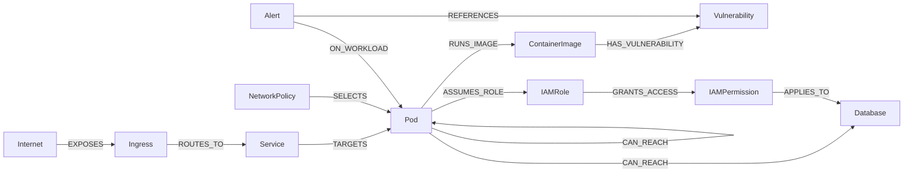
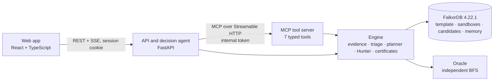

# Interdict

**Graph-grounded security triage on FalkorDB.** Interdict takes a storm of vulnerability alerts and uses a graph to find the few that sit on a real path from the Internet to a crown-jewel database. It computes the cheapest safe fix: at most three Kubernetes egress allowlist policies, ranked by how many declared dependencies they break. A deterministic Path Hunter then tries that fix on an isolated copy of the graph and checks, with three independent methods, that no path survives. Only then does it issue a **model-verified containment certificate (simulation)**.

> Built for **WeMakeDevs × FalkorDB Graph Hacks 2026, Track 01: Agents That Act on Connected Data** (Oct 15–18, 2026). All data is synthetic, and nothing ever changes real infrastructure.

**Live demo:** [interdict-graphhack.duckdns.org](https://interdict-graphhack.duckdns.org) (simulation only; each visitor gets a private sandbox).

**Read the story:** [Follow the graph, not the alert](https://interdict.hashnode.dev/follow-the-graph-not-the-alert), how Interdict works and how we built it.

## What happens in 60 seconds
| Step | What you see | What the graph does |
| :--- | :--- | :--- |
| 1. Alert storm | 1,000 alerts become **69 on a real attack path**, in 4 clusters; 382 are vulnerable but on no path, and 549 are not actionable. | FalkorDB builds `ATTACK_STEP` edges from evidence (exposure, exploitable vulnerability, observed reachability, IAM grants), then forward and backward reachability classify every alert. |
| 2. Investigate | The agent calls the tools over MCP and decides each next step from their answers: memory first, evidence checked, a fix with fully known impact preferred. No AI model. | Multi-hop tier queries and bounded path enumeration (≤ 3 lateral hops) over raw `CAN_REACH`. |
| 3. Cheapest safe fix | The exact best plan of ≤ 3 allowlist policies, its impact on declared dependencies, alternatives, and hard isolation for comparison. | Exact search over every subset of the action catalogue (the worst case is 4,526 subsets over 10,000 chains, in about 50 ms). |
| 4. Path Hunter | Rounds of verification. It also finds a **4-hop path to `customer-pii-db` beyond the planner's bound** and re-plans to close it. | `GRAPH.COPY` makes a candidate graph, FalkorDB applies the policies itself, and `algo.maxFlow` per crown jewel, bounded chains and an oracle BFS must agree. |
| 5. Certificate | "Model-verified containment (simulation)", with snapshot hashes, an expiry, and the exclusions written out. | SHA-256 hashes of the sandbox and the candidate. Any later sandbox change supersedes the certificate. |
| 6. Try to break it | Expose a workload and add a lateral reach in the sandbox panel: a new attack path appears, the certificate is superseded, and the next run re-plans. | Each change is one Cypher query with a revision compare-and-set. |

Honest outcomes are part of the product. Ask the API to protect both crown jewels at once (`POST /api/plans`, then `POST /api/hunts`) and the result is **"No safe plan within 3 changes"**: the Path Hunter finds a fourth path that the first plan misses, and 4 independent paths need 4 actions. The best partial plan comes with it. Expiring a piece of evidence makes the triage **inconclusive**, never "0 paths".

## Why the graph is essential
Every verdict comes from a connected-data operation in FalkorDB, never from the agent:

| Graph operation | Used for |
| :--- | :--- |
| Multi-hop pattern queries over 11 relationship types | Evidence tiers per workload, with provenance and freshness |
| Derived `ATTACK_STEP` graph, built in Cypher from evidence | One edge per possible attacker move (MITRE ATT&CK labels: T1190, T1210, T1078.004) |
| Variable-length paths over `CAN_REACH` | Bounded attack-chain enumeration (method E), cross-checked against `ATTACK_STEP` |
| `algo.bfs` and `algo.maxFlow` | Reachability for triage; unit-capacity max-flow from the Internet to each crown jewel (method F) |
| `GRAPH.COPY` | A private sandbox per visitor, and a candidate graph per Hunter round |
| Kubernetes policy semantics applied in Cypher | FalkorDB prunes every flow the candidate policies no longer allow, and the result must equal the planner's prediction |
| Revision compare-and-set in the same query as each mutation | Certificates are superseded the moment the graph changes |
| A per-session memory graph | Dated plans and certificates, recalled first for the same assets |

## Graph data model
The whole product runs on FalkorDB graphs. A synthetic environment is generated from a fixed seed into one graph, and every visitor works on a private copy of it.

| Graph | What it holds | Lifetime |
| :--- | :--- | :--- |
| `template` | The environment: 1,235 nodes and 2,566 relationships | Built from the seed at startup |
| `sandbox:{session}` | A visitor's private copy (`GRAPH.COPY`), plus the derived `ATTACK_STEP` edges | 2 hours idle |
| Candidate graphs | One copy of the sandbox per Path Hunter round, with the proposed policies applied | Deleted after the hunt |
| `cert:{id}` | The candidate graph a certificate was issued on | 24 hours |
| `memory:{session}` | What the agent learned: `Plan`, `Certificate` and `Asset` nodes | 7 days |



**Nodes** (counts in `template`):

| Label | What it is | Count |
| :--- | :--- | ---: |
| `Internet` | The untrusted outside | 1 |
| `Ingress`, `Service` | How traffic gets in | 6, 35 |
| `Pod` | A workload, with its namespace, app and dependency manifest (complete, partial or none) | 51 |
| `ContainerImage`, `Vulnerability` | What a pod runs, and its vulnerabilities (status, attack vector, severity) | 35, 81 |
| `IAMRole`, `IAMPermission` | Cloud identity: the roles a pod assumes and what they grant | 9, 8 |
| `Database` | Data stores; crown jewels carry `is_crown_jewel: true` | 4 |
| `PlatformService` | Shared platform services (`kube-dns`) | 1 |
| `NetworkPolicy` | Kubernetes egress policies: existing ones, and the Path Hunter's candidates | 3 |
| `Alert` | One scanner alert in the storm | 1,000 |
| `Meta` | The sandbox revision and the seed | 1 |

**Relationships:**

| Type | From → to | Count |
| :--- | :--- | ---: |
| `EXPOSES`, `ROUTES_TO`, `TARGETS` | Internet → Ingress → Service → Pod: exposure | 6, 8, 51 |
| `RUNS_IMAGE`, `HAS_VULNERABILITY` | Pod → ContainerImage → Vulnerability | 51, 81 |
| `CAN_REACH` | Pod → Pod, Database or PlatformService: an observed flow, with port and protocol | 187 |
| `ASSUMES_ROLE`, `GRANTS_ACCESS`, `APPLIES_TO` | Pod → IAMRole → IAMPermission → Database: authorization | 13, 8, 8 |
| `SELECTS`, `ALLOWS_EGRESS` | NetworkPolicy → Pod it applies to, and → destinations it allows | 6, 5 |
| `DEPENDS_ON` | Pod → a declared dependency (port, protocol) | 142 |
| `ON_WORKLOAD`, `REFERENCES` | Alert → Pod, and → Vulnerability | 1,000, 1,000 |
| `ATTACK_STEP` (derived) | One possible attacker move: Internet → Pod (`ENTRY`), Pod → Pod (`LATERAL`), Pod → Database (`GOAL`) | Built per sandbox |

Every evidence relationship (exposure, vulnerability, reachability and authorization) carries its provenance: `id`, `evidence_source`, `observed_at`, `valid_until` and `verified`. Evidence past `valid_until` makes a verdict inconclusive, never "safe". Each `ATTACK_STEP` carries `capacity: 1`, the ids of the evidence behind it, the revision it was built at, and a MITRE ATT&CK technique.

## Cypher queries the product depends on
Every query is a fixed, parameterised template in [`backend/src/interdict/engine/`](backend/src/interdict/engine/) or [`memory.py`](backend/src/interdict/memory.py). No query text is ever written by a model or built from user input, and the agent can only call the seven tools. These are the queries the verdicts rest on, exactly as they run.

**1. Evidence: the authorization tier** (`evidence.py`, `Q_AUTHORIZATION`). Four hops from a pod to a database, with the provenance of each hop:
```cypher
MATCH (p:Pod)-[ar:ASSUMES_ROLE]->(role:IAMRole)-[g:GRANTS_ACCESS]->(perm:IAMPermission)-[ap:APPLIES_TO]->(db:Database)
RETURN p.id, db.id, role.arn, perm.id, perm.effect, [ar.id, g.id, ap.id],
       [ar.verified, g.verified, ap.verified], [ar.observed_at, g.observed_at, ap.observed_at],
       [ar.valid_until, g.valid_until, ap.valid_until], [ar.evidence_source, g.evidence_source, ap.evidence_source]
```
The exposure, vulnerability and reachability tiers follow the same pattern (`Q_EXPOSURE`, `Q_VULNERABILITY`, `Q_REACHABILITY`).

**2. The attack graph, built in Cypher** (`attackgraph.py`, `Q_LATERAL`). A lateral move exists only where an observed flow reaches a pod with an active, network-exploitable vulnerability. `Q_ENTRY` and `Q_GOAL` build the entry and final steps the same way; a goal step needs an `Allow` IAM grant to the crown jewel.
```cypher
MATCH (a:Pod)-[c:CAN_REACH]->(b:Pod) WHERE a.id <> b.id
MATCH (b)-[:RUNS_IMAGE]->(:ContainerImage)-[:HAS_VULNERABILITY]->(v:Vulnerability {status: 'ACTIVE'})
WHERE coalesce(v.attack_vector, 'NETWORK') IN ['NETWORK', 'ADJACENT']
WITH a, b, collect(DISTINCT c.port) AS ports, collect(DISTINCT c.id) + collect(DISTINCT v.id) AS backing
CREATE (a)-[:ATTACK_STEP {kind: 'LATERAL', capacity: 1, ports: ports, backing_evidence_ids: backing,
        built_at_revision: $revision, technique_id: 'T1210', technique: 'Exploitation of Remote Services'}]->(b)
```

**3. Triage: what the Internet can reach** (`attackgraph.py`, `Q_FORWARD`):
```cypher
MATCH (i:Internet {id: $internet_id}) CALL algo.bfs(i, $depth, 'ATTACK_STEP') YIELD nodes RETURN [n IN nodes | n.id]
```

**4. Bounded attack chains, method E** (`attackgraph.py`). Variable-length paths over the raw `CAN_REACH` evidence, at most 3 lateral hops:
```cypher
MATCH path = (p0:Pod)-[:CAN_REACH*0..3]->(pm:Pod)
WHERE p0.id IN $entries AND pm.id IN $goals
RETURN [n IN nodes(path) | n.id] LIMIT $limit
```

**5. Max-flow to the crown jewels, method F** (`attackgraph.py`, `Q_MAXFLOW`). With unit capacities, the value is the number of edge-disjoint attack paths; 0 means none survives:
```cypher
MATCH (s:Internet {id: $internet_id}) MATCH (t:Database) WHERE t.id IN $targets
WITH s, collect(t) AS targets
CALL algo.maxFlow({sourceNodes: [s], targetNodes: targets, capacityProperty: 'capacity', relationshipTypes: ['ATTACK_STEP']})
YIELD edges, edgeFlows, maxFlow
RETURN maxFlow, [e IN edges | [startNode(e).id, endNode(e).id]], edgeFlows
```

**6. Kubernetes policy semantics, in the candidate graph** (`hunter.py`, `Q_PRUNE`). FalkorDB itself deletes every flow that no selecting policy allows any more. The result must equal the planner's prediction, or nothing is certified:
```cypher
MATCH (np:NetworkPolicy)-[:SELECTS]->(p:Pod) WHERE 'Egress' IN np.policy_types
WITH DISTINCT p MATCH (p)-[c:CAN_REACH]->(d)
OPTIONAL MATCH (p)<-[:SELECTS]-(q:NetworkPolicy)-[a:ALLOWS_EGRESS]->(d)
WHERE 'Egress' IN q.policy_types AND a.port = c.port AND a.protocol = c.protocol
WITH c, count(a) AS allowed WHERE allowed = 0
WITH collect(c) AS doomed, collect(c.id) AS ids
FOREACH (c IN doomed | DELETE c) RETURN ids
```

**7. Every sandbox change, with a revision compare-and-set** (`sandbox.py`, `mutate`). The change and the revision bump happen in one query, so a certificate from an earlier revision can never look current:
```cypher
MATCH (m:Meta {id: 'meta'}) WHERE m.revision = $expected_revision WITH m
<the change>
SET m.revision = m.revision + 1 RETURN m.revision
```

**8. Memory, read first** (`memory.py`, `Q_RECALL`):
```cypher
MATCH (a:Asset) WHERE a.id IN $assets MATCH (p:Plan)-[:PROTECTS]->(a)
WITH DISTINCT p OPTIONAL MATCH (p)-[:CERTIFIED_BY]->(c:Certificate)
RETURN properties(p), properties(c) ORDER BY p.created_at DESC LIMIT $limit
```

**Graph commands:** `GRAPH.COPY` creates each visitor's sandbox from `template`, and a candidate graph from the sandbox for each Path Hunter round.

## Architecture

- **Agent:** a decision agent with no AI model. It calls seven MCP tools (`triage_alert_storm`, `find_evidence_by_workload`, `find_attack_paths_to_asset`, `plan_remediation`, `hunt_residual_paths`, `submit_remediation_execution`, `recall_incident_memory`) and decides each next step from their answers:
  - it reads memory first, and skips an attempt that already failed at the same revision;
  - it stops on missing, stale or failed evidence (inconclusive, never "safe");
  - it prefers a fix whose impact on legitimate traffic is fully known, and accepts unknown impact only when no such fix cuts every path, saying so in the report;
  - it plans again once if the graph changes during the run, and acts only with a certificate.

  Every decision is a written rule in [`agent.py`](backend/src/interdict/agent.py), so runs are free and repeatable. The schemas are strict, there is no query tool, and the agent gets no sandbox access.
- **Guards in code:** at most 12 tool calls; the final status, plan, certificate and receipt are copied from tool results.
- **Action Gateway:** the only path to a receipt. It requires the allowlisted action type, SIMULATION mode, a VALID certificate at the current revision, and an idempotency key.

## Run it
**Live:** [interdict-graphhack.duckdns.org](https://interdict-graphhack.duckdns.org), this stack on one host with HTTPS from Caddy ([`deploy/docker-compose.prod.yml`](deploy/docker-compose.prod.yml)).

Prerequisites: Docker. For development, also [uv](https://docs.astral.sh/uv/) and Node 22.

```bash
cp .env.example .env
# In .env, set FALKORDB_PASSWORD, plus INTERDICT_SESSION_SECRET and INTERDICT_INTERNAL_TOKEN.
# Generate each secret with: python3 -c "import secrets; print(secrets.token_urlsafe(48))"
docker compose up -d --build        # FalkorDB + the app on http://localhost:8000
```

**Development:**
```bash
docker compose up -d falkordb
cd backend && uv sync
uv run python -m interdict.seed     # load the synthetic environment (graph `template`)
uv run python -m interdict.mcp_server &
uv run uvicorn interdict.api:app --port 8000
uv run pytest                       # 494 tests against the local FalkorDB
cd ../frontend && npm ci && npm run dev   # http://localhost:5173 (mock data by default; see frontend/README.md)
```

**Use the tools from Claude Code.** With the development setup above, the MCP server listens on localhost only and requires the internal token (the Docker setup does not publish it):
```bash
claude mcp add --transport http interdict http://127.0.0.1:8765/mcp \
  --header "Authorization: Bearer $INTERDICT_INTERNAL_TOKEN" \
  --header "X-Interdict-Session: my-local-session-0001"
```

## Measured on the default environment
| Measure | Result |
| :--- | :--- |
| Full storm triage, 1,000 alerts (gate G4) | median 58 ms |
| Exact planner, worst case (30 actions, 10,000 chains) | about 50 ms |
| Path Hunter for one cluster, two rounds, ending in a certificate | about 0.7 s |
| Whole agent investigation through the MCP server (7 to 9 tool calls) | about 1.2 to 1.6 s |
| `algo.maxFlow` agreement with the oracle on 50 random graphs (gate G1) | 50 / 50, p95 5 ms |
| Graph copy, about 800 nodes and 3,000 edges (gate G2) | p95 108 ms |
| Container start to ready, API + MCP + web app (gate G5) | 2.7 s |

Gate details are in [`solution.md`](solution.md) §17.1.

## What a certificate does and does not claim
- **It claims:** under threat model ITM-1, on the hashed synthetic snapshot, after the listed policies, no modelled chain reaches the target, and three methods agreed.
- **It does not claim:** real-world containment, CNI enforcement, or coverage of unmodelled vectors (credential theft, application-layer attacks, egress exfiltration, IAM conditions, supply chain, zero-days).
- **Optimality:** the plan is exact only among plans of at most three actions from its catalogue.
- **Oracle limitation:** in this event build, the oracle re-checks reachability over the same derived `ATTACK_STEP` edges as max-flow, so it does not independently re-derive the threat model (RSK-16). The certificate says so.

## Data and credits
- The environment is generated by our own code (seed 20261018). The application layout is shaped on Google's [Online Boutique](https://github.com/GoogleCloudPlatform/microservices-demo) demo (Apache-2.0).
- Vulnerability ids are synthetic (`DEMO-CVE-…`), addresses come from RFC 5737, hosts end in `.example`, and the IAM account is `000000000000`.
- Attack steps carry [MITRE ATT&CK®](https://attack.mitre.org/) technique labels. ATT&CK® is a registered trademark of The MITRE Corporation.
- No real company, personal or cloud-account data is used.

## Repository
| Path | Contents |
| :--- | :--- |
| `backend/src/interdict/engine/` | Evidence, attack graph, triage, planner, Path Hunter, snapshots, certificates |
| `backend/src/interdict/` | Tools, MCP server, agent, API, gateway, sandbox operations, memory, audit |
| `backend/src/interdict_oracle/` | Independent oracle (imports nothing from the engine) |
| `frontend/` | React + TypeScript web app |
| `deploy/`, `Dockerfile`, `docker-compose.yml` | One image (API + MCP + web app), FalkorDB, and Caddy for TLS |
| `solution.md` | Canonical specification; decisions D-01 to D-22 |
| `docs/` | Pre-event planning notes |

## Team
- **Yash Soni** ([@YashSoni998265](https://github.com/YashSoni998265)): designed and built Interdict: the engine, API, MCP server, agent and web app.
- **Rohan Jaiswal** ([@Sonicof](https://github.com/Sonicof)): planned the project and collaborated with Yash on its tasks, deployed the live demo, added unit tests for the web helpers, and recorded the demo video.

## Contributing and security
See [CONTRIBUTING.md](CONTRIBUTING.md) and [SECURITY.md](SECURITY.md). `main` is protected: every change goes through a pull request with passing CI.

## AI usage disclosure
This project is built with an AI coding assistant (Claude Code). The planning notes in `docs/` were prepared before the event; `solution.md` grew from them and was updated during the event to describe what was built. All application code was written during the event and is reviewed and tested by the team. Commits that include AI-written changes carry a `Co-Authored-By` trailer.

## License
[MIT](LICENSE)
