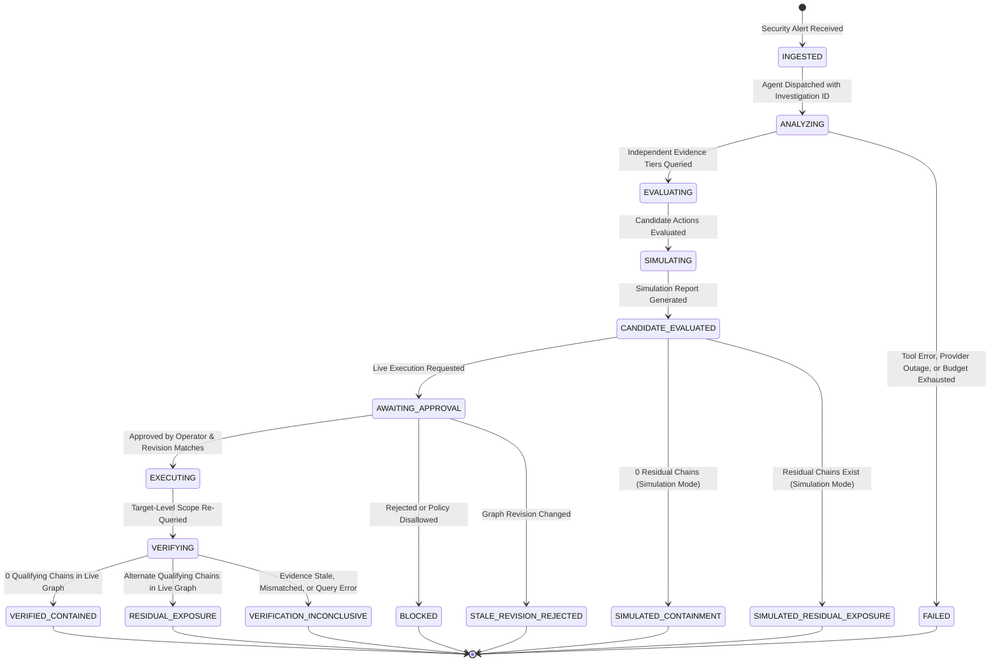

# Interdict V4.2: Architecture, Agent & Tool Contracts

> Status: Pre-event planning notes (Interdict V4.2). Ideas and design sketches only; all implementation is written fresh during the hackathon (Rule 8). Where this conflicts with [06_WINNING_PLAN.md](06_WINNING_PLAN.md), the V5 plan wins (see its §0).

---

## 0. Hard Engineering Constraints (Zero Tolerance)

1. **FalkorDB is Mandatory & Central:** FalkorDB is the primary graph database; removing it breaks the application entirely. Every attack-chain claim must originate from FalkorDB query results. The LLM must never fabricate edges.
2. **Zero Free-Form Cypher Generation:** The LLM selects tools and passes structured parameters (`pod_id`, `target_db_id`). It never executes raw Cypher strings against FalkorDB.
3. **The LLM is Never the Security Boundary:** Even if the LLM says an action is "safe and approved," the Action Gateway independently validates allowlists, target scopes, graph freshness, and idempotency keys.
4. **Simulation Must Not Mutate Observed Graph State:** `simulate_remediation` evaluates candidate rules in an isolated candidate overlay. It never deletes edges or mutates baseline data in FalkorDB.
5. **No Synthetic Shortcuts:** Never mock frontend responses or return hardcoded strings for Scenarios A, B, and C. The backend must actually execute queries and evaluate graph evidence.
6. **Query & Procedure Validation Rule:** Every Cypher query and `CALL algo.*` procedure is marked `UNVALIDATED` until verified against the running FalkorDB container on Day 1.

---

## 1. High-Level Modular Monolith Architecture

Interdict is structured as a single FastAPI modular monolith to ensure rapid debugging, zero network partition overhead, and strict boundaries between the agent, graph service, and execution gateway.

```mermaid
flowchart TD
    UI[Frontend: React + Vite + Vanilla CSS] <-->|REST / SSE Streaming| API[FastAPI Gateway]
    
    subgraph Backend_Modular_Monolith [FastAPI Application Core]
        API --> Orchestrator[Investigation Orchestrator]
        Orchestrator --> Agent[LLM Agent Engine: Constrained Tool Loop]
        Agent <--> Tools[Typed Agent Tools Interface]
        
        Tools --> GraphSvc[FalkorDB Graph Service]
        Tools --> SimEngine[Counterfactual Simulation Engine]
        Tools --> ActionGW[Action Gateway & Safety Boundary]
        
        GraphSvc <--> CypherTemplates[Canonical Parameterized Cypher Suite]
        ActionGW --> ApprovalGate[Policy & Approval Gate]
        ApprovalGate --> RemAdapter[Remediation Adapter: SIMULATION | LIVE]
        
        Orchestrator --> Audit[Append-Only Structured Audit Logger]
    end
    
    GraphSvc <--> DB[(FalkorDB Graph Engine)]
    Audit --> AuditStore[(Append-Only Hash-Chained Audit Store)]
```

### FalkorDB Platform Notes
- **Engine:** Redis-compatible graph database, run via Docker (`falkordb/falkordb`; pin the exact tag on Day 1).
- **Client:** `falkordb-python` (built on `redis-py`, RESP protocol).
- **Multi-graph isolation:** One instance hosts many independent graphs (e.g., `prod-cluster`, `staging-cluster`, or candidate simulation overlays).

---

## 2. Decoupling Simulation from Live Execution

```
[Simulation Mode (Default)]  --> Evaluates candidate rules in Python memory against FalkorDB baseline revision R.
                                 Does NOT mutate the live database.
                                 Yields outcome: SIMULATED_CONTAINMENT or SIMULATED_RESIDUAL_EXPOSURE.

[Live Execution Mode]         --> Requires explicit operator sign-off and graph revision validation.
                                 Applies policy adapter, refreshes observed graph revision R+1.
                                 Yields outcome: VERIFIED_CONTAINED, RESIDUAL_EXPOSURE, or INCONCLUSIVE.
```

### 2.1 Application-Managed Graph Revision Mechanism
To prevent stale simulations from executing against modified infrastructure:
1. **Revision Store:** The backend maintains an atomic, monotonically increasing `graph_revision` counter in Redis/memory.
2. **Mutation Invalidation:** Every ingestion, sync, or infrastructure change increments `graph_revision`.
3. **Simulation Binding:** `simulate_remediation` binds its result to the current `baseline_graph_revision`.
4. **Execution Gate Validation:** The Action Gateway compares `candidate.baseline_graph_revision == current_graph_revision`. If equal, the action proceeds to approval/execution; if not, it is rejected with `STALE_REVISION_REJECTED` and must be re-simulated.
5. **MVP Policy:** Live execution is disabled by default (`SIMULATION_ONLY`).

---

## 3. Investigation Lifecycle State Machine
> **V5.1 note:** adds `TRIAGING`, `PLANNING`, `HUNTING` between `EVALUATING` and `CANDIDATE_EVALUATED`, and terminals `NO_FEASIBLE_PLAN_WITHIN_K`, `PLANNING_INCONCLUSIVE`, `SIMULATION_INCONCLUSIVE`, `BUDGET_EXHAUSTED` ([07 §12.1](07_V5_ENGINE_SPECIFICATION.md)). `SIMULATED_CONTAINMENT` is reached only with a certificate. Diagram preserved as written.



---

## 4. Agent Tool Calling & Protocol Selection

### 4.1 Native Function Calling vs. Model Context Protocol (MCP)
> **Superseded (V5):** by ADR-05 below and [06 §4.4](06_WINNING_PLAN.md): the agent's only tool surface is our own MCP server. Original text preserved.
- **Tradeoff Analysis:** Model Context Protocol (MCP) provides standard tooling discoverability across external agent environments. However, running a standalone MCP daemon over stdio or SSE introduces IPC transport errors, process management bugs, and potential connection timeouts during a short 4-day build.
- **Architectural Decision (ADR):** Implement **Native Structured Tool Calling** in FastAPI using Pydantic schemas. Tool schemas are designed to be 100% schema-compatible with MCP tools, enabling an MCP adapter wrapper to be exposed on Day 3 if time permits without risking the core runtime.

### 4.2 Iteration Budget & Stop Conditions
> **Superseded (V5.1, conflict C-06):** budget is **≤ 12 tool calls**; preconditions and typical flow in [07 §12.2](07_V5_ENGINE_SPECIFICATION.md). Original 5-call flow preserved below.
- **Hard Limit:** Maximum **5 tool invocations total** per investigation.
- **Stop Conditions:**
  1. If `find_evidence_by_workload` returns `NOT_QUALIFIED` (proven lack of exposure/reachability), agent immediately halts reasoning (Budget consumed: 2/5).
  2. If `simulate_remediation` completes and `submit_remediation_execution` is verified, agent emits summary and halts.
  3. If 5 iterations are reached without resolution, system halts and marks `BUDGET_EXHAUSTED`.

```
[Incident Received]
  -> Tool 1: get_alert_context(alert_id)
  -> Tool 2: find_evidence_by_workload(pod_id)
       '-> If NOT_QUALIFIED (Scenario B): STOP, emit Restraint Report (2/5)
  -> Tool 3: simulate_remediation(candidate_surgical_payload)
  -> Tool 4: submit_remediation_execution(candidate_id, mode='SIMULATION')
  -> Tool 5: verify_remediation(target_db_id, scope='TARGET_ASSET')
  -> TERMINATE (5/5 max)
```

---

## 5. Typed Tool Signatures & Contracts
> **Superseded (V5.1, conflict C-05):** canonical MCP tool registry is [07 §12.2](07_V5_ENGINE_SPECIFICATION.md). `rank_remediation_options` → `plan_remediation`; `simulate_remediation` now runs on a candidate graph; `verify_remediation` is deferred with LIVE mode; new tools `triage_alert_storm`, `find_attack_paths_to_asset`, `hunt_residual_paths`, `verify_certificate`, `recall_incident_memory`, `rank_choke_points`. Original signatures preserved.

```python
# 1. Alert Context
get_alert_context(alert_id: str) -> AlertContextReport

# 2. Independent Evidence Discovery (4 Tiers)
find_evidence_by_workload(pod_id: str) -> WorkloadEvidenceReport

# 3. Blast Radius & Asset Breakdown
calculate_blast_radius(pod_id: str) -> BlastRadiusReport

# 4. Mitigation Candidate Ranking
rank_remediation_options(pod_id: str) -> List[CandidateOption]

# 5. Counterfactual Candidate Simulation (In-Memory Scope)
simulate_remediation(candidate_action_id: str, payload: CandidateActionPayload) -> SimulationReport

# 6. Action Execution Submission (Gated)
submit_remediation_execution(candidate_action_id: str, execution_mode: Literal['SIMULATION', 'LIVE'], idempotency_key: str) -> ExecutionReceipt

# 7. Verification Proof (Target/Investigation Scope)
verify_remediation(investigation_id: str, target_db_id: str, scope: Literal['WORKLOAD', 'TARGET_ASSET']) -> VerificationReport
```

---

## 6. Architecture Decision Records (ADRs)

### ADR-01: Disjoint Parameterized Queries vs. Monolithic Cypher
- **Context:** Multiple `OPTIONAL MATCH` clauses in a single query created intermediate Cartesian row multiplication and null-map collection bugs.
- **Decision:** Split into 4 atomic disjoint queries (1A–1D). Combine results deterministically in Python by database ID.
- **Tradeoff:** Requires 4 lightweight query calls instead of 1, but each runs in $<20\text{ms}$ in FalkorDB, eliminating Cartesian explosion.

### ADR-02: Pruning `REVOKE_IAM_PERMISSION` from MVP Allowlist
- **Context:** Cloud IAM involves complex SCPs, trust relationships, permission boundaries, and role chaining that cannot be modeled with full fidelity in 4 days.
- **Decision:** Remove IAM revocation from active Action Gateway allowlist. Keep IAM strictly as a read-only qualification tier. Focus active remediation on Kubernetes `NetworkPolicy`.
- **Tradeoff:** Reduces supported action types from 2 to 1, but guarantees 100% correctness on the supported action.

### ADR-03: In-Memory Candidate Graph State vs. Mutating FalkorDB
> **Superseded by ADR-06 (V5).** Preserved for history.
- **Context:** Simulating policy by deleting edges in FalkorDB risks corrupting baseline state or requiring complex rollbacks.
- **Decision:** In-memory counterfactual simulation in Python over deep-copied target scope evidence.
- **Tradeoff:** Simulator mirrors Cypher qualification logic, but provides absolute non-mutating safety.

### ADR-04: Defaulting to Simulation-Only Mode for Hackathon Demo
- **Context:** Connecting a live Kubernetes cluster introduces unpredictable cloud network latency, cluster auth failures, and API timeouts during a 3-minute video recording.
- **Decision:** Make `SIMULATION` the default, primary execution mode for the hackathon demo. Live cluster execution is retained as an optional secondary flag.
- **Tradeoff:** Demo is evaluated on simulated cluster effects, but avoids catastrophic demo-time cluster failure.

### ADR-05 (V5): Own Typed MCP Server as the Agent's Only Tool Surface
- **Context:** Track 1 lists "tool selection through MCP" as a focus area; ADR in §4.1 had rejected MCP for transport-risk reasons.
- **Decision:** The agent calls tools only through our MCP server (Streamable HTTP on the private network); the API acts as MCP client so per-turn budget, preconditions and audit stay in our code. No public MCP endpoint in MVP (07 §0.1).
- **Tradeoff:** One more process; mitigated by keeping tools thin wrappers over the shared engine package.

### ADR-06 (V5): Candidate Graphs via `GRAPH.COPY` Instead of In-Memory Overlays
- **Context:** ADR-03 duplicated qualification logic in Python and kept the graph out of simulation.
- **Decision:** Simulation and verification run on an isolated copy (`cand:{plan}:{round}`) where policies are applied and the same queries re-run (07 §8). Baseline and sandbox graphs are never mutated by simulation (TC-12, TC-34).
- **Tradeoff:** Copy cost per round; measured in Day-1 gate G2 with defined fallbacks (07 §13).

### ADR-07 (V5.1): Exact Catalogue Search Optimises; Max-Flow Verifies
- **Context:** NetworkPolicy actions block sets of edges, so action selection is a hitting-set problem, not a plain min-cut; Kubernetes policies have no deny rules.
- **Decision:** Allowlist action catalogue + exhaustive search up to k = 3 with a lexicographic objective (07 §6–§7); `algo.maxFlow` over the derived ATTACK_STEP graph is used for verification, not optimisation (07 §4.3).
- **Tradeoff:** Exactness only within k and the catalogue; reported explicitly (`EXACT_WITHIN_K`).

### ADR-08 (V5.1): Deterministic Path Hunter, No Second LLM Agent
- **Context:** An LLM re-reading the same tool outputs adds cost, not independence.
- **Decision:** The Hunter is a deterministic loop using a different method (unbounded max-flow + oracle) and broader adversary scope than the bounded planner; it never sees planner reasoning (07 §8.3).
- **Tradeoff:** Not marketed as multi-agent; shares the data model with the planner, which is stated as a limitation.
