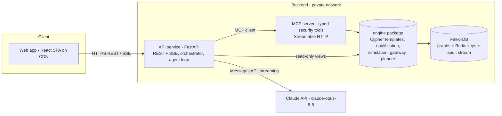

# Interdict V5: Winning Plan (Strategy, Stack, Architecture, UX, Deployment, Schedule)

> **Authority:** [`/solution.md`](../solution.md) is the canonical end-to-end specification and takes precedence over this document wherever they conflict.
> Status: Pre-event plan (written 2026-10-13). Planning notes only, no implementation code (Rule 8). Where this document conflicts with docs 00–05, **this document wins**; §0 lists every decision it overrides.
> **V5.1 (2026-10-14):** engine behaviour (threat model, planner, Path Hunter, certificate, Alert Storm, sandbox operations, enums, tool registry, tests, Day-1 gate) is canonical in [07_V5_ENGINE_SPECIFICATION.md](07_V5_ENGINE_SPECIFICATION.md). Where this plan and 07 differ on those topics, 07 wins; superseded passages here are marked and preserved.

---

## 0. Decisions This Plan Overrides

| Old decision (docs 00–05) | V5 decision | Why |
| :--- | :--- | :--- |
| Native function calling, **no MCP** (doc 02 §4.1, ADR) | **Our own typed MCP server** is the agent's only tool surface | Track 1 explicitly lists "tool selection through MCP" as a focus area. |
| Simulation in Python memory over copied evidence (ADR-03) | Simulation in a **candidate graph** (`GRAPH.COPY` of the baseline) where the policy is applied and the *same* Cypher re-runs | The graph does the work (Rule 3); no duplicated Python mirror logic; baseline is never touched. |
| Fixed 5-call pipeline (doc 02 §4.2) | Agent chooses tools from graph results, **max 12 tool calls**, orchestrator-enforced preconditions | A fixed script reads as "LLM narrating a pipeline", not an agent. |
| Persistent memory is P2 | Investigation memory stored in FalkorDB is **P0** | The challenge brief says the agent must "remember what it learns". |
| SQLite + JSONL file for state/audit (doc 03 §4) | **FalkorDB only** (graphs + Redis keys + Redis Stream for audit) | One stateful dependency; survives redeploys on a persistent volume. |
| Local Docker only | **Live public deployment** + Docker Compose for local | Rules: live deployment preferred. |
| ~50 hand-built nodes, 3 scenarios | Generated **realistic topology (300–800 nodes)** with 5 seeded scenarios | Removes "it's hardcoded" doubts; shows graph scale. |
| Remediation = isolate one pod | **Min-cut remediation planner** (`algo.maxFlow`) + choke points (`algo.betweenness`) | Graph-native answer to Scenario C ("fix every path with the fewest changes"). **V5.1 correction (07 C-09):** an exact allowlist-catalogue search optimises; `algo.maxFlow` verifies inside the Path Hunter. |
| (V5.1) Single alert per investigation | **Alert Storm triage** of 1,000 synthetic alerts → clusters → environment-wide plan | Solves the alert-fatigue problem at scale (07 §10). |
| (V5.1) "Disruption: LOW/CRITICAL" labels | **Computed impact** over declared synthetic dependencies; unknown impact never shown as zero | Removes fabricated precision (07 §6–§7). |
| (V5.1) Self-check verification | **Deterministic Path Hunter** + **model-verified containment certificate** | Different method, broader adversary scope, stated limits (07 §8–§9). |
| (V5.1) Fixed scenarios only | **Five typed sandbox operations** ("Break It Yourself") | Judges create cases we never scripted (07 §11). |
| Single LLM provider undecided | **Claude Opus 5.5** (`claude-opus-5-5`) via the Anthropic Python SDK | Strong tool use; adaptive thinking summaries give explainability for free. |

Everything else in docs 00–05 still stands (evidence tiers, three-valued logic, Action Gateway, threat model, scenarios A–C, test cases).

---

## 1. What We Are Judged On

### 1.1 Official facts (from the event site, read 2026-10-13)
- **Window:** Oct 15, 12:01 AM IST → **Oct 18, 11:59 PM IST**. Submitted via the WeMakeDevs hackathon panel.
- **Required (Rule 10):** public repo · README with setup + **graph data model** · the **Cypher queries / algorithms** the product depends on · **demo video** · **live deployment** (or full local setup) · **track named**.
- **Also required:** AI-assistant use disclosed (Rule 11); every member can explain model, queries, architecture (Rule 12); fully AI-generated projects may be rejected (Rule 13).
- **Rule 3:** "If the product still works with FalkorDB removed, the graph is decorative."
- **Rule 8:** main coding and design work starts after the event opens. Ideas, notes, graph sketches, diagrams may be prepared beforehand.
- **Track 1 focus areas:** multi-hop reasoning · graph queries & algorithms as agent tools · tool selection through MCP · actions based on graph results · explainable results.
- **Judging criteria and weights are not published.** Side prizes: best blog post (AirPods 5), top-50 t-shirts.

### 1.2 Inferred scorecard and how we max each line

| What judges will look for | How Interdict wins it | Proof the judge can see in < 60 s |
| :--- | :--- | :--- |
| Graph is essential, not decorative | Every decision, simulation, memory and audit lives in FalkorDB; 5 graph types in one instance | "Graph proof" drawer on every step: Cypher template, params, rows, latency, graph revision |
| Multi-hop reasoning | 4-tier evidence + **lateral movement** paths (pod→pod→IAM→DB, bounded) | Scenario D highlights a 5-hop path a single-alert tool misses |
| Algorithms as tools | `algo.betweenness` (choke points), `algo.maxFlow` (min-cut fix), `algo.WCC` (blast-radius segments) | Fix panel: "2 policies cut all 3 paths (min-cut)" |
| Tool selection through MCP | Agent's tools come only from our MCP server; judges can connect their own MCP client to a read-only demo endpoint | Timeline shows each MCP tool call and why it was chosen |
| Acts on graph results | Gateway-checked remediation, simulated in a candidate graph, verified across the whole target scope | Before/after graph diff with severed edges |
| Explainable | Claims in the final report must cite evidence IDs; reasoning summaries streamed; `INCONCLUSIVE` instead of guessing | Report where every sentence links to graph evidence |
| Works for real, reliably | Live URL, no login, deep links per scenario, replay mode if the LLM is down | Open the link and press one button |
| Engineering quality | CI, tests on a real FalkorDB, typed contracts, measured latency page, hash-chained audit | Green CI badge, `/system` page with live p95s |
| UX / presentation | Guided 60-second tour, plain-English/technical toggle, consistent status language | Judge understands the outcome without reading docs |
| Originality | Restraint (Scenario B) + residual-risk honesty (C) + min-cut planning + memory | The demo video's 3 "wow" moments (§2.2) |

---

## 2. Strategy

### 2.1 One-line pitch
**"Interdict is a security agent that follows the graph, not the alert: it proves which vulnerabilities are actually reachable, picks the smallest fix that cuts every attack path, tests that fix on a copy of your infrastructure graph, and remembers what it learned."**

### 2.2 The three "wow" moments (the demo and README are built around these)
1. **Restraint.** Two pods have the same critical CVE. The agent isolates one and *deliberately leaves the other alone*, showing the graph evidence for why (Scenario B).
2. **Honesty + min-cut.** Fixing the obvious pod leaves another path open. The agent says "not contained", then uses max-flow to find **the smallest set of policies that cuts every path** and proves it on a candidate graph (Scenario C).
3. **Memory.** A new alert on the same database arrives later; the agent recalls the earlier partial fix from the graph and starts from there instead of from zero.

### 2.3 What we deliberately do not build
Multi-cloud IAM modelling, live Kubernetes changes on the public deployment, user accounts/login, a chatbot UI, generic dashboards. Each costs time and none moves the scorecard.

### 2.4 Tracks
Enter **Track 1 only**. Memory is a supporting feature, not strong enough on Track 2's focus areas (per-tenant memory, high-concurrency writes) to compete there, and a focused entry reads better.

---

## 3. Scope and Cut Lines

| Priority | Capability | Day | Cut rule |
| :---: | :--- | :---: | :--- |
| **P0** | Seeded realistic graph + 5 scenarios (A critical, B restraint, C residual, D lateral, E stale → `INCONCLUSIVE`) | 1 | Never cut |
| **P0** | 4-tier evidence queries + lateral path query + three-valued qualification | 1–2 | Never cut |
| **P0** | Candidate-graph simulation + target-scope verification + Action Gateway (simulation-only in prod) | 2 | Never cut |
| **P0** | MCP server with typed tools; agent loop on Claude via MCP | 2–3 | Never cut |
| **P0** | Investigation memory in FalkorDB (write + recall) | 2–3 | Recall UI may shrink to one card |
| **P0** | Workbench UI: attack graph, agent timeline, fix comparison, verification, graph-proof drawer | 3 | Never cut |
| **P0** | Live deployment + replay mode + rate limits/spend cap | 1, 3 | Never cut |
| **P1** | Min-cut remediation planner (`algo.maxFlow`) | 2 | If maxFlow misbehaves on Day 1, fall back to choke-point + greedy set cover (still graph-driven) |
| **P1** | Choke-point ranking (`algo.betweenness`), WCC segments | 2 | Drop WCC first |
| **P1** | Guided tour, plain-English toggle, glossary, shareable report permalink | 3–4 | Keep tour, drop export |
| **P1** | Hash-chained audit stream + `/system` live metrics page | 2–4 | Keep audit, shrink metrics page |
| **P2** | Public read-only MCP endpoint for judges' own clients | 4 | First to cut |
| **P2** | Blog post | 4 / after | Write after submission if needed (check side-prize deadline) |

**Freeze rules:** feature freeze **Oct 18, 14:00 IST**; only bug fixes after. If Day 3 ends with any P0 red, all P1 work stops.

### 3.1 V5.1 scope changes (adopted 2026-10-14; supersede the rows above where they differ)

| Priority | Capability | Day | Cut rule / gate |
| :---: | :--- | :---: | :--- |
| **P0** | Alert Storm: seeded generator, triage partition, clusters, funnel (07 §10); scenarios A–E and the overlap scenario become structures inside this dataset | 1–2 | Gate G4 fallbacks (07 §13) |
| **P0** | Exact remediation planner with allowlist catalogue and computed impact (07 §5–§7); **replaces the P1 "min-cut planner" row** | 2 | Never cut; caps produce `PLANNING_INCONCLUSIVE`, not silent truncation |
| **P0** | Deterministic Path Hunter with E/F/O agreement (07 §8) | 2 | Gate G1 fallback; if the re-plan loop is not green by end of Day 2, ship a single verification round without re-planning |
| **P0** | Model-verified containment certificate (07 §9) | 2 | Never cut; signing deferred |
| **P0** | Five typed sandbox operations (07 §11) | 3 | Gate G2 fallback: shared queued sandbox |
| **P0, degradable** | Memory write/recall (FR-18) | 3 | First P0 to shrink if Day 3 slips |
| **P1** | Minimal temporal attribution (07 TC-40); choke-point ranking (display only) | 3 | Drop temporal first |
| **Deferred** | Public MCP endpoint (was P2), PR Guard, certificate signing, time slider, WCC segments (was P1), report export | — | Not built during the event |

---

## 4. Architecture

### 4.1 System overview



- **Agent path:** API orchestrator → Claude → tool call → API's MCP client → MCP server → engine → FalkorDB → result back to Claude → events streamed to the UI.
- **UI read path:** the UI's graph views (subgraph, memory, metrics) call the API, which uses the engine read-only. No LLM involved.
- **Why client-side MCP (our backend is the MCP client) instead of Anthropic's hosted MCP connector:** we keep per-turn control (budget, preconditions, audit, streaming each step to the UI) and the MCP server stays on the private network.

### 4.2 Services

| Service | Responsibility | Scales by |
| :--- | :--- | :--- |
| `web` | SPA: workbench, tour, reports, memory, system pages | CDN (static) |
| `api` | Sessions, investigations, agent loop, SSE event stream (resumable via `Last-Event-ID`), rate limits, spend cap, replay | Stateless; add instances (events fan out through Redis pub/sub) |
| `mcp` | Typed tools; input validation; calls the engine; never accepts raw Cypher | Stateless; add instances |
| `engine` (Python package, not a service) | Cypher templates, three-valued qualification, candidate-graph simulation, planner, Action Gateway, audit writer | Shared by `api` and `mcp` |
| `falkordb` | All state | Single node + persistent volume (replicas are out of scope; stated honestly) |

### 4.3 Graph design upgrades

**Graph layout in one FalkorDB instance (shows multi-graph isolation):**

| Graph key | Purpose | Lifetime |
| :--- | :--- | :--- |
| `template` | Seeded infrastructure + scenarios; never served directly | Rebuilt by idempotent seed |
| `sandbox:{session}` | Each visitor's own copy (`GRAPH.COPY template`) so judges can't break each other's demo | TTL ~2 h, cleaned by a sweeper |
| `candidate:{investigation}:{option}` | Copy of the sandbox with one remediation applied; same queries re-run here | Deleted after verification (kept if referenced by a report) |
| `memory:{tenant}` | Investigations, findings, decisions, outcomes, linked to asset IDs | Persistent |
| Redis keys / stream | `graph_revision` counters, idempotency receipts (24 h TTL), audit stream (append-only, hash-chained) | Persistent |

**Model additions to doc 01:**
- `NetworkPolicy` evaluated properly: policy `SELECTS` pods, `ALLOWS_EGRESS` rules; effective `CAN_REACH` in a candidate graph = observed reachability minus what the applied policy blocks (additive-allowlist semantics, DNS preserved). Resolves RSK-03.
- **Lateral movement:** pod-to-pod `CAN_REACH` with bounded variable-length paths (max 3 lateral hops), where the *last* pod carries the IAM grant to the crown jewel.
- **Flow network for min-cut:** cuttable edges (network reachability a NetworkPolicy can block) get capacity 1; non-cuttable edges get a large capacity; `algo.maxFlow` from `Internet` to the crown jewel; the min-cut is derived from the residual graph (maxFlow returns flows, not the cut).
- **Memory schema:** `(:Investigation)-[:ABOUT]->(asset)`, `(:Investigation)-[:FOUND]->(:Finding)`, `(:Investigation)-[:DECIDED]->(:Decision)-[:APPLIED]->(:Remediation)`, `(:Remediation)-[:LEFT_RESIDUAL]->(:Finding)`, each with timestamps and the graph revision they were computed on.
- All queries stay parameterized and bounded; all marked `UNVALIDATED` until Day 1.

### 4.4 Agent design

| Aspect | Decision |
| :--- | :--- |
| Model | `claude-opus-5-5`, adaptive thinking with `display: "summarized"` so reasoning summaries stream into the timeline; effort `medium` to start, tune on Day 3 |
| Loop | Our own loop in the API (not a hosted agent): we need per-turn hooks for budget, preconditions, audit and UI events |
| Tools (all via MCP, all `strict` JSON schemas) | `get_alert_context`, `find_evidence_by_workload`, `find_attack_paths_to_asset` (target scope incl. lateral), `rank_choke_points`, `plan_min_cut_remediation`, `simulate_remediation`, `submit_remediation`, `verify_remediation`, `recall_incident_memory` |
| Memory writes | Done by the orchestrator at the end of every investigation (not left to the model) |
| Budget | Max 12 tool calls; on exhaustion → `BUDGET_EXHAUSTED` with partial findings |
| Preconditions (enforced in code, not prompt) | No `submit` without a `simulation_id` at the current graph revision; no "contained" claim without a `verify` result; prod rejects `LIVE` mode |
| **V5.1 tools and preconditions (supersede the two rows above)** | Canonical tool registry in [07 §12.2](07_V5_ENGINE_SPECIFICATION.md): adds `triage_alert_storm`, `plan_remediation` (replaces `plan_min_cut_remediation`), `hunt_residual_paths`, `verify_certificate`; `submit_remediation` is named `submit_remediation_execution`; `verify_remediation` deferred with LIVE mode. Preconditions: no `submit_remediation_execution` without a `VALID` certificate at the current revision; no containment wording without `SIMULATED_CONTAINMENT`; sandbox operations are never agent tools |
| Explainability | Every tool result carries an `evidence_id` (template name, params, rows, latency, revision). The final report is structured output where each claim must reference evidence IDs; claims without valid IDs are rejected and the model is asked to fix them |
| Refusals | Security wording can trigger safety classifiers. Enable server-side refusal fallbacks, always check `stop_reason`, frame prompts as defensive triage of our own synthetic environment, and on refusal fall back to the deterministic (non-LLM) report, labelled as such. **Test on Day 1.** |
| Cost control | Prompt caching on the stable system prompt + tool list; per-IP rate limit; daily spend cap; API-key spend limit in the Anthropic Console |
| Replay mode | Real recorded runs (event logs) replay when the cap is hit or the LLM is unavailable; always labelled "Recorded run from <time>", never presented as live |

**Rough cost estimate (measure on Day 3):** ~10 turns per investigation, output-dominated → roughly $0.25–0.50 per live run on Opus 5.5 pricing ($4/$20 per million input/output tokens, cache reads $0.20).

### 4.5 Request lifecycle (one investigation)
1. UI `POST /investigations` → `202` with `investigation_id` (< 150 ms) → UI opens SSE stream.
2. Orchestrator ensures the session sandbox exists, records `graph_revision`, recalls memory for the target asset.
3. Agent loop: Claude picks a tool → orchestrator checks budget/preconditions → MCP call → engine queries FalkorDB → result + `evidence_id` → event to UI.
4. Simulation: `GRAPH.COPY` sandbox → candidate graph → apply policy → re-run qualification over the whole target scope.
5. Gateway: allowlist, scope, revision, idempotency → receipt (simulation mode in prod).
6. Verify across target scope → final structured report → memory written → audit stream appended → `done` event.

---

## 5. Tech Stack

| Layer | Choice | Why | Rejected |
| :--- | :--- | :--- | :--- |
| Graph DB | **FalkorDB** (pinned Docker tag) | Required; multi-graph, `GRAPH.COPY`, algorithms, Redis features in the same instance | FalkorDB Cloud free tier: 100 MB, no persistence, deleted after 7 days idle |
| Backend | **Python 3.12 + FastAPI + Pydantic v2 + uvicorn** | Matches our contracts; async; fast to build | Node: team spec is Python |
| Graph client | `falkordb` Python client (async) | Official | — |
| MCP | Official **Python MCP SDK** server over Streamable HTTP; MCP client in `api` | Official, typed | Hosted MCP connector (loses per-turn control) |
| LLM | **Anthropic Python SDK**, `claude-opus-5-5`, streaming | Tool use + thinking summaries | — |
| Frontend | **React + TypeScript + Vite** SPA | Fast builds, no SSR needed | Next.js (SSR adds no value here) |
| UI kit | **Tailwind CSS + shadcn/ui (Radix primitives)** | Accessible primitives, polished look like Linear/Vercel | Heavy component suites |
| Graph view | **React Flow (xyflow) + ELK.js layered layout** | Left-to-right attack paths read clearly; custom nodes/edges | Force-directed graphs (hard to read) |
| State/data | TanStack Query (server state), Zustand (UI state), native `EventSource` for SSE | Simple, proven | Redux |
| Motion & UX extras | Framer Motion, cmdk (command palette), Sonner (toasts), Lucide icons | Polish with little effort | — |
| Tooling | `uv`, ruff, pyright, pytest · pnpm, ESLint, Prettier, tsc, Vitest, Playwright, axe-core · k6 | Fast, standard | — |
| Errors / uptime | Sentry (frontend + backend), Better Stack or UptimeRobot (5-min checks) | Free tiers | — |
| Hosting | **Vercel** (web) + **Fly.io** (api, mcp, falkordb with volume) | Preview deploys per PR; Docker apps with private networking, health checks, volumes | Render/Railway free tiers (sleep); VPS kept as fallback |

Pin exact versions on Day 1; do not use `latest` anywhere in production.

---

## 6. Quality Bars (measured, published on `/system` and in the README)

| Area | Target | How verified |
| :--- | :--- | :--- |
| Graph latency | p95 evidence bundle (4 tiers) < 250 ms; lateral path query < 300 ms; non-LLM investigation < 1 s | Timed in code, shown live on `/system`; k6 report in README |
| API | `POST /investigations` p95 < 150 ms; first SSE event < 300 ms; 50 concurrent non-LLM investigations without errors | k6 load test on Day 4 |
| Reliability | 99.5 % availability through the judging period; no cold starts (min 1 machine per app); graceful degradation if algorithms or LLM fail | Uptime monitor, `/healthz` (liveness) + `/readyz` (FalkorDB, MCP, LLM key) |
| Resilience | Cypher timeout 500 ms; LLM calls with retries + circuit breaker; idempotent seed; SSE resumable; heartbeat every 15 s | Chaos check: kill api mid-run, stream resumes |
| Security | Simulation-only in prod; no raw Cypher; strict schemas; CORS locked to our domain; secrets only in platform secret stores; gitleaks in CI; per-IP rate limits | CI checks + threat model (doc 03) |
| Frontend performance | Lighthouse ≥ 95 (performance, accessibility, best practices); LCP < 2.0 s; INP < 200 ms; CLS < 0.1; initial JS ≤ 250 KB gzip; 60 fps graph up to 500 nodes | Lighthouse CI on preview deploys |
| Accessibility | WCAG 2.2 AA; full keyboard use; status never shown by colour alone; reduced-motion respected; table view alternative to every graph | axe in Playwright; manual keyboard pass |
| Responsiveness | Full experience ≥ 1280 px; usable 768–1279 px (panes become tabs); report and memory pages readable on phones | Playwright viewport tests |

---

## 7. UX Plan

### 7.1 Principles
1. **Understandable in 60 seconds without docs.** One button starts a scenario; the outcome is stated in one plain sentence.
2. **Show, then prove.** Every statement has a "Show graph proof" affordance.
3. **One status language everywhere.** Same colour, icon and word for each state in graph, timeline, cards and report.
4. **Never a blank wait.** Live step-by-step progress with what the agent is doing and why.
5. **Two reading levels.** "Plain English" (default) and "Technical" toggle; glossary hovercards for terms like *crown jewel* or *CAN_REACH*.

### 7.2 Screens
| Screen | Purpose |
| :--- | :--- |
| **Landing** | One-sentence value, "Run the 60-second demo" button, 5 scenario cards each with a one-line question ("Is this CVE actually dangerous?") |
| **Investigation workbench** | Left: attack graph (focused subgraph) + 4-tier checklist. Centre: agent timeline (each step: plain title, why this tool, result, proof). Right: decision panel (fix options compared, verification, confidence). Bottom: collapsible audit stream |
| **Report** | Shareable permalink: verdict, evidence-cited claims, fix plan, before/after graph, residual risk |
| **Memory** | What Interdict has learned: past investigations as a graph and a list, linked to assets |
| **System** | Live graph stats, FalkorDB version, measured p50/p95 latencies, uptime, build SHA, proving it is real |

### 7.3 First-run journey (what a judge experiences)
- 0–10 s: landing explains the product in one sentence; presses "Run the 60-second demo".
- 10–20 s: skippable 4-step tour highlights graph, timeline, decision panel, proof drawer.
- 20–50 s: Scenario A runs live; tiers light up one by one; the fix is simulated; green "Contained (simulated)".
- 50–60 s: prompt "Now see why it ignored the other pod with the same CVE" → Scenario B; then C and the min-cut.

### 7.4 Status language (single source for design + code)

| State | Colour | Icon | Plain-English label |
| :--- | :--- | :--- | :--- |
| `QUALIFYING_MODELED_CHAIN` | Red | Alert | "Real attack path" |
| `NOT_QUALIFIED` | Amber | Shield | "Vulnerable but not reachable" |
| `SIMULATED_RESIDUAL_EXPOSURE` / `RESIDUAL_EXPOSURE` | Orange | Split path | "Partly fixed: paths remain" |
| `INCONCLUSIVE` family | Yellow | Question | "Not enough fresh evidence" |
| `SIMULATED_CONTAINMENT` / `VERIFIED_CONTAINED` | Green | Check | "Contained" (+ "simulated" tag) |
| Candidate change | Violet, dashed | Scissors | "Proposed cut" |

**V5.1 label changes (07 §12.1, conflict C-10):** `SIMULATED_CONTAINMENT` → **"Model-verified containment"** (replaces "Contained (simulated)"; never "Contained" alone). New states: `NOT_ON_ATTACK_PATH` → amber "Vulnerable but not on any attack path"; `KNOWN_DISRUPTION` → "Closes all modelled paths; breaks N declared dependencies"; `IMPACT_PARTIALLY_UNKNOWN` → yellow "Impact partly unknown"; `NO_FEASIBLE_PLAN_WITHIN_K` → orange "No safe plan within 3 changes"; `CertificateStatus SUPERSEDED/EXPIRED` → grey "Certificate no longer current".

### 7.5 Visual language
Dark theme first (with light theme), neutral greys plus one accent; Inter or Geist for UI, JetBrains Mono for Cypher; 8 px spacing grid; motion 150–250 ms and disabled under reduced-motion; graph shows only the relevant subgraph, with "expand neighbours" on demand. Inspiration: Linear (clarity), Vercel (restraint), Wiz-style security graphs (left-to-right paths).

---

## 8. Deployment and Operations

### 8.1 Topology
| Piece | Where | Notes |
| :--- | :--- | :--- |
| `web` | Vercel | Custom domain; preview deploy per PR |
| `api` | Fly.io app, min 1 machine, public HTTPS | Region near India (Mumbai or Singapore; confirm availability Day 1) |
| `mcp` | Fly.io app, private network only | Optional read-only public endpoint is P2 |
| `falkordb` | Fly.io app with persistent volume, private only | Persistence on; nightly snapshot copied off-box |
| Fallback | One small VPS running the same `docker compose` behind Caddy (auto-TLS) | Used only if Fly has problems; same compose file as local |

### 8.2 Environments
- **Local:** `docker compose up --build` (FalkorDB + api + mcp + web), seed runs automatically. Must start in ≤ 60 s.
- **Preview:** every PR → Vercel preview against the shared staging API (Fly app `-staging`).
- **Production:** merge to `main` → CI → deploy → smoke test (`/readyz` + one scripted non-LLM investigation) → automatic rollback on failure.

### 8.3 CI/CD (GitHub Actions)
- **On PR:** ruff, pyright, pytest (unit + integration against a real FalkorDB service container), ESLint, tsc, Vitest, build, gitleaks, Playwright on the preview URL, Lighthouse CI.
- **On main:** build images → deploy api/mcp to Fly → Vercel production → smoke test → tag release.

### 8.4 Operations
- Secrets only in Fly/Vercel/GitHub secret stores; `.env.example` in repo.
- Uptime checks every 5 min on web, `/healthz`, `/readyz`; alert to the team chat.
- Sentry on both sides; structured JSON logs with `trace_id` = `investigation_id`.
- Spend control: Anthropic Console spend limit + in-app daily cap; when hit, the app switches to labelled replay mode.
- **Keep everything live until results are announced** (date unpublished; plan for at least 6 weeks) and do not push to `main` after the submission tag.

---

## 9. GitHub and Team Workflow (from Oct 15, 12:01 AM IST)

### 9.1 Day-1 repo setup checklist
- [ ] Create public repo (`interdict`) under a team org; first commit only after 12:01 AM IST Oct 15.
- [ ] Add `LICENSE` (MIT), `README` skeleton, `.gitignore`, `.env.example`, `CODEOWNERS`, PR template, issue templates.
- [ ] Protect `main`: PR required, CI must pass, no force-push.
- [ ] Add CI workflow and gitleaks pre-commit hook in the first hour.
- [ ] Create a GitHub Project board with every P0/P1 item from §3 as an issue, each with an owner.
- [ ] Copy `docs/00–06` in as `docs/planning/` (pre-event notes, disclosed as such).

### 9.2 Monorepo layout
```
interdict/
  apps/web/              React SPA
  services/api/          FastAPI, orchestrator, agent loop, SSE
  services/mcp/          MCP server (typed tools)
  packages/engine/       Cypher templates, qualification, simulation, planner, gateway, audit
  data/seed/             topology generator + scenario fixtures
  infra/                 docker-compose.yml, Fly configs, Caddyfile (fallback)
  tests/e2e/ tests/load/ Playwright, k6
  docs/                  README assets, architecture, graph model, Cypher catalogue
  .github/workflows/
```

### 9.3 Working rules
- Trunk-based: short branches (`feat/…`, `fix/…`), small PRs, squash merge, Conventional Commits.
- Commit at least every couple of hours; **every member commits from their own account** (visible meaningful contribution, Rules 12–13).
- Every PR touching queries updates the Cypher catalogue in `docs/`.
- At submission: tag `v1.0.0-submission`, put the tag/commit in the submission form, freeze `main`.

---

## 10. Schedule

Times in IST. Lanes assume up to four people: **G** = graph & engine, **A** = agent & MCP, **U** = frontend & UX, **P** = platform, QA, docs, video. With two people: G+A and U+P. Solo: follow lane order G → A → U → P and use the cut lines aggressively.

### Before the event (Oct 13–14): allowed prep only, no project code
- Register the team on the WeMakeDevs panel; add all members.
- Create accounts and limits: GitHub org, Anthropic Console (API key + spend limit), Fly.io, Vercel, Sentry, uptime monitor; buy/choose the domain.
- Install tooling (Docker, uv, pnpm, flyctl, Vercel CLI). Read the FalkorDB getting-started, Cypher, algorithms (betweenness, maxFlow, WCC) and `GRAPH.COPY` docs.
- Paper/whiteboard wireframes of the 5 screens; agree the status language (§7.4) and the demo story.
- Assign lane owners and decide the open questions in §14.

### Day 1: Thu Oct 15: "Walking skeleton live"
- **P:** repo + CI + branch protection; compose for all four services; Fly + Vercel apps created; first deploy of a health page.
- **G:** pin FalkorDB; **validate** `algo.betweenness`, `algo.maxFlow`, `algo.WCC`, `GRAPH.COPY`, query timeouts; build the topology generator + 5 scenario fixtures; run queries 1A–1D, 2, 3, 5 and the lateral query; record real latencies.
- **A:** Claude smoke test with a defensive security prompt (check refusal behaviour); MCP server skeleton exposing one real tool against FalkorDB.
- **U:** app shell, routing, design tokens (§7.4–7.5), landing page, React Flow rendering a real subgraph from the API.
- **Exit:** public URL shows live graph stats from FalkorDB; all queries validated; CI green.

### Day 2: Fri Oct 16: "Engine and MCP correct"
- **G:** three-valued qualification; sandbox/candidate graphs; NetworkPolicy evaluation; target-scope verifier; min-cut planner; choke-point ranking.
- **A:** all MCP tools with strict schemas and evidence IDs; Action Gateway (allowlist, revision, idempotency); audit stream; memory write/recall.
- **U:** workbench layout with mocked event stream shaped exactly like the real SSE contract; graph-proof drawer; status components.
- **P:** acceptance tests TC-01…TC-12 plus new ones (lateral, min-cut, memory, audit chain, betweenness fallback) running in CI against real FalkorDB.
- **Exit:** every scenario produces the correct verdict through MCP **without** the LLM; tests green.

### Day 3: Sat Oct 17: "Agent and UI end to end"
- **A:** agent loop on Claude through the MCP client; preconditions + budget; reasoning summaries; structured, evidence-cited report; replay recorder; tune effort; measure cost per run.
- **U:** wire workbench to the live SSE; fix comparison and before/after graph; report page; memory page; tour.
- **G:** performance pass (indexes, bounded paths); `/system` metrics endpoints.
- **P:** rate limits, spend cap, replay fallback, Sentry, uptime checks, staging → production pipeline.
- **Exit:** scenarios A–E run end to end on production; recorded replays exist for all five.

### Day 4: Sun Oct 18: "Polish, prove, ship"
- **08:00–14:00:** UX polish, empty/error states, accessibility and keyboard pass, responsive pass, Lighthouse and k6 runs, bug bash on production.
- **14:00:** **feature freeze.**
- **14:00–16:00:** README (setup, architecture diagram, graph data model, Cypher + algorithm catalogue, measured results, AI-use disclosure), final production deploy.
- **16:00–19:00:** record and edit the demo video (script in §12.2); upload.
- **19:00–21:00:** fill the submission form, check every link from a logged-out browser, tag `v1.0.0-submission`.
- **21:00:** submitted (≈ 3 h buffer before 11:59 PM IST). Blog draft afterwards if time allows.

### 10.1 V5.1 schedule adjustments (supersede the Day 1–3 bullets above where they differ)
- **Day 1:** add the seeded storm generator (topology, declared dependencies with manifest completeness, alerts, scenario structures incl. the overlap scenario), set-based tier queries, the independent oracle (written separately from the engine), and the **Day-1 validation gate G0 → G3 → G1 → G2 → G4** ([07 §13](07_V5_ENGINE_SPECIFICATION.md)) with a go/fallback decision by **18:00 IST**. Exit: TC-15–TC-18 green, gate results recorded.
- **Day 2:** policy semantics, action catalogue, exact planner, ATTACK_STEP construction, Path Hunter loop, certificate, MCP tools wrapping them. Exit: TC-06/07 (revised), TC-19–TC-34, TC-39 green. Gate: if the re-plan loop is not green by end of Day 2, ship single-round verification.
- **Day 3:** agent loop over MCP; sandbox operations API (TC-35–TC-38); UI for funnel → cluster → plan comparison → Hunter rounds → certificate; memory (TC-41); temporal attribution only if every P0 test is green.
- **Day 4:** unchanged.

---

## 11. Testing and Evals
> **V5.1 note:** the canonical acceptance-test registry is [07 §12.4](07_V5_ENGINE_SPECIFICATION.md) (TC-13…TC-41; TC-06/07 revised).

- **Unit:** qualification truth table (every row of doc 01 §4.2), gateway rules, planner on small known graphs.
- **Integration (real FalkorDB in CI):** all 12 existing acceptance tests + lateral path, min-cut correctness, candidate graph never mutates baseline, memory recall, audit hash-chain verification, algorithm-failure fallback, stale-evidence `INCONCLUSIVE`.
- **Agent evals:** the 5 scenarios run against the real model; assert final verdict, that every claim cites valid evidence, tool calls ≤ 12, no forbidden actions. Run on demand (costs money), not on every PR.
- **E2E:** Playwright journeys for the tour and each scenario on preview and production, plus axe accessibility checks.
- **Load:** k6 on the non-LLM investigation path and SSE fan-out; results published in the README.

---

## 12. Submission Package

### 12.1 Checklist mapped to the rules
- [ ] Public repo URL (tagged commit)
- [ ] README: one-line pitch, live link, 60-second quickstart, setup (`docker compose up --build`), architecture diagram, **graph data model**, **Cypher queries and algorithms catalogue**, measured performance, limitations, **AI usage disclosure** (tools used, what was verified by us, pre-event planning notes disclosed)
- [ ] Demo video link
- [ ] Live deployment URL (no login, works from a fresh browser)
- [ ] Track named: **Track 01 — Agents That Act on Connected Data**
- [ ] Every member can explain graph model, queries, architecture (rehearse Q&A on Day 4)

### 12.2 Demo video outline (target ~3 minutes; no length limit is published)
> **Superseded (V5.1):** the current narrative is [07 §15](07_V5_ENGINE_SPECIFICATION.md). Original outline preserved below.
1. **0:00–0:20** Problem: alert says "critical CVE", says nothing about reachability.
2. **0:20–1:00** Scenario A live: tiers proven in FalkorDB, simulated fix on a candidate graph, contained.
3. **1:00–1:25** Scenario B: same CVE, agent shows restraint, with the evidence.
4. **1:25–2:15** Scenario C/D: residual path detected, min-cut plan cuts all paths with the fewest policies; lateral path shown.
5. **2:15–2:40** Memory: new alert recalls the earlier investigation.
6. **2:40–3:00** Proof: graph-proof drawer (Cypher + latency), MCP tool calls, audit chain, `/system` page; close on the pitch.

---

## 13. Top Risks (new, beyond doc 05's register)

| Risk | Impact | Mitigation |
| :--- | :--- | :--- |
| Claude refuses security-themed prompts | Agent stalls in demo | Day-1 test; refusal fallbacks; defensive framing; deterministic fallback report; replay |
| Public link drains the API budget | Demo dies mid-judging | Per-IP limits, daily cap, Console spend limit, labelled replay mode |
| FalkorDB algorithm syntax/behaviour differs from docs | Planner or ranking breaks | Validate first thing Day 1; documented fallbacks (§3) |
| Scope creep | P0 unfinished | Cut lines, Day-3 rule, 14:00 freeze |
| Rule 8 / Rule 13 challenge | Disqualification | Fresh code from Oct 15, commits by every member, honest AI disclosure, rehearsed explanations |
| Deployment breaks after submission | Judges see an error | No pushes after tag, min machines, volume snapshots, uptime alerts, VPS fallback, video as backup |
| SSE dropped by proxies | UI freezes | Browser talks to the API domain directly; heartbeats; resumable stream |
| Judges don't understand the UI | Lost UX points | Tour, plain-English mode, one-sentence verdicts, deep links per scenario |

---

## 14. Open Decisions for the Team (decide by Oct 14)
1. **Team size and lane owners** (G / A / U / P).
2. **Domain name** and whether to buy one.
3. **LLM budget**: Console spend limit for the event plus judging period.
4. **Hosting region** for api/falkordb (Mumbai vs Singapore) after a quick availability check.
5. **Blog post**: who writes it, and the side-prize deadline (not published yet; ask on Discord).
6. **Engine open items (V5.1):** C-11 partial-scope triage, C-12 objective order, C-13 policy-removal semantics, C-16 stale-evidence handling, C-20 cluster definition, all with provisional answers in [07 §14](07_V5_ENGINE_SPECIFICATION.md).
