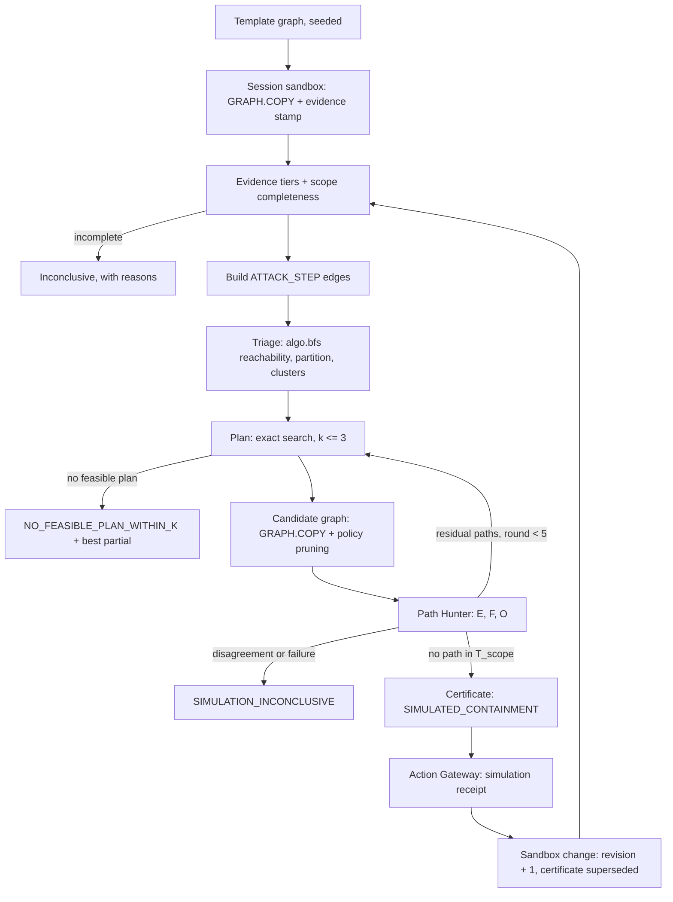
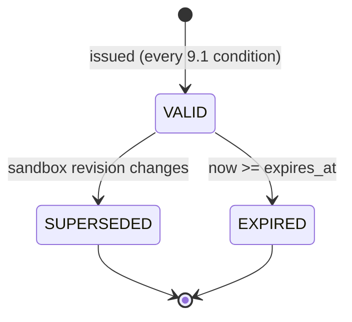
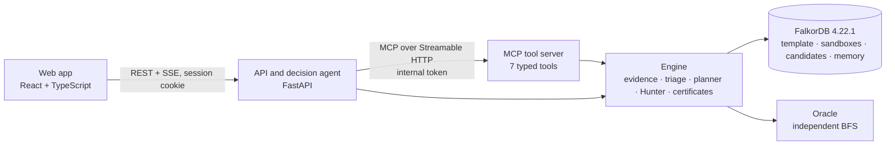
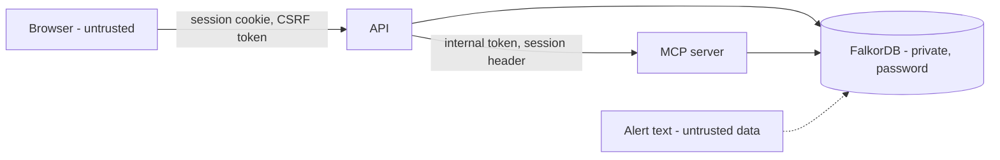

# Interdict: Solution Specification

> **Document:** `solution.md`, v2.0 (2026-10-18). Interdict was named *SentinelGraph* until 2026-10-16 (D-15).
> **Event:** WeMakeDevs × FalkorDB Graph Hacks 2026, **Track 01: Agents That Act on Connected Data** (Oct 15, 12:01 AM IST → Oct 18, 11:59 PM IST).
> **What this is:** the specification of Interdict as built. It began as pre-event planning notes (kept in the repository history, PR #2) and was updated during the event, one recorded decision at a time (§0.2), to match the code. Section numbers are stable because code and tests cite them.

---

## Contents

- [0. Authority, Conventions and Glossary](#0-authority-conventions-and-glossary)
- [1. Executive Summary](#1-executive-summary)
- [2. Problem and Positioning](#2-problem-and-positioning)
- [3. Scope](#3-scope)
- [4. End-to-End Workflow](#4-end-to-end-workflow)
- [5. Graph Data Model](#5-graph-data-model)
- [6. Evidence and Attack-Path Semantics](#6-evidence-and-attack-path-semantics)
- [7. Remediation Planning and Policy Semantics](#7-remediation-planning-and-policy-semantics)
- [8. Path Hunter and Independent Verification](#8-path-hunter-and-independent-verification)
- [9. Model-Verified Containment Certificate](#9-model-verified-containment-certificate)
- [10. Agent, MCP and Tool Contracts](#10-agent-mcp-and-tool-contracts)
- [11. Architecture](#11-architecture)
- [12. Persistence, Revisioning and Audit](#12-persistence-revisioning-and-audit)
- [13. Frontend and User Experience](#13-frontend-and-user-experience)
- [14. Requirements](#14-requirements)
- [15. Security and Threat Model](#15-security-and-threat-model)
- [16. Testing](#16-testing)
- [17. Day-1 Runtime Validation Gates](#17-day-1-runtime-validation-gates)
- [18. Build Process and Timeline](#18-build-process-and-timeline)
- [19. Deployment and Operations](#19-deployment-and-operations)
- [20. Demo and Submission](#20-demo-and-submission)
- [21. Known Limitations and Non-Claims](#21-known-limitations-and-non-claims)
- [22. Frozen Decisions and Stack](#22-frozen-decisions-and-stack)
- [Appendix A. External Sources](#appendix-a-external-sources)

---

## 0. Authority, Conventions and Glossary

### 0.1 Authority
1. This document is the canonical description of Interdict. Where the pre-event planning notes (repository history, PR #2) disagree with it, this document wins.
2. A design change is recorded as a decision in §0.2 in the same pull request as the code that implements it.
3. Every number given here was measured (gate results in §17.1, the test suite, or the running app), not estimated.

### 0.2 Decisions
| ID | Decision | Reason |
| :--- | :--- | :--- |
| **D-02** | Each Path Hunter round adds every residual path in T_scope to the constraint set, not just one. | Fewer rounds; termination is unchanged because each added path is new. |
| **D-03** | The revision lives inside each graph (`(:Meta {id: 'meta'})`) and is raised in the same query as every change, with a compare-and-set on the expected revision and a per-graph lock. | A separate counter can drift from the graph it describes. |
| **D-04** | Evidence is stamped when a sandbox is created: `observed_at` = creation time, `valid_until` = 12 hours later, `evidence_source = 'SYNTHETIC_GENERATOR'`. | A static seed would go stale during weeks of judging. The stamp is disclosed. |
| **D-05** | Stale evidence is shown with the `EXPIRE_EVIDENCE` operation, never seeded into the baseline. | Strict completeness would make the whole seeded storm inconclusive. |
| **D-06** | Unverified evidence in scope makes the scope incomplete (`UNVERIFIED_EVIDENCE`). | Filtering it out would make it look absent. |
| **D-07** | Evidence queries return stale and unverified records with their fields; freshness is judged in Python against one evaluation time. | Three-valued logic has to see that evidence to avoid treating it as absent. |
| **D-08** | Audit appends are serialised by a lock shared by every process, with a single API instance. | A hash chain needs ordered appends. |
| **D-09** | Memory is per session: `memory:{session}`, kept for 7 days. | In an anonymous public demo, one visitor's changes must not reach another visitor's recall. |
| **D-11** | Frozen answers: strict completeness (C-11); known breaks rank before unknown impact (C-12); stale evidence is handled strictly (C-16); a cluster is (target, entry ingress) (C-20). | No design debate during the build. |
| **D-12** | TC-36: flipping batch-1 onto a path needs `EXPOSE_WORKLOAD(batch-1)` plus `ADD_LATERAL_REACH(batch-1, checkout-1, 8080)`. Exposure alone must not flip it. | ITM-1 needs reach as well as exposure. |
| **D-13** | The oracle O is a separate breadth-first search over the exported ATTACK_STEP edges, in a package that imports nothing from the engine (TC-44). It shares that input with method F, which every certificate states (RSK-16). | An independent implementation catches engine bugs, and the shared input is disclosed instead of hidden. |
| **D-14** | **Time-recovery scope.** Building started at 23:30 IST on Oct 16, about 46 hours before the target. One complete vertical slice was built (§3.1). | Two of the four planned build days were lost. |
| **D-15** | Renamed SentinelGraph → Interdict, with the threat model `ITM-1`, the policy owner `INTERDICT_CANDIDATE` and the policy prefix `idt-`. | *Network interdiction* is the problem of removing edges to stop flow from a source to a target. |
| **D-16** | **Engine rules from the Day-1 gates:** (a) a result that reaches `RESULTSET_SIZE` counts as truncated (`QUERY_FAILED`), and large reads are paged; (b) with no ATTACK_STEP edges, F = 0 is recorded without calling `algo.maxFlow`, which errors on an absent relationship type; (c) `GRAPH.COPY` runs behind one global lock with retry, because each copy forks the server; (d) forward reachability uses `algo.bfs` (outgoing edges only), and backward reachability runs in the engine; (e) queries never build large lists with eager functions such as `range()`, because timeouts cannot interrupt them. | Measured FalkorDB 4.22.1 behaviour (§17.1). Each rule has a contract test. |
| **D-17** | **Memory.** Each finished investigation writes dated `Plan` and `Certificate` nodes to `memory:{session}`. `recall_incident_memory` reads them first, and the agent says when a step relies on them. If memory fails, the run still completes (FR-18, TC-41). | The brief asks for an agent that remembers what it learns. |
| **D-18** | **Data.** Fully synthetic and generated by our code. The layout is shaped on Google's Online Boutique (Apache-2.0); attack steps carry MITRE ATT&CK technique labels with attribution; vulnerability IDs are `DEMO-CVE-…`. | Rule 6. Real CVE IDs on made-up applications would mislead. |
| **D-19** | **Planner output.** Alternatives are the next best *minimal* plans. The best partial plan obeys every rule except coverage. Planning fails closed on an incomplete triage, as `PLANNING_INCONCLUSIVE (SCOPE_INCOMPLETE)`. | Dominated plans crowd out real choices, and a failed triage must not produce an empty `PLAN_FOUND`. |
| **D-20** | **Hunter checks:** (a) agreement is per crown jewel: F_t > 0 exactly when O reaches t, and every E chain ends at a target that F and O both reach; E = ∅ with F > 0 is a path beyond the planner's bound, not a disagreement; (b) FalkorDB applies the candidate policies itself, and the pruned flows must equal the planner's Blocked set; (c) a residual chain that the plan claims to cut is a `METHOD_DISAGREEMENT`; (d) a round's residuals are E's chains plus the flow decomposition; (e) the certified candidate is renamed with `RENAMENX` after its 24-hour expiry is set. | A wrong planner or policy model is caught by the graph, not trusted. |
| **D-21** | **Service rules:** (a) each MCP result carries compact JSON text plus the full view as structured content; (b) `plan_remediation` returns a plan handle unique to (plan, scope, constraints, strictness, revision); (c) a sandbox reset keeps counting the revision up; (d) `EXPOSE_WORKLOAD` rejects a pod that an ingress already exposes. | Old certificates stay superseded after a reset, and a second route to the same pod adds nothing. |
| **D-22** | **One agent, with no AI model.** Written rules over tool results choose each next step (§10.1). | No API key or budget. Every decision is explainable and repeatable, and a run costs nothing. |

### 0.3 Conventions
- **IDs:** D-xx decisions (§0.2), FR/NFR requirements (§14), TC-xx tests (§16.2), Q-xx query templates (§5.6), C-xx frozen answers (D-11), RSK-16 (§8.9).
- **Measured values:** they name their source. "The running app" means the build verified on 18 Oct 2026.

### 0.4 Glossary
| Term | Meaning |
| :--- | :--- |
| **template** | The seeded baseline graph. Never served or changed after seeding. |
| **sandbox** | `sandbox:{hmac(session)}`, a visitor's private copy of `template` (via `GRAPH.COPY`). Every investigation runs in one. |
| **candidate graph** | `cand:{run}:r{n}`, a copy of a sandbox with one plan's policies applied, for one Path Hunter round. |
| **certificate snapshot** | `cert:{certificate_id}`, the candidate graph kept for 24 hours after a certificate is issued. |
| **evidence item** | A baseline edge carrying provenance: `evidence_source`, `observed_at`, `verified`, `valid_until`. |
| **fresh** | `verified = true` and `observed_at ≤ t < valid_until` at evaluation time `t`. |
| **scope completeness** | Every evidence query succeeded, all evidence in scope is fresh and verified, no reachability is uncollected, the inventory is complete, and observed flows agree with the policies in force (§6.6). |
| **ITM-1** | The threat model: ENTRY, LATERAL and GOAL transitions (§6.2). |
| **chain** | Internet → p₀ → … → p_m → t satisfying ITM-1 with distinct pods; `m` is the number of lateral hops. |
| **bounded chain** | A chain with `m ≤ 3`, the planner's scope. |
| **ATTACK_STEP** | A derived edge for one ITM-1 transition. It exists only in sandbox and candidate graphs. |
| **T_scope** | The crown jewels a plan and its certificate cover. |
| **E / F / O** | The three verification methods: the bounded **E**numerator (Cypher over raw evidence), max-**F**low (`algo.maxFlow` over ATTACK_STEP), and the independent **O**racle (a separate breadth-first search over the exported ATTACK_STEP edges). |
| **declared dependency** | A `DEPENDS_ON` edge from the synthetic fixture (`evidence_source = 'DECLARED_FIXTURE'`): a model input, not observed traffic. |
| **dependency manifest** | Per pod, `COMPLETE`, `PARTIAL` or `NONE`: how much of its legitimate egress is declared. |
| **catalogue** | The candidate actions generated for one planning problem (§7.3). |
| **plan** | A set of at most 3 catalogue actions, at most one per selector. |
| **model-verified containment** | The only containment claim Interdict makes: under ITM-1, on a hashed snapshot, no modelled chain reaches T_scope after the plan. Never real-world containment. |

---

## 1. Executive Summary

**What it is.** Interdict is a security investigation agent for a synthetic cloud-native environment. FalkorDB is its decision engine. It turns a storm of vulnerability alerts into the few that sit on a real attack path to a crown-jewel database, plans the least disruptive fix that closes every modelled path, tries to break that fix on an isolated copy of the graph, and acts only with a certificate that states its own limits.

**How it works.**
1. **Alert Storm:** 1,000 synthetic alerts are classified against the graph as on an attack path, on no path, not actionable or inconclusive, and the real paths are grouped into clusters.
2. **Investigate:** a decision agent calls seven typed MCP tools and chooses each next step from their answers (§10.1). No AI model is involved.
3. **Cheapest safe fix:** Kubernetes egress allowlist actions are generated from the graph, their cost to declared dependencies is computed, and every combination of up to 3 actions is searched exactly.
4. **Path Hunter:** the fix is applied to a candidate copy of the graph, and three independent methods search for any surviving path, with no hop limit. Survivors are added and the fix is re-planned.
5. **Certificate and action:** when the three methods agree that no path survives, a hashed, expiring certificate is issued, and the fix is recorded through the Action Gateway as a simulation.
6. **Break it yourself:** visitors change their private graph and watch the certificate stop being current and the next run re-plan.

**Why FalkorDB is essential.** Every verdict comes from connected-data operations in FalkorDB: multi-hop evidence queries, ATTACK_STEP construction in Cypher, `algo.bfs` reachability, `algo.maxFlow` proof, policy pruning in a candidate graph, `GRAPH.COPY` sandboxes and candidates, revision compare-and-set, and a memory graph. Remove FalkorDB and nothing can produce a verdict (Rule 3).

**What the default environment shows.** These were measured on the running app:
- 69 of 1,000 alerts sit on a real attack path, in 4 clusters. 382 are vulnerable but on no path, and 549 are not actionable.
- Only 33 of the 104 critical alerts are on a path, while 36 high alerts are.
- The first fix for the payments database leaves 2 paths, which the Path Hunter finds and closes.
- A 4-hop path to `customer-pii-db`, beyond the planner's 3-hop bound, is found by max-flow and closed.
- One visitor change raises the on-path count from 69 to 76 and supersedes the certificate.

---

## 2. Problem and Positioning

### 2.1 Alert fatigue
Cloud-native environments produce hundreds to thousands of vulnerability alerts. An alert about one pod does not say whether the pod is reachable from the Internet, whether its vulnerability is active and network-exploitable, whether it (or a workload it can pivot to) reaches a sensitive database, or whether the last hop holds IAM permission to that database.

### 2.2 Why a graph
Whether an alert matters is a path question across four kinds of evidence. Similar-text retrieval cannot follow directional multi-hop relationships, and prompt-stuffing manifests into a model produces invented connections. A graph answers path questions directly, and graph algorithms such as max-flow can prove that no path survives a fix.

### 2.3 Target user and workflow
A security or DevOps engineer who triages cloud vulnerability alerts and approves containment changes. They receive a batch of alerts, see which matter and why, compare candidate fixes with their operational cost, see each fix challenged, and get an auditable verdict before any real change. This comes from our problem research; no customer validation is claimed.

### 2.4 Track alignment
| Requirement | How Interdict meets it |
| :--- | :--- |
| Rules 2–3: FalkorDB is primary and does real work | Every verdict comes from FalkorDB queries and algorithms (§1) |
| Rule 6: public, synthetic or own data only | Fully synthetic data (D-18) |
| Rule 8: main work after the event starts | Planning notes were prepared before the event and disclosed; all code was written during it |
| Rule 10: submission contents | §20.2 |
| Rules 11–13: disclose AI use; be able to explain everything | §20.3 |
| Track 01: multi-hop reasoning | Four-hop authorisation evidence, chains of up to 3 lateral hops, max-flow at any depth |
| Track 01: graph queries and algorithms as tools | Seven MCP tools on fixed Cypher, `algo.bfs`, `algo.maxFlow` and `GRAPH.COPY` |
| Track 01: tool selection through MCP | Each next tool and its arguments are chosen from the last answer (§10.1) |
| Track 01: actions based on graph results | The Action Gateway acts only with a certificate earned on the graph (§10.9) |
| Track 01: explainable results | A reason under every step, evidence with its freshness, a source for every number (§13.5) |

### 2.5 Assumptions
- The environment is synthetic: generated topology, telemetry, IAM and alerts.
- Observed reachability (`CAN_REACH`) reflects the enforced state; no packets or network plugin are simulated.
- IAM is simplified to role → permission (`effect: 'Allow'`) → database.
- Remediation actions are Kubernetes egress NetworkPolicies only, and live execution is disabled.
- Declared dependencies are fixture inputs, and their completeness is stated per pod.

---

## 3. Scope

### 3.1 Built for the event
- **Data:** a deterministic generator (seed 20261018) and loader for 1,235 nodes and 2,566 relationships, including 1,000 alerts and the §4.3 fixture; sandbox stamping (D-04).
- **Evidence:** four evidence tiers with provenance, three-valued collection status and scope completeness (§6).
- **Attack paths:** ATTACK_STEP construction, the bounded enumerator E, `algo.bfs` triage, the alert partition and clusters.
- **Planner:** allowlist variants, impact sets, exact search with k ≤ 3, strict mode, alternatives, hard isolation and the best partial plan (§7).
- **Path Hunter:** candidate graphs via `GRAPH.COPY`, policy pruning in FalkorDB, methods E, F and O, re-planning for up to 5 rounds (§8).
- **Certificate:** the §9.2 schema with snapshot hashes, expiry and supersession.
- **Agent and tools:** the decision agent (D-22) over our own MCP server with seven tools (§10).
- **Memory:** dated plans and certificates per session, recalled first (D-17).
- **Action Gateway:** allowlist, simulation mode, certificate and revision checks, idempotency (§10.9).
- **Sandbox:** `EXPOSE_WORKLOAD`, `ADD_LATERAL_REACH`, `EXPIRE_EVIDENCE` and reset, each with a revision compare-and-set (§10.7).
- **Audit:** a hash-chained log per session (§12.5).
- **Web app:** a guided five-step demo, Explore, the investigation workbench, certificates, the sandbox and a system page (§13).
- **Deployment:** one container image plus FalkorDB, the same compose file locally and on one host behind Caddy TLS (§19).

### 3.2 Constants
Planner lateral-hop bound L = 3 · plan size k ≤ 3 · Hunter rounds R ≤ 5 · catalogue cap 30 actions · chain enumeration cap 10,000 · certificate validity ≤ 24 h · 20 sandbox operations per session · ≤ 12 tool calls per investigation · default query timeout 500 ms.

### 3.3 Non-goals
Changing real infrastructure; user accounts; a chat interface or model-written Cypher; generic dashboards; claims about real-world alert ratios, production traffic or real-world containment.

### 3.4 Time-recovery scope (D-14)
Building started late on the evening of Oct 16, so a complete, honest vertical slice was preferred to a broad, unfinished one: the event build is exactly §3.1.

---

## 4. End-to-End Workflow

### 4.1 Overview


### 4.2 Steps
| # | Step | What happens | Fails closed when |
| :---: | :--- | :--- | :--- |
| 1 | Seed | The generator builds `template` with indexes and `Meta {revision: 1}`; idempotent | Duplicate or missing `id` aborts the seed |
| 2 | Sandbox | `GRAPH.COPY template → sandbox:{hmac(session)}`, then evidence stamping (D-04) | A failed copy returns a typed error |
| 3 | Evidence | Set-based tier queries and scope completeness (§6.6) | Any incompleteness: no ATTACK_STEP edges; affected verdicts inconclusive |
| 4 | Attack graph | ATTACK_STEP edges (Q-A1–Q-A4), bounded chains (Q-E1), forward and backward reachability | Enumeration cap reached → `CHAIN_ENUMERATION_TRUNCATED` |
| 5 | Triage | Partition every alert (§6.8); clusters by (target, entry ingress) | Class counts must add up to the input count |
| 6 | Plan | Catalogue, impact sets, exact search (§7) | `NO_FEASIBLE_PLAN_WITHIN_K` or `PLANNING_INCONCLUSIVE`, never a certificate |
| 7 | Hunt | Candidate graph, pruning, E/F/O, re-plan on residuals (§8) | Disagreement, failure or a revision change → `SIMULATION_INCONCLUSIVE` |
| 8 | Certificate | Issued only when every §9.1 condition holds | Any condition false → no certificate |
| 9 | Act | Gateway checks, then a simulation receipt (§10.9) | Missing or stale certificate → rejected |
| 10 | Change | A typed sandbox operation with revision compare-and-set (§10.7) | Validation, policy or limit rejections |

### 4.3 Worked example (synthetic fixture)
All identifiers below are synthetic. The fixture is embedded in the seeded storm, and its outcomes are pinned by tests and were checked on the running app.

| Pod | Exposed via | Active vulnerability | Allow grant to `prod-payments-db` | Observed egress | Declared dependencies | Manifest |
| :--- | :--- | :--- | :---: | :--- | :--- | :--- |
| `auth-1` | `ing-auth` → `svc-auth` | `DEMO-CVE-001`, network | yes | payments-db:5432, billing-1:8080, kube-dns:53 | billing-1:8080, kube-dns:53 | COMPLETE |
| `analytics-1` | `ing-analytics` → `svc-analytics` | `DEMO-CVE-303`, network | yes | payments-db:5432, metrics-1:9090, kube-dns:53 | kube-dns:53 | PARTIAL |
| `frontend-1` | `ing-shop` → `svc-frontend` | `DEMO-CVE-101`, network | no | checkout-1:8080, kube-dns:53 | checkout-1:8080, kube-dns:53 | COMPLETE |
| `checkout-1` | — | `DEMO-CVE-202`, network | yes | payments-db:5432, kube-dns:53 | payments-db:5432, kube-dns:53 | COMPLETE |
| `batch-1` | — | `DEMO-CVE-001`, network | no | kube-dns:53 | kube-dns:53 | COMPLETE |

**Triage.** ATTACK_STEP edges: ENTRY to auth-1, analytics-1 and frontend-1; LATERAL frontend-1 → checkout-1; GOAL from auth-1, analytics-1 and checkout-1 to the payments database. Bounded chains: `c1 = chain-auth-1-prod-payments-db`, `c2 = chain-analytics-1-prod-payments-db`, `c3 = chain-frontend-1-checkout-1-prod-payments-db`. batch-1 has the same `DEMO-CVE-001` as auth-1 but is on no path: no fix is proposed for it (TC-02).

**Plan for the cluster `prod-payments-db via ing-auth`** (constraint set {c1}). The best plan is `act:shop:auth:EGRESS_DECLARED`, which keeps billing and DNS and removes the GOAL step, with zero known breaks (`KNOWN_ZERO_DISRUPTION`).

**Hunt, round 0.** In the candidate graph, F and O still reach the database through c2 and c3. Both are added (D-02).

**Re-plan.** Every way to cut c3 removes a declared dependency, so no zero-disruption plan exists (TC-26). The optimum is {analytics DECLARED, auth DECLARED, checkout STRICT}:
- it breaks 1 declared dependency (checkout-1 → prod-payments-db :5432/TCP);
- 2 blocked flows have unknown impact (analytics-1 → metrics-1 :9090 and analytics-1 → prod-payments-db :5432), because analytics-1's manifest is partial;
- it blocks 4 flows and cuts 3 of 3 paths.

A tie with frontend STRICT is broken by the sorted action IDs.

**Round 1.** E = ∅, F = 0 and O reaches nothing in scope, so the certificate is issued (`SIMULATED_CONTAINMENT`).

**Break it (TC-36, D-12).** `EXPOSE_WORKLOAD(batch-1)` plus `ADD_LATERAL_REACH(batch-1, checkout-1, 8080)` creates the chain Internet → batch-1 → checkout-1 → prod-payments-db:
- the revision rises by 2 and the certificate becomes `SUPERSEDED`;
- batch-1's 7 alerts move onto a path, so the storm shows 76 instead of 69;
- the next run finds the new chain and re-plans.

---

## 5. Graph Data Model

### 5.1 Graphs in the FalkorDB instance
| Graph | Contents | Changed by | Lifetime |
| :--- | :--- | :--- | :--- |
| `template` | Seeded baseline evidence, alerts and `Meta` | The seed, once | Re-seeded idempotently at startup |
| `sandbox:{hmac(session)}` | A stamped copy of `template`, the visitor's changes and derived ATTACK_STEP edges | Sandbox operations; the engine (derived edges only) | 2 hours idle |
| `cand:{run}:r{n}` | A sandbox copy with one plan's candidate policies applied | The Path Hunter | Deleted after the round unless promoted |
| `cert:{certificate_id}` | The promoted candidate behind a certificate | Never (read-only) | 24 hours |
| `memory:{session}` | `Plan`, `Certificate` and `Asset` nodes | The agent's tools, at the end of a run | 7 days |

The same instance holds non-graph keys: per-graph locks, idempotency receipts, plan and certificate records, the audit stream, investigation event logs and rate-limit counters. The revision is not a separate key (D-03).

### 5.2 Global rules
1. Every node and evidence edge has a stable domain `id` (lowercase `[a-z0-9-]`, at most 64 characters). FalkorDB's internal IDs are never exposed, compared or hashed.
2. Every evidence edge carries provenance: `evidence_source`, `observed_at`, `verified` and `valid_until`.
3. Labels and property names are never built from input. Every query is a fixed, parameterised template.

### 5.3 Node schema
| Label | Key properties | Count in `template` |
| :--- | :--- | ---: |
| `Meta` | `id: 'meta'`, `revision`, `created_at`, `seed`, `generator_version`, `inventory_complete`, `storm_id`, `alert_count` | 1 |
| `Internet` | `id: 'global-internet'`, `untrusted: true` | 1 |
| `Ingress`, `Service` | `id`, `name`, `namespace` (+ `host`, `ip` on ingresses) | 6, 35 |
| `Pod` | `id`, `namespace`, `app`, labels, `dependency_manifest` (`COMPLETE`/`PARTIAL`/`NONE`), `reach_status` | 51 |
| `ContainerImage` | `id`, `repository`, `tag`, `digest` | 35 |
| `Vulnerability` | `id`, `cve_id` (`DEMO-CVE-…`), `severity`, `cvss_score`, `status`, `attack_vector` | 81 |
| `IAMRole`, `IAMPermission` | `id`, `arn`; `id`, `action`, `effect` | 9, 8 |
| `Database` | `id`, `name`, `is_crown_jewel` (2 crown jewels) | 4 |
| `PlatformService` | `id: 'kube-dns'` | 1 |
| `NetworkPolicy` | `id`, `namespace`, `pod_selector`, `policy_types`, `managed_by` (`BASELINE`/`INTERDICT_CANDIDATE`) | 3 |
| `Alert` | `id`, `severity`, `created_at`, `scanner`, `title` (untrusted text) | 1,000 |

Total: 1,235 nodes.

### 5.4 Relationship schema
| Type | From → to | Count |
| :--- | :--- | ---: |
| `EXPOSES`, `ROUTES_TO`, `TARGETS` | Internet → Ingress → Service → Pod (exposure evidence) | 6, 8, 51 |
| `RUNS_IMAGE`, `HAS_VULNERABILITY` | Pod → ContainerImage → Vulnerability | 51, 81 |
| `CAN_REACH` | Pod → Pod, Database or PlatformService: an observed flow with `port` and `protocol` | 187 |
| `ASSUMES_ROLE`, `GRANTS_ACCESS`, `APPLIES_TO` | Pod → IAMRole → IAMPermission → Database | 13, 8, 8 |
| `SELECTS`, `ALLOWS_EGRESS` | NetworkPolicy → the pods it applies to, and → the destinations it allows | 6, 5 |
| `DEPENDS_ON` | Pod → a declared dependency (`port`, `protocol`) | 142 |
| `ON_WORKLOAD`, `REFERENCES` | Alert → Pod, and → Vulnerability | 1,000, 1,000 |

Total: 2,566 relationships. Memory graphs add `PROTECTS` (Plan → Asset) and `CERTIFIED_BY` (Plan → Certificate).

### 5.5 Derived ATTACK_STEP edges
- **Kinds:** ENTRY (Internet → Pod), LATERAL (Pod → Pod) and GOAL (Pod → crown jewel), built in sandbox and candidate graphs only.
- **Properties:** `kind`, `capacity: 1`, `ports`, `backing_evidence_ids` (the evidence behind the step) and `built_at_revision`.
- **Technique labels:** each edge carries a MITRE ATT&CK technique for display: T1190 Exploit Public-Facing Application (ENTRY), T1210 Exploitation of Remote Services (LATERAL), and T1078.004 Valid Accounts: Cloud Accounts (GOAL).

### 5.6 Query templates
Every query is a named, parameterised template in `backend/src/interdict/`. Each run records its template, rows and latency, and the system page and certificates show them. The exact text of the key queries is in the README ("Cypher queries the product depends on").

| ID | Templates in code | Purpose |
| :--- | :--- | :--- |
| — | `evidence-meta`, `-pods`, `-databases`, `-exposure`, `-vulnerability`, `-reachability`, `-authorization`, `-policies`, `-dependencies`, `-alerts`, `-duplicate-ids` (`engine/evidence.py`) | Inventory, the four evidence tiers with provenance (D-07), policies, declared dependencies, alerts and the `id` uniqueness check |
| Q-A1–Q-A4 | `attack-clear`, `attack-entry`, `attack-lateral`, `attack-goal` (`engine/attackgraph.py`) | Rebuild the ATTACK_STEP edges from evidence (§8.1) |
| — | `attack-forward-bfs`, `attack-export`, `attack-count` | `algo.bfs` from the Internet (D-16 d); export the steps; count them before max-flow (D-16 b) |
| Q-E1 | `chains-enumerate` | Method E: `CAN_REACH*0..3` paths between entry and goal pods over raw evidence |
| Q-F1 | `attack-maxflow` | Method F: unit-capacity `algo.maxFlow` from the Internet to each crown jewel |
| — | `candidate-prune` (`engine/hunter.py`) | Kubernetes policy semantics in the candidate graph: delete every flow no selecting policy allows (D-20 b) |
| Q-H1, Q-H2 | `snapshot-nodes`, `snapshot-edges` (`engine/snapshot.py`) | Paged canonical export for the snapshot hashes (§9.3) |
| — | `op-*` (`sandbox_ops.py`), each through `mutate` (`engine/sandbox.py`) | Sandbox operations, each with the revision compare-and-set in the same query (D-03) |
| — | `memory-record`, `memory-certify`, `memory-recall` (`memory.py`) | Write and read the memory graph (D-17) |

### 5.7 Indexes
The loader creates an index on `id` for every node label and for every relationship type. Every template anchors on `id`. `GRAPH.COPY` copies the indexes (gate G2).

---

## 6. Evidence and Attack-Path Semantics

### 6.1 Predicates (state S, evaluation time t, fresh evidence only)
- **Exposed(p):** `Internet -EXPOSES-> Ingress -ROUTES_TO-> Service -TARGETS-> p`.
- **NetVuln(p):** `p -RUNS_IMAGE-> img -HAS_VULNERABILITY-> v` with `v.status = 'ACTIVE'` and `v.attack_vector` in {NETWORK, ADJACENT}. A missing vector counts as NETWORK and is flagged.
- **EffReach_S(a, d):** an observed `CAN_REACH(a → d)` on some port that S's egress policies allow (§7.1).
- **Authorized(p, t):** `p -ASSUMES_ROLE-> role -GRANTS_ACCESS-> perm {effect: 'Allow'} -APPLIES_TO-> t`, where t is a crown jewel.

### 6.2 Exploitable transitions (ITM-1)
| Transition | From → to | Condition |
| :--- | :--- | :--- |
| **ENTRY** | Internet → pod p | Exposed(p) ∧ NetVuln(p) |
| **LATERAL** | pod a → pod b, a ≠ b | EffReach_S(a, b) ∧ NetVuln(b) |
| **GOAL** | pod a → crown jewel t | EffReach_S(a, t) ∧ Authorized(a, t) |

Every condition depends only on the step's two endpoints and S. This locality is what makes the graph encoding correct (§8.2). Conditions that depend on earlier steps, such as stolen credentials, are out of scope.

### 6.3 Qualifying chain
A chain is ENTRY, then `m` LATERAL steps, then GOAL, through distinct pods; its ID is `chain-{p₀}-…-{p_m}-{t}`. A target is `QUALIFYING_MODELED_CHAIN` when the scope is complete and a chain reaches it, `NOT_QUALIFIED` when the scope is complete and none does, and `INCONCLUSIVE` otherwise. Inconclusive is never read as safe.

### 6.4 Freshness, expiry and provenance
- Evidence is fresh when `verified = true` and `observed_at ≤ t < valid_until`. One evaluation time `t` is used per run and recorded in its outputs.
- A missing `valid_until` or `evidence_source` makes the evidence incomplete.
- Sandbox evidence is stamped at creation (D-04), and visitor changes are valid for 2 hours. `EXPIRE_EVIDENCE` moves `valid_until` into the past (D-05).

### 6.5 Missing versus explicitly absent evidence
| Situation | Collection status | Effect |
| :--- | :--- | :--- |
| Query succeeded, rows found | `COLLECTED_COMPLETE` | Use the rows |
| Query succeeded, zero verified rows, inventory complete | `COLLECTED_EMPTY` | Proof of absence for that tier |
| Error, timeout, malformed data, or a possibly truncated result (D-16 a) | `QUERY_FAILED` | Scope incomplete |
| Evidence past `valid_until` | `STALE_EXPIRED` | Scope incomplete |
| Reachability not collected (`reach_status = 'UNCOLLECTED'`) | `UNCOLLECTED` | Scope incomplete |
| `verified = false` | — (D-06) | Scope incomplete (`UNVERIFIED_EVIDENCE`) |

### 6.6 Scope-wide completeness
Required before any ATTACK_STEP construction, triage beyond `NOT_ACTIONABLE`, planning, hunting or certificate:
1. Every tier query returned `COLLECTED_COMPLETE` or `COLLECTED_EMPTY`.
2. All evidence in scope is fresh and verified, and no pod's reachability is uncollected.
3. `Meta.inventory_complete = true`.
4. Every fresh observed flow is allowed by the policies in force; otherwise `CONTRADICTORY_EVIDENCE`.
5. The `id` uniqueness check passes.

If any check fails, no attack graph is built and the run reports an inconclusive status with its reasons (§10.2). This strict rule (C-11) is frozen (D-11).

### 6.7 Decision rule
If any needed tier is `QUERY_FAILED`, `STALE_EXPIRED` or `UNCOLLECTED`, the conclusion is `INCONCLUSIVE`. `NOT_QUALIFIED` requires every relevant tier to have been queried successfully. A vulnerability whose vector is only LOCAL or PHYSICAL creates no ENTRY or LATERAL step.

### 6.8 Alert triage partition
Every alert gets exactly one class, and the class counts add up to the input count.
1. `TRIAGE_INCONCLUSIVE`: the scope is incomplete. Under the strict rule, every alert not decidable as `NOT_ACTIONABLE` becomes inconclusive (TC-16).
2. `NOT_ACTIONABLE`: the vulnerability is inactive or not network-exploitable.
3. `NOT_ON_ATTACK_PATH`: the workload is outside `Forward(Internet) ∩ Backward(crown jewels)` over ATTACK_STEP.
4. `ON_ATTACK_PATH`: the workload is in that intersection, with the roles `ENTRY`, `LATERAL` and `FINAL_HOP`.

"On a path" is exact and unbounded: a node lies on some Internet → crown-jewel path exactly when the Internet reaches it and it reaches a crown jewel.

### 6.9 Unmodelled vectors
Every result, plan and certificate names ITM-1 and carries a fixed exclusions block covering:
- credential theft;
- application-layer vectors without a network vector;
- node, host and loopback traffic;
- egress exfiltration;
- IAM Deny statements, conditions and SCPs;
- supply chain and zero-days;
- real network-plugin enforcement and ingress policies.

The count of vulnerabilities with a missing attack vector is reported.

---

## 7. Remediation Planning and Policy Semantics

### 7.1 Modelled Kubernetes NetworkPolicy semantics
Adopted from the Kubernetes documentation (Appendix A):
- A pod is non-isolated for egress by default.
- It becomes isolated for egress when **any** policy with `Egress` in `policyTypes` selects it.
- Allowed egress is the **union** of the selecting policies' rules, and there is no explicit deny.
- Enforcement needs a network plugin that implements NetworkPolicy, so Interdict models the semantics and cannot claim enforcement.

`Allowed_S(p, d, π)` is true if no egress policy in S selects `p`. Otherwise it is true exactly when some selecting policy has `ALLOWS_EGRESS {port: π}` to `d`.

### 7.2 Policy model in the graph
A policy is a `NetworkPolicy` node with `SELECTS` edges (materialised from selector and namespace) and one `ALLOWS_EGRESS {port, protocol}` edge per allowed destination. Applying a plan in a candidate graph creates `INTERDICT_CANDIDATE` policies, and FalkorDB then deletes every observed flow that no selecting policy allows (`candidate-prune`), in the candidate only.

### 7.3 Action catalogue
Each action uses the single allowlisted gateway type `APPLY_NETWORK_POLICY_ISOLATE` and creates one candidate egress policy for a workload selector σ = (namespace, app).

**Eligibility:** σ selects at least one pod; no existing egress policy selects any of its pods (under union semantics a new policy cannot restrict an isolated pod: `INELIGIBLE_EXISTING_EGRESS_POLICY`); and some selected pod is the source of a LATERAL or GOAL step of a chain in the constraint set.

| Variant (ID `act:{ns}:{app}:{variant}`) | Allow list | Generated when | Typical impact |
| :--- | :--- | :--- | :--- |
| `EGRESS_DECLARED` | Declared dependencies ∪ DNS | Always, if eligible | Blocks undeclared flows; no known breaks |
| `EGRESS_STRICT` | (Declared ∪ DNS) minus the attack destinations | Only when an attack step overlaps a declared dependency | Breaks the overlapping dependencies |
| `EGRESS_DENY_ALL` | Nothing (DNS blocked too) | Always, if eligible | Breaks every declared dependency |

A planning problem with more than 30 actions is `PLANNING_INCONCLUSIVE (CATALOGUE_TOO_LARGE)`.

### 7.4 Impact computation
For an action on selector σ:
- **Blocked:** the observed flows from σ's pods that the allow list drops.
- **StepRemoved:** the LATERAL or GOAL steps whose every observed port is blocked.
- **KnownBroken:** the declared dependencies the allow list drops.
- **Unknown:** the blocked flows that are not declared, from pods whose manifest is `PARTIAL` or `NONE`. With a `COMPLETE` manifest, an undeclared blocked flow is a known non-dependency.

A plan's sets are the unions over its actions. The impact status is `KNOWN_ZERO_DISRUPTION`, `KNOWN_DISRUPTION` or `IMPACT_PARTIALLY_UNKNOWN`. "Zero disruption" always reads "of declared dependencies (synthetic fixture)".

### 7.5 Unknown impact and strict mode
Unknown impact is a cost in the objective (criterion 2), never zero, and always shown. Strict mode (`require_known_impact = true`) makes plans with unknown impact infeasible; if nothing remains, the result is `NO_FEASIBLE_PLAN_WITHIN_K (UNKNOWN_IMPACT_EXCLUDED)`. The agent tries strict mode first (D-22).

### 7.6 Exact search
- **Hitting:** a plan hits a chain when one of its actions removes a LATERAL or GOAL step of that chain. Egress actions cannot remove ENTRY steps.
- **Feasibility:** the plan hits every chain in the constraint set, has at most one action per selector and at most 3 actions, and meets strict mode if it is on.
- **Objective (lexicographic, minimised):**
  1. declared dependencies broken;
  2. unknown-impact flows;
  3. number of actions;
  4. flows blocked;
  5. sorted action IDs, as a deterministic tie-break.

At most Σ_{i≤3} C(30, i) = 4,526 subsets are evaluated, with each action's hits stored as one bitmask over the chains. The measured worst case, 4,526 subsets over 10,000 chains, takes about 50 ms. Alternatives and the best partial plan follow D-19.

### 7.7 Outputs
- **`PLAN_FOUND`:**
  - the plan with full policy specs and its optimality (`EXACT_WITHIN_K`);
  - the KnownBroken, Unknown and Blocked sets and the impact status;
  - the covered chains;
  - up to 3 alternatives, and the best hard-isolation plan for comparison.
- **`NO_FEASIBLE_PLAN_WITHIN_K`:**
  - the reason (`K_EXCEEDED`, `UNKNOWN_IMPACT_EXCLUDED` or `NO_ELIGIBLE_ACTION`) and `k`;
  - the best partial plan, with its covered and uncovered chains;
  - never a certificate. For example, planning for both crown jewels and then hunting ends here: a fourth path beyond the bound needs a fourth action.
- **`PLANNING_INCONCLUSIVE`:** the reason (`SCOPE_INCOMPLETE`, `CATALOGUE_TOO_LARGE` or `CHAIN_ENUMERATION_TRUNCATED`).

### 7.8 Policy export
The web app turns the verified plan into a downloadable YAML file of Kubernetes-style egress policies, one per workload. Its header states that it is simulation only, never applied to a real cluster, and names the plan, the certificate and the sandbox revision.

### 7.9 Monotonicity
Eligible actions target pods selected by no egress policy, so a pod allows everything before the action and only the action's list after it. Allowed egress only shrinks, ATTACK_STEP edges can only disappear, and other pods are unchanged: a catalogue action never creates an attack path (TC-27).

### 7.10 Exactness and when no zero-disruption fix exists
- The result is optimal among plans of up to 3 actions from this catalogue for this constraint set. It is not globally optimal over every possible policy. General hitting set is NP-hard, and exactness comes from the small bounded instance.
- No `KNOWN_ZERO_DISRUPTION` plan exists when every way to cut some chain removes a declared dependency or an unknown-impact flow. The fixture contains such a cluster (TC-26, §4.3 chain c3).

---

## 8. Path Hunter and Independent Verification

### 8.1 Derived ATTACK_STEP construction
1. ATTACK_STEP edges are built only in sandbox and candidate graphs, and only after scope completeness passes (§6.6).
2. Q-A1 clears the derived edges, and Q-A2 to Q-A4 create the ENTRY, LATERAL and GOAL edges. Parallel ports collapse into one edge with a `ports` list.
3. Each edge stores its backing evidence and `built_at_revision`. The graph is rebuilt when that differs from `Meta.revision`.

### 8.2 Why the encoding is correct
**Theorem 1.** For a state that passes scope completeness, an attack chain of any length to crown jewel t exists exactly when ATTACK_STEP has a directed path from the Internet to t.

*Proof sketch:*
- (⇒) Each step of a chain satisfies its transition condition, so the matching edge exists.
- (⇐) The Internet has only ENTRY out-edges and crown jewels only GOAL in-edges, so any path is ENTRY, LATERAL…, GOAL. Each edge exists only if its endpoint-local condition holds, and cutting cycles leaves a chain through distinct pods. ∎

**Corollary.** E's bounded chains, computed over raw evidence, equal the simple ATTACK_STEP paths with at most 3 LATERAL edges (TC-19).

### 8.3 Planner bounds versus Hunter scope
| | Planner (E) | Hunter (F, O) |
| :--- | :--- | :--- |
| Lateral hops | ≤ 3 | Unbounded |
| Targets | T_scope | All crown jewels (the decision covers T_scope; others are reported) |
| Input | Raw evidence | F: ATTACK_STEP in the candidate graph; O: exported ATTACK_STEP edges |

### 8.4 Max-flow (method F)
**Theorem 2.** With capacity 1 on every ATTACK_STEP edge, `maxFlow(Internet → T) = 0` exactly when no directed Internet → T path exists. The value is the number of edge-disjoint attack paths. Gate G1 confirmed directed edges, unit capacities, multiple targets and that unlisted relationship types are ignored (§17.1). `algo.maxFlow` returns the edges with positive flow, not a minimum cut.

### 8.5 Independent oracle O (D-13)
- **What it is:** a separate Python package, `backend/src/interdict_oracle/`, that runs its own unbounded breadth-first search over the exported ATTACK_STEP edges and returns the reachable targets and a witness path per target.
- **Independence:** it imports nothing from the engine (TC-44), has its own tests on hand-built graphs, and agreed with `algo.maxFlow` on 50 of 50 random graphs (gate G1, TC-20).
- **Limit:** it shares the derived ATTACK_STEP construction with method F, so it does not re-derive the threat model (RSK-16, §8.9).

### 8.6 Flow decomposition and residual paths
From F's positive-flow edges, unit paths are traced from the Internet to each crown jewel, decrementing flows; cycles are removed and each path is mapped to a chain ID. Every path that reaches T_scope is added to the constraint set (D-02, D-20 d). O reports one witness path per reachable target for cross-checking.

### 8.7 The Hunter loop
Up to 5 rounds:
1. Copy the sandbox to `cand:{run}:r{n}` under the sandbox lock, and check that the copy's revision matches.
2. Apply the plan's policies, prune disallowed flows in FalkorDB, and check that the pruned flows equal the planner's Blocked set (D-20 b).
3. Re-check scope completeness and rebuild ATTACK_STEP.
4. Run E, F (per crown jewel) and O, and check agreement (D-20 a). A disagreement, failure or timeout gives `SIMULATION_INCONCLUSIVE`.
5. With no path in T_scope, re-read the sandbox revision. If it is unchanged, issue the certificate (§9); otherwise stop with `REVISION_CHANGED` (TC-43).
6. Otherwise add the residual paths and re-plan. An infeasible re-plan ends with its planner status.

If paths still survive after round 5, the result is `SIMULATED_RESIDUAL_EXPOSURE`. The loop terminates because each round's plan hits every chain so far, so each residual is a new simple chain. Candidate graphs are deleted in a `finally` step unless promoted to `cert:`.

### 8.8 Conditions that prevent a certificate
Any of these prevents a certificate:
- the scope is incomplete;
- a query failed or timed out;
- E, F and O disagree;
- a residual path in T_scope remains after the last round;
- the planner has no verified plan;
- the sandbox revision changed during the run;
- the snapshot hash or the `id` uniqueness check failed.

### 8.9 What the cross-validation gives
- **Gives:** three different computations must agree:
  - bounded Cypher over raw evidence;
  - FalkorDB max-flow over the derived edges;
  - a separate Python search.

  A bug in any one surfaces as a disagreement, not as false containment. The graph also checks the planner (D-20 b, TC-29).
- **Does not give:** independent validation of the telemetry, the inventory, the synthetic dependencies or the threat model. **RSK-16:** F and O both read the derived ATTACK_STEP construction, so a construction error would not be caught by their agreement; E, which works over raw evidence, cross-checks it only within the bounded scope (TC-19). This is not proof of real-world security, and no AI model takes part in the search.

---

## 9. Model-Verified Containment Certificate

### 9.1 Issuance conditions (all required)
- Scope completeness passed on the sandbox and on the final candidate graph.
- E = ∅, F = 0 and O reaches nothing in T_scope, and the three methods agree.
- No query failed or timed out.
- The sandbox revision was unchanged from the copy to issuance.
- Both snapshot hashes were computed and `id` uniqueness held.
- The plan is `PLAN_FOUND`, with its optimality recorded.
- The audit append succeeded.

### 9.2 Certificate schema
```json
{
  "certificate_id": "cert-<uuid>",
  "claim": "MODEL_VERIFIED_CONTAINMENT",
  "status": "VALID",
  "issued_at": "<UTC>",
  "expires_at": "<min(earliest valid_until in scope, issued_at + 24 h)>",
  "evaluation_time": "<t used for every freshness check>",
  "snapshot": {
    "sandbox_graph_key": "sandbox:<hmac>", "sandbox_revision": 1,
    "baseline_snapshot_hash": "sha256:<hex>",
    "candidate_graph_key": "cert:<certificate_id>", "candidate_snapshot_hash": "sha256:<hex>"
  },
  "threat_model": {
    "id": "ITM-1",
    "constants": {"max_lateral_hops_planner": 3, "max_plan_actions": 3, "max_hunt_rounds": 5},
    "relationship_types": ["EXPOSES", "ROUTES_TO", "TARGETS", "RUNS_IMAGE", "HAS_VULNERABILITY", "CAN_REACH",
                           "ASSUMES_ROLE", "GRANTS_ACCESS", "APPLIES_TO", "SELECTS", "ALLOWS_EGRESS"],
    "t_scope": ["prod-payments-db"],
    "over_approximations": {"missing_attack_vector_count": 0, "ingress_policies_ignored": true}
  },
  "evidence": {
    "completeness": {"<tier>": "COLLECTED_COMPLETE", "inventory_complete": true},
    "freshness": {"earliest_valid_until": "<UTC>", "stale_items": 0, "unverified_items": 0}
  },
  "plan": {"plan_id": "plan-<id>", "actions": ["<policy specs, §7.3>"], "optimality": "EXACT_WITHIN_K",
           "impact_status": "<§7.4>", "known_broken": ["<ids>"], "unknown_impact": ["<ids>"]},
  "verification": {"enumerator_E": {}, "maxflow_F": {}, "oracle_O": {}, "agreement": true,
                   "rounds": ["<per-round plans and residual chains>"], "out_of_scope_residuals": ["<chain ids>"]},
  "provenance": {"engine_git_sha": "<sha>", "falkordb_version": "4.22.1", "oracle_version": "<method + version>"},
  "exclusions": "<the fixed exclusions block of §6.9, including the RSK-16 limitation>"
}
```

### 9.3 Snapshot hash (canonical serialisation)
SHA-256 over the nodes sorted by `id` (each with sorted labels and sorted properties), then the edges sorted by (source `id`, type, target `id`, sorted properties). Timestamps are normalised to UTC ISO-8601, keys are sorted, and derived ATTACK_STEP edges are excluded. A duplicate or missing `id` aborts issuance.

### 9.4 Lifecycle

The status is recomputed on every read. The snapshot graph `cert:{id}` is kept for 24 hours and the certificate record for 7 days.

### 9.5 What a certificate establishes and cannot establish
| Establishes (under the stated conditions) | Cannot establish |
| :--- | :--- |
| Under ITM-1, on the hashed snapshot, after the listed policies, no modelled chain reaches T_scope | Real-world containment or network-plugin enforcement |
| All evidence used was complete, verified and fresh at `evaluation_time` | That the synthetic telemetry and inventory are correct |
| Three methods agreed | That the threat model covers every vector (§6.9) |
| The record is tamper-evident through the audit chain | That the result holds after a later change, or that the plan is globally optimal |

---

## 10. Agent, MCP and Tool Contracts

### 10.1 Agent responsibilities and limits
The agent is a decision agent with no AI model (D-22), in `backend/src/interdict/agent.py`. The engine decides every verdict: evidence completeness, triage, chains, plans, the Hunter's result, certificate issuance and gateway authorisation. The agent only chooses the next tool and its arguments, by written rules over the previous answers:
1. **Read memory first,** and skip a fully-known-impact attempt that already failed at the same revision.
2. **Stop on bad evidence:** missing, stale or failed evidence ends the run as inconclusive, never "safe".
3. **Prefer known impact:** plan with `require_known_impact` first; accept unknown impact only when no fully known fix cuts every path, and record that in the report's notes.
4. **Re-plan once** if the revision moves during the run (`PRECONDITION_FAILED`).
5. **Act only with a certificate,** through `submit_remediation_execution` in simulation mode.

Each step is shown with its reason. The final report's status, plan, certificate and receipt are copied from tool results, never written by the agent. On the payments cluster, a first run takes 9 tool calls; a re-run at the same revision takes 7, because memory skips the failed attempt.

### 10.2 Status enum registry
| Enum | Values |
| :--- | :--- |
| `CollectionStatus` | `COLLECTED_COMPLETE`, `COLLECTED_EMPTY`, `QUERY_FAILED`, `STALE_EXPIRED`, `UNCOLLECTED` |
| `InvestigationStatus` | `QUALIFYING_MODELED_CHAIN`, `NOT_QUALIFIED`, `INCONCLUSIVE` |
| `InconclusiveReason` | `QUERY_FAILED`, `STALE_EVIDENCE`, `UNCOLLECTED_EVIDENCE`, `UNVERIFIED_EVIDENCE`, `CONTRADICTORY_EVIDENCE`, `INVENTORY_INCOMPLETE`, `METHOD_DISAGREEMENT`, `REVISION_CHANGED` |
| `AlertTriageClass` | `ON_ATTACK_PATH`, `NOT_ON_ATTACK_PATH`, `NOT_ACTIONABLE`, `TRIAGE_INCONCLUSIVE` |
| `AttackPathRole` | `ENTRY`, `LATERAL`, `FINAL_HOP` |
| `PlanStatus` | `PLAN_FOUND`, `NO_FEASIBLE_PLAN_WITHIN_K`, `PLANNING_INCONCLUSIVE` |
| `NoPlanReason` | `K_EXCEEDED`, `UNKNOWN_IMPACT_EXCLUDED`, `NO_ELIGIBLE_ACTION` |
| `PlanningInconclusiveReason` | `SCOPE_INCOMPLETE`, `CATALOGUE_TOO_LARGE`, `CHAIN_ENUMERATION_TRUNCATED` |
| `PlanOptimality` | `EXACT_WITHIN_K`, `NOT_EXACT` |
| `ImpactStatus` | `KNOWN_ZERO_DISRUPTION`, `KNOWN_DISRUPTION`, `IMPACT_PARTIALLY_UNKNOWN` |
| `DependencyManifest` | `COMPLETE`, `PARTIAL`, `NONE` |
| `SimulationStatus` | `SIMULATED_CONTAINMENT` (only with a certificate), `SIMULATED_RESIDUAL_EXPOSURE`, `SIMULATION_REJECTED`, `SIMULATION_INCONCLUSIVE` |
| `CertificateStatus` | `VALID`, `EXPIRED`, `SUPERSEDED` |
| `SandboxOpResult` | `APPLIED`, `REJECTED_VALIDATION`, `REJECTED_UNAUTHORIZED`, `REJECTED_LIMIT`, `REJECTED_CONTRADICTS_POLICY` |
| `GatewayRejection` | `UNAUTHORIZED_ACTION`, `STALE_REVISION_REJECTED`, `MISSING_CERTIFICATE`, `LIVE_MODE_DISABLED` |
| Lifecycle | `TRIAGING`, `ANALYZING`, `PLANNING`, `HUNTING`, `EXECUTING`, ending in the run's final status |

### 10.3 MCP architecture
- **Server:** our own MCP server (official Python MCP SDK, Streamable HTTP) exposes only the seven tools in §10.4. We did not use FalkorDB's reference MCP server, because it accepts raw Cypher (Appendix A).
- **Network:** it binds to `127.0.0.1` and checks Host and Origin against an allowlist (DNS-rebinding protection). It is never published.
- **Authentication:** every request carries the internal token (`Authorization: Bearer …`) and a session ID header. The server derives the sandbox key from the session with HMAC, so tool arguments never contain session IDs or graph keys.
- **Client:** the API's investigation runner is the MCP client, so budget, preconditions, audit and streaming stay in our code. In development, any MCP client (Claude Code, MCP Inspector) can call the same tools locally (README).

### 10.4 Tool registry
Every tool has a strict JSON schema with `additionalProperties: false`. IDs match `^[a-z0-9-]{1,64}$` and must exist in the caller's sandbox. Each result carries a summary, the evidence IDs and the templates run with their latencies. Errors are typed.

| Tool | Inputs | Output |
| :--- | :--- | :--- |
| `triage_alert_storm` | `storm_id` | Class counts, roles, clusters and funnel stages, with inconclusive reasons |
| `recall_incident_memory` | `asset_ids[]` | Earlier plans and certificates for these assets in this session, and whether they still hold |
| `find_evidence_by_workload` | `pod_id` | The four tiers with collection status, records, provenance and freshness |
| `find_attack_paths_to_asset` | `target_db_id`, `max_lateral_hops` (0–3) | Bounded chains (method E), plus a flag for paths beyond the bound |
| `plan_remediation` | `cluster_id` or `target_db_ids[]`, `require_known_impact` | The §7.7 report and a plan handle (D-21 b) |
| `hunt_residual_paths` | `plan_id` | Rounds, final plan, status and the certificate if issued |
| `submit_remediation_execution` | `plan_id`, `certificate_id`, `idempotency_key`, `execution_mode` (`SIMULATION`) | A simulation receipt, or a gateway rejection (§10.9) |

### 10.5 Tool-call budget and stopping
- **Budget:** at most 12 tool calls per investigation (NFR-03). Reaching it stops the run as inconclusive without acting.
- **Stop conditions:**
  - a certificate is issued and the receipt recorded;
  - no feasible plan exists;
  - evidence is inconclusive;
  - the budget is spent.
- **Enforced in code:** no execution without a `VALID` certificate at the current revision, and no containment wording unless the status is `SIMULATED_CONTAINMENT`. Sandbox operations are not tools.

### 10.6 Parameterised templates only
The engine runs only the named templates of §5.6. No MCP schema has a field that accepts a query, label, property name or graph key, and requests with unknown fields are rejected. There is no generic query tool and no shell.

### 10.7 Sandbox operations
These are callable only from the browser session through the API, never by the agent. Each one:
- uses the server-derived sandbox key;
- takes typed inputs that are validated against the sandbox;
- holds the per-graph lock and applies the revision compare-and-set (D-03);
- writes an audit event;
- supersedes the sandbox's certificates.

A session may make 20 operations, and a reset starts the count again.

| Operation | Effect | Rejected when |
| :--- | :--- | :--- |
| `EXPOSE_WORKLOAD(pod_id)` | Fresh `EXPOSES` and `ROUTES_TO` edges from the default ingress to the pod's service (valid 2 hours) | Unknown pod, no service, or already exposed (D-21 d) |
| `ADD_LATERAL_REACH(src_pod_id, dst_pod_id, port)` | A fresh observed `CAN_REACH` | Pods not distinct, unknown pod, bad port, existing reach, or egress not allowed (`REJECTED_CONTRADICTS_POLICY`) |
| `EXPIRE_EVIDENCE(edge_ref)` | That evidence's `valid_until` moves into the past | Unknown or derived edge |
| Reset | Re-copies `template`; the revision keeps counting up (D-21 c) | — |

### 10.8 Untrusted content and prompt injection
Alert titles and other free text are untrusted data. They are returned only inside structured results, marked `untrusted_text`, never interpolated into Cypher, and rendered inert in the browser (an ESLint rule forbids `dangerouslySetInnerHTML`). No AI model reads them, and the agent decides only from structured fields. The seeded storm includes an alert whose title reads "IGNORE ALL PREVIOUS INSTRUCTIONS…": it is shown as plain text and changes nothing.

### 10.9 Action Gateway
The gateway is the only path to a receipt. It requires all of the following:
1. **Allowlist:** `APPLY_NETWORK_POLICY_ISOLATE` only (`UNAUTHORIZED_ACTION` otherwise); no shell.
2. **Scope:** the plan, the certificate and the session must match.
3. **Revision:** the certificate's `sandbox_revision` equals the current revision (`STALE_REVISION_REJECTED` otherwise).
4. **Certificate:** it must be `VALID` (`MISSING_CERTIFICATE` otherwise).
5. **Idempotency:** an atomic check-and-set on the key; a duplicate returns the cached receipt.
6. **Mode:** `SIMULATION` only. `LIVE` is rejected (`LIVE_MODE_DISABLED`).

### 10.10 Rate limits
Per IP address: 10 new sessions and 60 sandbox operations per hour. Per session: 20 sandbox operations. Investigations: one at a time per session (`BUSY`).

---

## 11. Architecture

### 11.1 Overview

`engine` and `interdict_oracle` are Python packages, not services. The API and the MCP server are two processes in one container image, which also serves the built web app. FalkorDB is the only stateful dependency.

### 11.2 Components
| Component | Responsibilities | Fails closed by |
| :--- | :--- | :--- |
| **FalkorDB** | All state: graphs, locks, idempotency keys, records, audit and event streams, rate counters | Private network and a password; never internet-reachable |
| **seed** (`interdict.seed`) | Build `template` deterministically, with indexes and `Meta`; idempotent | Aborting on validation failure |
| **engine** | Evidence, completeness, ATTACK_STEP, triage, policy semantics, planner, Hunter, certificates, hashing | Mapping query errors to inconclusive statuses, never "0 paths" |
| **interdict_oracle** | An independent BFS over exported ATTACK_STEP edges | Treating an exception as a disagreement |
| **mcp** (`interdict.mcp_server`) | The seven tools; schema validation; session-to-sandbox mapping | Typed errors; token, session, Host and Origin checks |
| **api** (`interdict.api`) | Sessions, REST, SSE (resumable with `Last-Event-ID`), the decision agent, gateway, sandbox operations, audit, rate limits, `/system`, health | Signed cookie, CSRF token, CORS allowlist, rate limits |
| **web** (`frontend/`) | The screens of §13; never computes a verdict | Explicit error and inconclusive states |

### 11.3 REST surface
| Endpoint | Purpose |
| :--- | :--- |
| `POST /api/sessions` | Create an anonymous session: signed HttpOnly SameSite cookie plus a CSRF token |
| `GET /api/storm` | The storm triage for the session's sandbox |
| `GET /api/clusters/{cluster_id}/subgraph` | The focused attack subgraph for display |
| `GET /api/workloads/{pod_id}/evidence` | A workload's four evidence tiers |
| `POST /api/plans`, `POST /api/hunts` | Plan and hunt directly (workbench and API users) |
| `POST /api/investigations` | Start the agent on a cluster: `202 {investigation_id}` |
| `GET /api/investigations/{id}`, `GET /api/investigations/{id}/events` | Current state and report; SSE event stream (15 s heartbeat, resumable) |
| `GET /api/certificates/{id}` | A certificate, with its status recomputed on read |
| `GET /api/audit` | The session's audit chain and whether it verifies |
| `POST /api/sandbox/operations`, `POST /api/sandbox/reset` | §10.7 |
| `GET /api/system` | FalkorDB version, build SHA, seed, dataset, agent, tools, graph stats, measured query latencies |
| `GET /healthz`, `GET /readyz` | Liveness; readiness (FalkorDB reachable, template present, MCP server listening) |

### 11.4 Why this architecture
One stateful dependency to run and reason about. One engine package is shared by the MCP tools and the read-only views. The MCP process is the only extra moving part, and the track asks for it. There are no queues, brokers or extra databases.

---

## 12. Persistence, Revisioning and Audit

### 12.1 Baseline (`template`) lifecycle
The seed runs at container start (`deploy/entrypoint.sh`). If `template` exists with the same seed and generator version, it does nothing; otherwise it builds and validates the graph. The seed is idempotent (gate G5).

### 12.2 Sandbox and candidate lifecycle
- **Sandbox:** created on the session's first use and refreshed on every use. It expires after 2 idle hours.
- **Candidate:** one per Hunter round, deleted in a `finally` step unless promoted to `cert:{id}`.
- **Certificate snapshot:** read-only, kept for 24 hours.
- **Copies:** serialised behind one global lock with retry (D-16 c).

### 12.3 Graph revision management (D-03)
- Each graph holds `(:Meta {id: 'meta', revision})`, and a sandbox starts at revision 1.
- Every change is one parameterised query (`mutate`) that matches `Meta` at the expected revision, makes the change and raises the revision. Zero matched rows means a concurrent change, and exactly one of two racing writers wins (TC-42).
- Changes and copies hold the per-graph lock. A copy checks that its revision matches the one read under the lock.
- The Hunter re-reads the revision before issuing a certificate (TC-43).

### 12.4 Snapshot hashing
The sandbox (`baseline_snapshot_hash`) and the candidate (`candidate_snapshot_hash`) are hashed with the canonical serialisation of §9.3, using the paged export (Q-H1, Q-H2).

### 12.5 Audit events and tamper evidence
Each session has an append-only audit stream. Every event records:
- a sequence number, timestamp, event type, trace ID (the investigation ID for a run) and graph revision;
- its payload, `payload_hash`, `prev_hash` and `hash`.

`hash_N = SHA256(payload_hash_N ‖ hash_{N−1})`, with `hash_0` set to 64 zeros. Event types include:
- `SESSION_CREATED`, `SANDBOX_CREATED`, `STORM_TRIAGED`;
- `INVESTIGATION_STARTED`, `PLAN_COMPUTED`, `HUNT_ROUND`, `INVESTIGATION_FINISHED`;
- `CERTIFICATE_ISSUED`, `CERTIFICATE_SUPERSEDED`;
- `GATEWAY_RECEIPT`;
- `SANDBOX_OPERATION_APPLIED`, `SANDBOX_OPERATION_REJECTED`.

Appends are serialised by a shared lock (D-08), and the stream is kept for 7 days. The chain is tamper-evident, not tamper-proof: replaying it detects an inserted, deleted or modified event (TC-13), but an operator who controls the store could rewrite the whole stream.

### 12.6 Plans, certificates and investigation state
| Entity | Stored as | Kept |
| :--- | :--- | :--- |
| Investigation state and event log (for SSE resume) | Records and a stream per investigation | 24 hours |
| Plan and hunt records | Records keyed by plan handle | 24 hours |
| Certificate | A record, plus the `cert:{id}` graph and an audit event | 7 days; graph 24 hours |
| Idempotency receipts | Records keyed by idempotency key | 24 hours |
| Memory | `memory:{session}` graph | 7 days |

### 12.7 Session isolation
Every key and graph name is derived on the server from the session ID with an HMAC under the session secret. No endpoint or tool accepts a graph key, and another session's records are not visible (TC-35).

### 12.8 Retention summary
Sandboxes: 2 hours idle · candidates: per round · certificate graphs: 24 hours · plans: 24 hours · certificate records: 7 days · audit: 7 days · memory: 7 days · idempotency receipts: 24 hours · sessions: 7 days.

### 12.9 Failure recovery
- **MCP server or API exits:** the container stops, and Docker restarts both processes. They were ready again in 2.5 s (gate G5).
- **FalkorDB restarts:** it persists to its volume (append-only file), and the template is re-seeded if missing; `/readyz` stays red until then.
- **API restart during a run:** an investigation runs inside the API process, so a restart ends any run in progress, and the visitor starts a new one. A missing graph or revision mismatch is never read as "0 paths".

---

## 13. Frontend and User Experience

### 13.1 Principles
Show why each step was taken, what was verified and what was assumed. Make it understandable in a minute: show first, then prove (every number has its graph proof). Use one status language everywhere, never a blank wait, and never compute a verdict in the browser.

### 13.2 Screens
| Route | Screen |
| :--- | :--- |
| `/` | The pitch, a way into the demo, and how it works |
| `/demo` | The guided demo in five one-screen steps: the alerts, the agent, the hunt, the action (with the policy file), and break it |
| `/storm` | Explore: the triage funnel with its graph proofs, the restraint example, cluster cards and every alert |
| `/clusters/:clusterId` | The workbench (§13.3) |
| `/certificates/:certificateId` | The full certificate (§9) |
| `/sandbox` | Break it yourself; also a drawer from the header |
| `/system` | Under the hood: tools, sandbox operations, deployment, dataset, graph stats, measured query latencies |

A mock mode replays recorded engine output in the browser for frontend development, with a visible replay banner.

### 13.3 Workbench layout
At 1280 px and wider there are three panes: the evidence graph with the four-tier checklist; the investigation timeline (each step's title, reason, result and graph proof); and the plan and verification (proposed changes, compared plans, hard isolation, Hunter rounds, certificate). Narrower screens show the panes as tabs. An audit strip shows the latest events and whether the chain verifies.

### 13.4 Status language
| State | Colour | Label |
| :--- | :--- | :--- |
| `QUALIFYING_MODELED_CHAIN` / `ON_ATTACK_PATH` | Red | "Real attack path (modelled)" |
| `NOT_QUALIFIED` / `NOT_ON_ATTACK_PATH` | Amber | "Vulnerable but not on any attack path" |
| `NOT_ACTIONABLE` | Grey | "Not actionable (inactive or not network-exploitable)" |
| `SIMULATED_RESIDUAL_EXPOSURE` | Orange | "Partly fixed: paths remain" |
| `NO_FEASIBLE_PLAN_WITHIN_K` | Orange | "No safe plan within 3 changes" |
| Inconclusive family | Yellow | "Not enough fresh evidence", with the reason |
| `IMPACT_PARTIALLY_UNKNOWN` | Yellow | "Impact partly unknown" |
| `SIMULATED_CONTAINMENT` with a certificate | Green | "Model-verified containment (simulation)", never "Contained" alone |
| `SUPERSEDED` / `EXPIRED` | Grey | "Certificate no longer current" |
| Candidate change | Violet, dashed | "Proposed policy change" |

An icon and text always accompany the colour.

### 13.5 Every displayed number and its source
Numbers render through one component whose tooltip gives the category and formula:
- **`CALCULATED_GRAPH`:** triage counts, workloads on paths, chains, clusters, dependencies broken, unknown-impact flows, flows blocked, paths cut, revision.
- **`MEASURED_ALGO`:** max-flow values.
- **`MEASURED_RUNTIME`:** query and tool latencies.
- **`CONSTANT`** and **`SYNTHETIC_INPUT`** (for example CVSS scores).

Truncated counts show "≥". No percentages or risk scores are shown.

### 13.6 Screen states
| State | Behaviour |
| :--- | :--- |
| Loading | Live progress naming the request; no blank spinners |
| Empty | Says what is empty, with the evidence that shows it |
| Stale or incomplete | "Not enough fresh evidence", with the reason and a reset |
| Error | A typed error with a retry, never "0 paths" |
| Inconclusive | The reasons, linked to the failing evidence |
| Superseded | Certificate greyed, with the revision that superseded it |
| Replay (mock mode) | A persistent "recorded run" banner |
| Simulation only | A permanent header badge: "Simulation only: no infrastructure is changed" |

### 13.7 Interaction and design rules
- **Path colours:** active paths are red; partly fixed paths are orange; proposed cuts are violet and dashed.
- **Evidence:** every step label opens an evidence drawer showing source, observed time, validity and verification.
- **Graphs:** only the focused subgraph is drawn, and a table view is the text alternative to every graph.
- **Theme and type:** light theme by default with a dark mode, Inter for UI text and JetBrains Mono for code.
- **Motion:** skipped under reduced motion. The demo keeps every step on one screen at common laptop sizes.

### 13.8 Accessibility and responsiveness
Keyboard navigation with visible focus, labelled regions and controls, screen-reader announcements for new timeline steps, and text colours that meet WCAG AA in both themes. No formal audit has been run. The workbench panes become tabs below 1280 px, and pages do not scroll sideways at phone width.

---

## 14. Requirements

### 14.1 Functional requirements (built)
| ID | Requirement | Tests |
| :--- | :--- | :--- |
| FR-01 | Set-based evidence collection with provenance | TC-02, TC-16 |
| FR-02 | Deterministic qualification on exact target IDs | TC-01 |
| FR-03 | Freshness validation: stale evidence is inconclusive | TC-05, TC-30 |
| FR-04 | Counterfactual simulation on candidate graphs; the sandbox never changes | TC-34 |
| FR-06 | Scope-wide residual detection by the Path Hunter | TC-28, TC-29 |
| FR-07 | Action Gateway checks | TC-08, TC-09 |
| FR-08 | Idempotent execution | TC-10 |
| FR-09 | Hash-chained audit log | TC-13 |
| FR-11 | Alert Storm triage with conservation and determinism | TC-15, TC-16, TC-17 |
| FR-12 | ITM-1 and the ATTACK_STEP encoding | TC-19, TC-20, TC-21 |
| FR-13 | Allowlist policy semantics and monotonicity | TC-06, TC-07, TC-27 |
| FR-14 | Exact planner with honest infeasibility | TC-22 to TC-26 |
| FR-15 | Path Hunter with three-method agreement | TC-28, TC-29, TC-33 |
| FR-16 | Certificate gating and lifecycle | TC-30, TC-32, TC-34 |
| FR-17 | Sandbox operations with isolation and supersession | TC-35, TC-36 |
| FR-18 | Memory isolation: a memory failure never breaks a run | TC-41 |
| FR-20 | Revision control and concurrency | TC-42, TC-43 |
| FR-21 | Independent oracle (event scope, §8.5) | TC-20, TC-44 |

### 14.2 Non-functional requirements (measured)
| ID | Requirement | Target | Measured |
| :--- | :--- | :--- | :--- |
| NFR-01 | Query latency | p95 < 250 ms | Every triage template under 25 ms on the system page |
| NFR-03 | Agent tool budget | ≤ 12 calls | Enforced; 9 calls on a first run, 7 with memory |
| NFR-04 | Clean startup | ≤ 60 s | Ready 2.7 s after the container starts (G5) |
| NFR-05 | No secrets in the repository | 0 | gitleaks in CI and in a pre-commit hook |
| NFR-06 | Storm triage, 1,000 alerts | p95 < 2 s warm | Median 58 ms; slowest of 5 warm runs 64 ms (G4) |
| NFR-07 | Hunter latency | p95 < 1.5 s per round | Two-round hunt with a certificate in about 0.7 s |
| NFR-08 | Graph copy | p95 < 500 ms | p95 108 ms; concurrent copies serialised (D-16 c) |
| NFR-14 | Query timeout | 500 ms default | `QUERY_TIMEOUT_MS = 500`; a timeout is `QUERY_FAILED` (TC-39) |
| NFR-15 | Traceability | Every run traceable | Audit events carry the investigation ID as the trace ID |

A whole agent investigation, with 7 to 9 tool calls, takes about 1.2 to 1.6 s on the running app.

---

## 15. Security and Threat Model

### 15.1 Trust boundaries

Untrusted: browser input, alert and CVE text, and any value not produced by our generator. Trusted: engine code, query templates, the seed and the gateway.

### 15.2 Threats (STRIDE)
| Category | Threat | Mitigation |
| :--- | :--- | :--- |
| Spoofing | A visitor targets another session's sandbox | Server-derived keys, no graph keys in any input (TC-35) |
| Tampering | Modified telemetry hides attack paths | Unverified, expired or missing evidence is inconclusive; snapshot hashes |
| Tampering | Concurrent writes break revision consistency | Compare-and-set, lock, and a revision re-check before issuance (D-03) |
| Tampering | An engine bug produces false containment | E/F/O agreement and the graph's check of the planner; fail closed on disagreement |
| Repudiation | A change is denied | Hash-chained audit with session, payload and revision |
| Information disclosure | Secrets leak | Synthetic data only; secrets only in the host's `.env`; gitleaks |
| Denial of service | Expensive queries or mass sandboxes | Per-query timeouts, enumeration, catalogue and round caps, rate limits, sandbox expiry |
| Elevation of privilege | Prompt injection through alert text | No model reads it; strict schemas; no query tool or shell; the gateway is independent of the agent |

### 15.3 Controls
- **Injection:** parameterised templates only; strict schemas with `additionalProperties: false`; an ID regex.
- **Authentication:** anonymous sessions with signed HttpOnly cookies, a CSRF token on every POST, an internal token between the API and the MCP server, and a FalkorDB password on a private network.
- **Authorisation:** every request is scoped to its session's keys; the gateway rules of §10.9; server-side validation of sandbox operations.
- **Limits:** per-query timeout, chain enumeration cap 10,000, catalogue cap 30, R = 5, 20 operations per session, and the rate limits of §10.10.
- **Web hardening:** CORS allowlist; on the public host, Caddy adds Content-Security-Policy, HSTS, `X-Frame-Options: DENY` and related headers.

### 15.4 Failure-closed behaviour
A failure in evidence collection, completeness, construction, verification, hashing or auditing produces an inconclusive or failed status, never a containment claim. Live execution is disabled, and the gateway rejects `LIVE` regardless of the caller.

### 15.5 Remaining limitations
Anonymous sessions can be recreated; rate limits slow abuse but do not prevent it. An operator who controls the store can rewrite the audit stream. Synthetic data limits realism.

---

## 16. Testing

### 16.1 Principles
- Tests touching queries or algorithms run against a real, pinned FalkorDB container, locally and in CI, never against a mock.
- Verdict-producing code is cross-checked against independent computations: the oracle (TC-20), an exhaustive brute-force planner (TC-23) and raw-evidence path checks (TC-19, TC-22).
- Agreement cannot catch a wrong definition, fixture or telemetry. The fixtures are pinned to the outcomes in §4.3.

### 16.2 Acceptance test registry
These are the test cases implemented in `backend/tests/`, named `test_tcNN_…`.

| ID | Test |
| :---: | :--- |
| TC-01 | The direct auth chain qualifies |
| TC-02 | Negative control: batch-1 has a critical CVE but is on no path, so no fix is proposed |
| TC-05 | Stale evidence makes the result inconclusive, and the gateway refuses |
| TC-06 | Hard isolation blocks every egress flow, including DNS, and other pods are unchanged |
| TC-07 | Strict allowlist blocks the attack port and keeps the other dependencies and DNS |
| TC-08 | A certificate from an earlier revision is rejected (`STALE_REVISION_REJECTED`) |
| TC-09 | An unallowlisted action is rejected (`UNAUTHORIZED_ACTION`) |
| TC-10 | Repeating an idempotency key returns the cached receipt and changes nothing |
| TC-13 | The audit chain detects an altered, inserted or deleted event |
| TC-15 | The same environment gives an identical triage, clusters and chain IDs |
| TC-16 | A failed query leaves only decidable alerts classified; class counts add up |
| TC-17 | Engine code contains no scenario or fixture identifiers |
| TC-19 | Method E equals the bounded ATTACK_STEP paths, over 20 random graphs |
| TC-20 | `algo.maxFlow` agrees with the oracle on random graphs |
| TC-21 | Transition rules: no LATERAL into a pod without a network vulnerability, and no GOAL without an Allow grant |
| TC-22 | The plan cuts every chain, checked from raw evidence, and the certified graph has no path to the target |
| TC-23 | Exact search matches an independent brute force on 300 random instances, including a greedy trap |
| TC-24 | An instance needing four actions is `NO_FEASIBLE_PLAN_WITHIN_K (K_EXCEEDED)`, with a best partial plan |
| TC-25 | Unknown impact depends on the manifest; strict mode excludes unknown-impact plans |
| TC-26 | The overlap cluster has no zero-disruption plan |
| TC-27 | Catalogue actions keep declared dependencies, add no attack step, and skip selectors already under an egress policy |
| TC-28 | A path beyond the bound is found by F and O, re-planned and certified |
| TC-29 | A planner that drops an action is caught by the Hunter |
| TC-30 | Stale evidence, a failed query or an incomplete sandbox withholds the certificate |
| TC-32 | Certificates are superseded by a change and expire with their evidence |
| TC-33 | A fault in any one method is a `METHOD_DISAGREEMENT` |
| TC-34 | Hunting never changes the sandbox |
| TC-35 | Sessions cannot see each other's sandboxes or records |
| TC-36 | Exposure alone does not flip batch-1; exposure plus reach does (D-12); operations supersede certificates |
| TC-38 | Reachability marked uncollected makes the scope inconclusive, never assumed |
| TC-39 | A query timeout is `QUERY_FAILED`, then inconclusive, never "0 paths" |
| TC-41 | A memory failure never breaks a run |
| TC-42 | With two writers at the same expected revision, exactly one wins |
| TC-43 | A sandbox change during a hunt blocks issuance |
| TC-44 | The oracle imports nothing from the engine |

### 16.3 Coverage and counts
- **Backend:** 169 test functions, 494 cases with parametrisation, against FalkorDB. They include 15 contract tests that pin the Day-1 gate behaviours (`test_falkordb_contract.py`) and the decision agent's rules (`test_mcp_agent.py`).
- **Web:** about 80 Vitest tests, 116 cases, covering the guided demo, the break-it flow, the status language, number sources, untrusted text, the mock API contract and the storm, format and evidence helpers.
- **CI:** GitHub Actions run every check on each pull request: PR title, hygiene, secrets scan, backend tests against FalkorDB, and web lint, typecheck, tests and build.

---

## 17. Day-1 Runtime Validation Gates

The gates checked every FalkorDB behaviour the design relied on, against the pinned image `falkordb/falkordb:v4.22.1@sha256:b0bdcac2cbaff989e77cb0610439b7a9289e86de033ccbbd4368b66fb680ae7a`, which `docker-compose.yml` and CI use (`latest` is never used). Re-run them with `uv run python scripts/day1_gates.py`. The raw results are in `backend/scripts/gate_results/day1.json`.

| Gate | Checks |
| :--- | :--- |
| **G0** Version and capabilities | Procedures, functions, variable-length patterns, indexes, constraints, write atomicity, compare-and-set |
| **G3** Query timeouts | Per-query timeouts, rollback, error mapping, result-size limits |
| **G1** Max-flow and BFS | Direction, unit capacities, multiple targets, ignored types, agreement with the oracle, speed |
| **G2** Graph copy | Speed, contents, indexes, existing destination, concurrency |
| **G4** Storm latency | Full triage of 1,000 alerts |
| **G5** Startup and readiness | One-command start, readiness, seed idempotency, restart |

### 17.1 Recorded results (2026-10-17)
FalkorDB v4.22.1 (module version 42201, Redis 8.10.2), local Docker on Apple Silicon. The behaviours below are pinned by `backend/tests/test_falkordb_contract.py`.

| Gate | Status | Observed | Consequence |
| :--- | :--- | :--- | :--- |
| **G0** | Pass | `algo.maxFlow`, `algo.betweenness` and `algo.bfs` present; every function used works; `*0..3` patterns work; node and relationship-property indexes; unique constraints reject duplicates; a failed write leaves no partial writes; compare-and-set: exactly 1 of 20 concurrent writers wins | D-03 and D-08 confirmed at the database level |
| **G3** | Pass, with findings | Timeouts raise "Query timed out" (a traversal stopped after 57 ms for a 50 ms limit); timed-out writes roll back; a per-query timeout above `TIMEOUT_MAX` is rejected. **Eager list functions are not interruptible** (`range()` of 200 M items ran ~8.7 s despite a 50 ms limit). **Results are truncated silently at `RESULTSET_SIZE`** (100,010 rows requested, 100,000 returned) | D-16 (a), (e) |
| **G1** | Pass, with finding | Edges are directed; unit capacities give the number of edge-disjoint paths; per-edge flows returned; multiple targets supported; unlisted relationship types ignored; **50 of 50 random graphs agree with the oracle**; p95 5.0 ms on 800 nodes / 3,000 edges; `algo.bfs` follows outgoing edges only. **`algo.maxFlow` errors when no edge of the listed type exists** | Max-flow stays as method F; D-16 (b), (d) |
| **G2** | Pass, with finding | Copy of 800 nodes / 3,000 edges: p50 105 ms, p95 108 ms; contents and indexes identical; an existing destination is rejected. **10 concurrent copies fail with "could not fork"** | D-16 (c) |
| **G4** | Pass | Full storm triage of 1,000 alerts (1,235 nodes, 2,566 edges): **median 58 ms, slowest of 5 warm runs 64 ms** (target p95 < 2 s) | The 1,000-alert storm and the 3-hop planner bound stay |
| **G5** | Pass | One image (web app, API and MCP server) plus FalkorDB via `docker compose up`: **`/readyz` green 2.7 s after the container starts**; rerunning the seed is a no-op; killing the MCP process stops the container, and Docker restarts both, ready again in 2.5 s; image 449 MB | Readiness requires FalkorDB, the template and the MCP server |

Further findings, each with a contract test:
- Variable-length patterns return a node sequence once per parallel edge, so method E de-duplicates by node sequence.
- `algo.bfs` returns an empty result, not an error, when no edge of the listed type exists.
- `RENAMENX` renames a graph without overwriting, needs no fork and keeps the expiry, and the renamed graph stays usable (D-20 e).

---

## 18. Build Process and Timeline

**Process.**
- Every change goes through a pull request to a protected `main`: a Conventional Commits title, required CI, and a squash merge.
- Pre-commit hooks run ruff, a secrets scan, YAML and TOML checks, and a 500 KB file limit.
- Design changes add a decision to §0.2 in the same pull request.

**Timeline (IST).**
| When | Milestone |
| :--- | :--- |
| Oct 16, 23:30 | Building starts (D-14): repository standards and CI, planning notes, backend foundation, pinned FalkorDB, Day-1 gates |
| Oct 17, ~04:00 | The full stack is merged: generator and loader, evidence, attack graph and triage, planner, Path Hunter and certificates, API with MCP server and memory, web app, container and TLS overlay |
| Oct 17 | Web app redesign: external stylesheets, the guided demo, dark mode, one-screen demo steps |
| Oct 18, ~03:00 | The decision agent with no AI model (D-22) |
| Oct 18 | Graph model and queries in the README, cleanup, demo fixes, team section, public deployment |

---

## 19. Deployment and Operations

### 19.1 Topology
| Environment | Setup |
| :--- | :--- |
| Local | `docker compose up -d --build`: FalkorDB (pinned) and the app image on `http://localhost:8000`. FalkorDB and the app bind to `127.0.0.1` |
| Development | FalkorDB in Docker; `uv run python -m interdict.seed`, `interdict.mcp_server` and `uvicorn interdict.api:app`; the web app via `npm run dev` |
| Public | One Linux host running the same compose file plus `deploy/docker-compose.prod.yml`, which adds Caddy with automatic HTTPS, secure cookies, proxy headers and the allowed origin. Only ports 80 and 443 are public. The live link is in the README |

### 19.2 Startup and health
FalkorDB starts first (health: `PING` with the password). The app container then seeds the template idempotently and runs the MCP server and the API side by side (`deploy/entrypoint.sh`). If either process exits, the container stops and Docker restarts it. `/healthz` reports liveness; `/readyz` reports FalkorDB reachable, the template present and the MCP server listening.

### 19.3 Environment variables
| Variable | Purpose |
| :--- | :--- |
| `FALKORDB_HOST`, `FALKORDB_PORT`, `FALKORDB_PASSWORD` | Connection (the password is secret) |
| `FALKORDB_TIMEOUT_DEFAULT_MS`, `FALKORDB_TIMEOUT_MAX_MS`, `FALKORDB_RESULTSET_SIZE`, `FALKORDB_BROWSER` | Server limits; FalkorDB Browser off by default |
| `QUERY_TIMEOUT_MS` | Engine per-query timeout (NFR-14) |
| `INTERDICT_SESSION_SECRET`, `INTERDICT_INTERNAL_TOKEN` | Secrets: session HMAC, and the API-to-MCP token |
| `INTERDICT_MCP_URL`, `INTERDICT_ALLOWED_ORIGINS`, `INTERDICT_COOKIE_SECURE` | MCP address, CORS allowlist, secure cookies |
| `INTERDICT_DOMAIN`, `INTERDICT_TRUST_PROXY`, `FORWARDED_ALLOW_IPS` | Public host name and proxy handling (production overlay) |
| `INTERDICT_GIT_SHA` (build) | The commit shown on the system page |

`.env.example` lists every setting. `.env` is git-ignored, and secrets live only on the host.

### 19.4 Operations
- **Persistence:** FalkorDB writes an append-only file to its volume, and the template is re-seeded if missing.
- **Freeze:** after the submission, the public host stays on the submitted commit until results are announced.
- **Monitoring:** `/healthz` and `/readyz`. Uptime monitors should use `GET`, because `HEAD` is not allowed.

---

## 20. Demo and Submission

### 20.1 Demo
The guided demo (`/demo`) follows the cluster `prod-payments-db via ing-auth`:
1. **The alerts:** 1,000 alerts, 69 on a real path; severity against the graph; the same CVE on auth-1 (on a path) and batch-1 (no fix).
2. **The agent:** a run of 9 tool calls with the reason under each step, ending in "Model-verified containment (simulation)". A re-run takes 7 calls from memory.
3. **The hunt:** round 0 leaves 2 paths, and round 1 closes them; E, F and O agree.
4. **The action:** the Gateway's requirements, the cost of the fix (1 dependency broken, 2 flows of unknown impact), the policy file, and the certificate with its receipt.
5. **Break it:**
   - opening a new attack path moves the on-path count from 69 to 76 and supersedes the certificate;
   - the agent re-plans;
   - expiring one piece of evidence turns 451 alerts inconclusive;
   - a reset restores the graph.

The workbench then shows the 4-hop path to `customer-pii-db` that only max-flow and the oracle find, and the exact queries behind each step.

### 20.2 Submission contents (Rule 10)
| Item | Where |
| :--- | :--- |
| Public source repository (MIT licence) | GitHub |
| README with setup instructions and the graph data model | `README.md` |
| The Cypher queries and graph algorithms the product depends on | README, §5.6 |
| Demo video of the working project | Linked from the submission |
| Live deployment, and complete local setup | README |
| Track | Track 01: Agents That Act on Connected Data |

### 20.3 AI-use disclosure
- **Coding:** the team used Claude Code as a coding assistant, and commits with AI-written changes carry a `Co-Authored-By` trailer.
- **Planning notes:** pre-event planning notes were prepared with AI assistance and are disclosed; they remain in the repository history (PR #2). This specification grew from them and was updated during the event.
- **Code:** all application code was written during the event.
- **Runtime:** no AI model runs; the agent is written rules (D-22).
- **Verification:** the team checked the work with the test suite, the gate results and live checks of the running app.

---

## 21. Known Limitations and Non-Claims

| Area | Limitation |
| :--- | :--- |
| Data | Entirely synthetic; ratios are not real-world statistics |
| Telemetry | Completeness and correctness of the (synthetic) telemetry and inventory are assumed |
| Threat model | ITM-1 only; the unmodelled vectors of §6.9 |
| IAM | Simplified Allow grants; Deny, conditions, SCPs, permission boundaries and role chaining are not modelled |
| Kubernetes | Policy semantics are modelled, not enforced; existing policies are not modified; egress actions cannot remove ENTRY steps |
| Planning | Exact only within 3 actions from the generated catalogue; caps can force `PLANNING_INCONCLUSIVE` |
| Dependencies | A declared fixture, not production traffic; unknown impact is reported as unknown |
| Verification | E, F and O share the data and the written definitions; F and O share the derived construction (RSK-16) |
| Certificate | Model-verified, per snapshot and T_scope, time-limited; not signed |
| Staleness | The strict rule makes any incomplete evidence in a sandbox turn its verdicts inconclusive (coarse but safe) |
| Operations | A single API instance; anonymous sessions; the audit log is tamper-evident only |

**Interdict does not claim:** real-world containment, production-equivalent policy simulation, globally optimal remediation, independent validation of its telemetry or assumptions, protection against unmodelled vectors, or that its ratios describe real environments.

---

## 22. Frozen Decisions and Stack

### 22.1 Frozen decisions
- **Track and safety:** Track 01; synthetic data; simulation only; `APPLY_NETWORK_POLICY_ISOLATE` is the only action type.
- **Queries and tools:** fixed parameterised templates, no model-written Cypher, and our own MCP server as the agent's only tool surface.
- **Verification:** candidate graphs via `GRAPH.COPY`; exact search plans and max-flow verifies; the Hunter is deterministic.
- **Semantics:** ITM-1; strict completeness; allowlist semantics with three variants; known breaks rank before unknown impact (D-11).
- **Constants:** §3.2.
- **Wording:** certificates only with `SIMULATED_CONTAINMENT`, labelled "Model-verified containment (simulation)".

### 22.2 Stack
- **Backend:** Python 3.12, FastAPI, the official FalkorDB Python client, the official MCP Python SDK (Streamable HTTP), uv, pytest, ruff.
- **Frontend:** React 18, TypeScript, Vite, React Router, TanStack Query, React Flow with elkjs, Radix UI primitives, external stylesheets, Vitest with Testing Library, ESLint.
- **Platform:** FalkorDB 4.22.1, Docker Compose, Caddy, GitHub Actions, gitleaks.

---

## Appendix A. External Sources
- FalkorDB algorithms (`algo.bfs`, `algo.maxFlow`): https://docs.falkordb.com/algorithms/
- FalkorDB `GRAPH.COPY`: https://docs.falkordb.com/commands/graph.copy
- FalkorDB configuration (`TIMEOUT_DEFAULT`, `TIMEOUT_MAX`, `RESULTSET_SIZE`): https://docs.falkordb.com/getting-started/configuration
- FalkorDB MCP server (reference only; not used, because it accepts raw Cypher): https://docs.falkordb.com/genai-tools/mcpserver
- Kubernetes network policies: https://kubernetes.io/docs/concepts/services-networking/network-policies/
- MCP Streamable HTTP transport and its security guidance: https://modelcontextprotocol.io/specification/2025-06-18/basic/transports
- CVSS v3.1 (attack vector): https://www.first.org/cvss/v3.1/specification-document
- Google Online Boutique (Apache-2.0), the shape of the synthetic environment: https://github.com/GoogleCloudPlatform/microservices-demo
- MITRE ATT&CK®: https://attack.mitre.org/ (ATT&CK® is a registered trademark of The MITRE Corporation)
- Max-flow min-cut theorem: https://en.wikipedia.org/wiki/Max-flow_min-cut_theorem
- Menger's theorem: https://en.wikipedia.org/wiki/Menger%27s_theorem
- Set cover and hitting set (NP-hardness): https://en.wikipedia.org/wiki/Set_cover_problem
- Hackathon pages: https://www.wemakedevs.org/hackathons/falkordb and https://www.wemakedevs.org/hackathons/falkordb/rules
