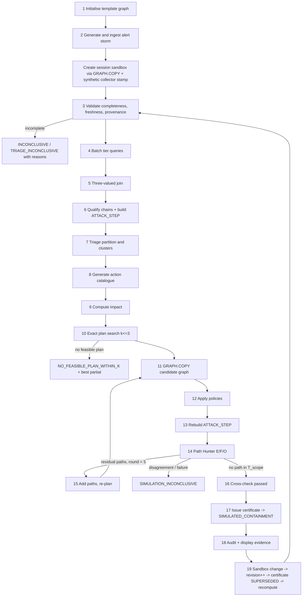
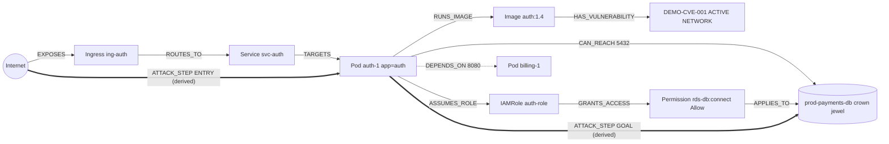
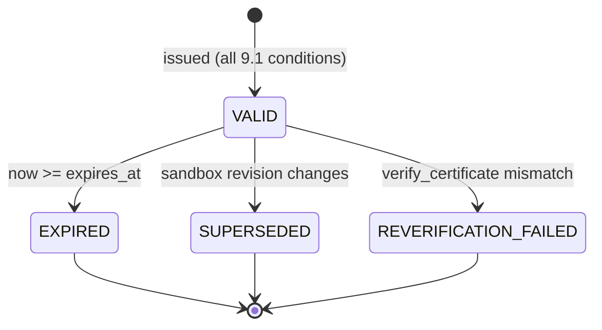
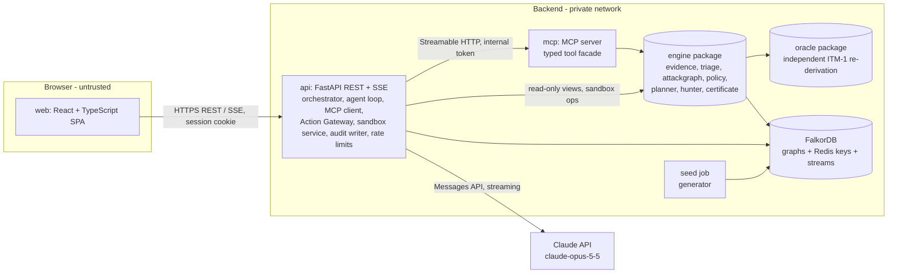
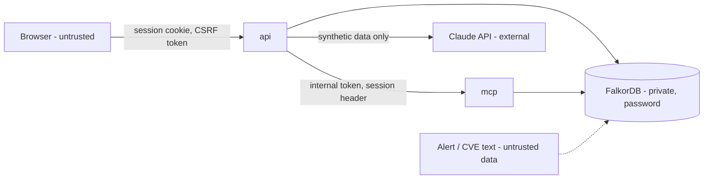

# Interdict: Canonical Solution Specification

> **Document:** `solution.md`, Solution Specification v1.1 (2026-10-16; v1.0 was 2026-10-14). The project was formerly named *SentinelGraph* and was renamed **Interdict** on 2026-10-16 (D-15).
> **Event:** WeMakeDevs × FalkorDB Graph Hacks 2026, **Track 01: Agents That Act on Connected Data** (Oct 15, 12:01 AM IST → Oct 18, 11:59 PM IST)
> **Nature of this document:** design specification and pre-event planning notes. **No application code exists and none is written here.** Code blocks are schemas, Cypher templates (marked `UNVALIDATED`) and illustrative pseudocode for the team to implement during the event, consistent with Rule 8 ("ideas, notes, graph model sketches, diagrams may be prepared beforehand").
> **Validation status:** nothing in this document has been runtime-tested. Every behaviour of FalkorDB, hosting, latency or the LLM is an assumption until it passes the Day-1 gates in [§17](#17-day-1-runtime-validation-gates).

---

## Contents

- [0. Authority, Conventions and Glossary](#0-authority-conventions-and-glossary)
- [1. Executive Summary](#1-executive-summary)
- [2. Problem Statement and Product Positioning](#2-problem-statement-and-product-positioning)
- [3. Scope and Feature Priorities](#3-scope-and-feature-priorities)
- [4. End-to-End System Workflow](#4-end-to-end-system-workflow)
- [5. Graph Data Model](#5-graph-data-model)
- [6. Evidence and Attack-Path Semantics](#6-evidence-and-attack-path-semantics)
- [7. Remediation Planning and Policy Semantics](#7-remediation-planning-and-policy-semantics)
- [8. Path Hunter and Independent Verification](#8-path-hunter-and-independent-verification)
- [9. Model-Verified Containment Certificate](#9-model-verified-containment-certificate)
- [10. Agent, MCP and Tool Contracts](#10-agent-mcp-and-tool-contracts)
- [11. Architecture and Component Responsibilities](#11-architecture-and-component-responsibilities)
- [12. Persistence, Revisioning and Audit](#12-persistence-revisioning-and-audit)
- [13. Frontend and User Experience](#13-frontend-and-user-experience)
- [14. Functional and Non-Functional Requirements](#14-functional-and-non-functional-requirements)
- [15. Security and Threat Model](#15-security-and-threat-model)
- [16. Testing and Correctness Strategy](#16-testing-and-correctness-strategy)
- [17. Day-1 Runtime Validation Gates](#17-day-1-runtime-validation-gates)
- [18. Four-Day Implementation Plan](#18-four-day-implementation-plan)
- [19. Deployment and Operations](#19-deployment-and-operations)
- [20. Demo Narrative and Submission](#20-demo-narrative-and-submission)
- [21. Known Limitations and Explicit Non-Claims](#21-known-limitations-and-explicit-non-claims)
- [22. Final Decisions and Implementation Checklist](#22-final-decisions-and-implementation-checklist)
- [Appendix A. Source-Document Traceability](#appendix-a-source-document-traceability)
- [Appendix B. Conflict Register](#appendix-b-conflict-register)
- [Appendix C. External Sources](#appendix-c-external-sources)

---

## 0. Authority, Conventions and Glossary

### 0.1 Authority and precedence
1. **`solution.md` is the canonical, end-to-end solution specification.** Where any other document disagrees with a decision recorded here, this document wins.
2. [`docs/07_V5_ENGINE_SPECIFICATION.md`](docs/07_V5_ENGINE_SPECIFICATION.md) is the **detailed engine baseline** (threat model, proofs, registries). It applies except where §0.2 records an explicit change.
3. [`docs/00`–`docs/06`](docs/) are **supporting documents**: research, rationale, legacy designs (preserved and marked "superseded" where applicable), test matrices and plans. Docs 06 and 07 each contain their own "this document wins" statements; those are subordinate to this document.
4. No supporting document may silently override a decision here. If implementation discovers that a decision must change, the change is made **explicitly in this file** (with date, reason and affected sections) before or together with the code change.

### 0.2 Decisions made in this document (changes relative to docs 00–07)
| ID | Decision | Justification | Supersedes |
| :--- | :--- | :--- | :--- |
| **D-01** | Minimal memory (recall of previous plans and certificates) is **P1**, not P0 | Approved scope for this specification; memory must never threaten P0 | 06 §3 (P0), 07 §0.1/§12.2 (P0 degradable) |
| **D-02** | Each Path Hunter round adds **every** residual path from the flow decomposition (up to the flow value), not one path | Fewer rounds for the same result; termination argument unchanged (each added path is new and simple) | 07 §8.1 step 2.6 |
| **D-03** | Graph revision is stored **inside each graph** (`(:Meta {id:'meta'})`) and incremented in the **same query** as the mutation, with compare-and-set on the expected revision and a per-graph lock | A process-local or separate counter is not durable revision control and can drift from graph contents | 02 §2.1, 03 §4 ("counter in Redis/memory") |
| **D-04** | The synthetic collector stamps evidence when a sandbox is created (`observed_at = creation time`, `valid_until = observed_at + 12 h`, `evidence_source = 'SYNTHETIC_GENERATOR'`) | A static seed would go stale during the multi-week judging period; re-stamping is the honest model of a synthetic collector running at sandbox creation, and is disclosed | none (gap, C-22) |
| **D-05** | Stale-evidence behaviour (old "Scenario E") is **not seeded into the baseline**; it is demonstrated through the `EXPIRE_EVIDENCE` sandbox operation | The V5 strict completeness rule would make the whole seeded storm inconclusive if any baseline evidence were stale (internal V5 contradiction) | 06 §3 scenario E row, 07 §10.1 "A–E" (C-21) |
| **D-06** | Evidence with `verified = false` inside the evaluation scope makes the scope incomplete; new reason `UNVERIFIED_EVIDENCE` | Legacy queries filtered `{verified: true}` in `MATCH`, making unverified evidence indistinguishable from absent evidence | 01 Query 1C/5 filtering semantics (C-23) |
| **D-07** | New set-based queries **return** stale and unverified evidence with its fields (freshness judged in Python); legacy per-workload queries are kept for drill-down display only | Three-valued logic needs to see stale/unverified evidence to avoid treating it as absent | — (C-23) |
| **D-08** | Audit append is atomic (server-side script computing `prev_hash` and appending in one step) **[GATE G0]**; MVP runs a single API instance | Hash chains require serialised appends | 06 §4.2 "add instances" (C-24) |
| **D-09** | Memory graphs are **per session**: `memory:{session}` (session cookie lifetime 7 days) | Anonymous public demo; a shared memory would let one visitor's sandbox changes appear in another's recall | 06 §4.3 `memory:{tenant}` (C-25) |
| **D-10** | Choke-point ranking failure → panel shows `UNAVAILABLE`; no degree-centrality fallback | Ranking is display-only (P1); V5 TC-14 already specifies this | archived FINAL_DECISIONS "degree fallback" (C-26) |
| **D-11** | V5 provisional answers C-11, C-12, C-13, C-16, C-20 are **frozen for the MVP** (see Appendix B) | Prevents design debate during the build; each is configurable or revisitable after submission | 07 §14 "Open" |
| **D-12** | **TC-36 revised:** the flip uses `EXPOSE_WORKLOAD(batch-1)` + `ADD_LATERAL_REACH(batch-1, checkout-1, 8080)`; `GRANT_DB_ACCESS` alone on a pod without reach must **not** flip the verdict (asserted as TC-36b) | 07 TC-36 expected a flip from exposure + IAM, but Scenario B defines batch-worker with no reach to the database, so ITM-1 correctly keeps it unqualified | 07 §12.4 TC-36 (C-27) |
| **D-13** | The independent oracle **O re-derives ITM-1 from the raw sandbox snapshot export plus the plan's policy specs** (own policy semantics, predicates and search), instead of reading exported ATTACK_STEP edges | Removes the shared-construction and shared-policy-application blind spot (RSK-16) at low cost, because the export already exists for snapshot hashing | 07 §4.4 (C-28) |
| **D-14** | **Time-recovery scope (2026-10-16).** Implementation started at 23:30 IST on Oct 16, about 46 hours before the submission target. For the event, only the demo path in [§3.5](#35-time-recovery-scope-d-14) is built, on the schedule in [§18.0](#180-recovery-schedule-d-14). Everything in §3.1–§3.2 not listed in §3.5 is deferred. UI work may start in parallel against a mocked API contract | The plan assumed four build days and two were lost; a complete, honest vertical slice beats a broad unfinished one | §3.1–§3.2 (in part), §18 day plans, §22.6 sequencing rule (C-31) |
| **D-15** | **Project renamed from SentinelGraph to Interdict (2026-10-16).** Identifiers renamed with it: threat model `SG-TM-1` → `ITM-1`, policy owner `SENTINELGRAPH_CANDIDATE` → `INTERDICT_CANDIDATE`, candidate policy prefix `sg-` → `idt-` | *Network interdiction* is the operations-research problem of removing edges to stop source-to-target flow, which is exactly this product; no security product with this name was found | Product name in all documents |
| **D-16** | **Engine rules from the Day-1 gates (2026-10-17).** (a) A query result whose row count reaches `RESULTSET_SIZE` is treated as possibly truncated (`QUERY_FAILED`); large reads are paged well below the limit. Enforced in `db.run`. (b) Before calling `algo.maxFlow`, count ATTACK_STEP edges; with zero edges, record F = 0 without calling the procedure, which errors on an absent relationship type. (c) `GRAPH.COPY` is serialised behind one global lock shared by every process and retried with backoff on "could not fork": each copy forks the server, and only one fork (including background saves) can run at a time. (d) Forward reachability may use `algo.BFS` (outgoing only); backward reachability uses engine-side search over exported ATTACK_STEP edges. (e) Engine queries must not build large lists with eager functions such as `range()`, because timeouts cannot interrupt them | Measured behaviour of FalkorDB v4.22.1 ([§17.1](#171-recorded-results-2026-10-17)); each rule has a contract test | §5.6, §8.4, §12.2, §12.3 (C-32, C-33, C-34) |
| **D-17** | **Minimal memory restored to the event scope (2026-10-17).** Each finished investigation writes dated `Plan` and `Certificate` nodes (and the findings they cite) to `memory:{session}`; `recall_incident_memory` reads the most recent entries for the same assets first, and the agent says when an answer comes from memory and when it was learned. If memory is unavailable, the run still completes and recall reports `UNAVAILABLE` (FR-18, TC-41) | The challenge brief asks for an agent that "remembers what it learns", and the organisers' Oct 15 blog lists "answered from memory" as an expected outcome | D-14 deferral of memory and `recall_incident_memory` (C-35) |
| **D-18** | **Data sources (2026-10-17).** The environment is fully synthetic and generated by our own code. Its application layout is shaped on Google's Online Boutique demo (Apache-2.0, credited in the README); attack steps carry MITRE ATT&CK technique labels for display (with MITRE attribution); vulnerability IDs stay synthetic (`DEMO-CVE-…`); any people or teams are fictional. Never used: real company, client or cloud-account data, personal data, paid or login-only feeds, scraped data, or scans of real systems | Rule 6 (public, synthetic or own data only). Real CVE IDs attached to fake applications could imply that real software is vulnerable in ways it is not | §2.7 (refines) |
| **D-19** | **Planner output rules (2026-10-17).** (a) The alternatives are the next best **minimal** feasible plans: plans from which no action can be dropped while every chain stays cut. (b) The best partial plan obeys every feasibility rule except coverage, so in strict mode it never has unknown impact. (c) Planning fails closed on any incomplete triage, including failures after evidence collection (`QUERY_FAILED`, `METHOD_DISAGREEMENT`, `REVISION_CHANGED`), reported as `PLANNING_INCONCLUSIVE (SCOPE_INCOMPLETE)` | (a) A plan with a redundant action is dominated and never optimal; listing it would crowd out real choices. (b) The best partial plan is what could actually be applied under the user's constraint. (c) A failed triage reports no chains, which would otherwise yield an empty `PLAN_FOUND` | §7.6 pseudocode, §7.7 (refines) |
| **D-20** | **Hunter agreement and cross-checks (2026-10-17).** (a) Agreement is checked **per crown jewel**: F_t > 0 exactly when O reaches t, and every E chain must end at a target that F and O both reach. E = ∅ with F > 0 is a path beyond the planner's bound, not a disagreement. (b) FalkorDB applies the candidate policies itself (union semantics, one prune query), and the pruned flows must equal the planner's Blocked set. (c) A residual chain that the current plan claims to cut is a `METHOD_DISAGREEMENT`, never a new round. (d) Each round's residuals are E's bounded chains plus the decomposition of the in-scope flow. (e) The certified candidate is promoted with `RENAMENX` after its 24 h expiry is set; Redis keeps the expiry on rename | (a) Read literally, "E = ∅ ⇔ F = 0" would make every beyond-bound path inconclusive, contradicting FR-15 and TC-28. (b), (c) A wrong planner or policy model is caught by the graph, not trusted (TC-29). (d) Fewer rounds, same termination argument (D-02). (e) Atomic, needs no fork, and leaves no window without expiry | §8.6, §8.7 agreement rule (refines); §4.2 step 17 |
| **D-21** | **Service-layer rules (2026-10-17).** (a) Each MCP tool result has two parts: compact JSON text that the model reads, and the full view as structured content for the timeline UI. (b) `plan_remediation` returns a plan **handle**, unique to (plan, scope, constraint set, strictness, revision), for `hunt_residual_paths`; the gateway takes the certified plan's own id. (c) `RESET_SANDBOX` re-copies the template but keeps counting the revision up, so certificates from before a reset stay `SUPERSEDED`. (d) `EXPOSE_WORKLOAD` rejects a pod that some ingress already exposes. (e) Agent mode falls back to the deterministic pipeline, labelled as such, when no API key is configured, on a refusal or API error, past the per-IP limit, or past the daily LLM budget. (f) Claude receives strict tool schemas reduced to the keywords strict mode supports; the MCP server still enforces every pattern and bound | (a) Keeps a full investigation within a sane token budget without hiding proof from the UI. (b) Engine plan ids depend only on the actions, so two scopes can share one; the empty plan always does. (c) A reset would otherwise return to revision 1 and revive old certificates. (d) A second route adds nothing and confuses the demo. (e) The same tools run either way (D-14), so verdicts never depend on the LLM. (f) Unsupported keywords would be rejected by the API | §10.4, §10.5, §10.7 (refines) |

### 0.3 Validation and status markers
- **[DESIGN]**: argued on paper here; correctness depends on the stated assumptions.
- **[GATE Gx]**: must pass the named Day-1 gate ([§17](#17-day-1-runtime-validation-gates)) before it may be described as working.
- **[TARGET]**: a performance or demo outcome we aim for; unverified until measured.
- **[OPEN]**: unresolved; listed in [§22.2](#222-unresolved-decisions) and [Appendix B](#appendix-b-conflict-register).
- Requirement status values ([§14](#14-functional-and-non-functional-requirements)): `specified`, `unverified`, `tested`, `deferred`. On 2026-10-14 **nothing is `tested`**.

### 0.4 Glossary (terms are used only in these meanings)
| Term | Meaning |
| :--- | :--- |
| **template** | The seeded, read-only graph built by the generator. Never served or mutated after seeding. |
| **sandbox** | `sandbox:{hmac(session)}`, a visitor's private copy of `template` (via `GRAPH.COPY`). All investigations run here. |
| **candidate graph** | `cand:{plan_id}:{round}`, a copy of a sandbox with one plan's policies applied. Simulation and verification run here. |
| **certificate snapshot** | `cert:{certificate_id}`, the candidate graph retained for re-verification after a certificate is issued. |
| **evidence item** | A baseline edge (or edge chain) carrying provenance: `evidence_source`, `observed_at`, `verified`, `valid_until`. |
| **fresh** | `verified = true` ∧ `observed_at ≤ t < valid_until` at evaluation time `t`. |
| **evaluation scope** | Every pod, crown jewel, policy and evidence item that could create or remove an attack step. For triage, Hunter and certificates: the whole sandbox. |
| **scope completeness** | All evidence queries over the scope succeeded, all evidence in scope is fresh and verified, no reachability is `UNCOLLECTED`, inventory complete, baseline consistency holds ([§6.6](#66-scope-wide-completeness)). |
| **ITM-1** | The threat model: ENTRY, LATERAL and GOAL transitions ([§6.2](#62-exploitable-transitions-itm-1)). |
| **chain** | Internet → p₀ → … → p_m → t satisfying ITM-1 with distinct pods; `m` = lateral hops. |
| **bounded chain** | A chain with `m ≤ 3` (planner scope). |
| **ATTACK_STEP** | Derived relationship representing one ITM-1 transition; exists only in sandbox and candidate graphs. |
| **T_scope** | The crown jewels a plan and its certificate cover. |
| **E / F / O** | The three verification methods: bounded **E**numerator (Cypher over base evidence), max-**F**low (`algo.maxFlow` over ATTACK_STEP), and independent **O**racle (separate Python search over exported ATTACK_STEP edges). |
| **declared dependency** | `DEPENDS_ON` edge from the synthetic fixture (`evidence_source = 'DECLARED_FIXTURE'`). A model input, not observed production traffic. |
| **dependency manifest** | Per-pod `COMPLETE` / `PARTIAL` / `NONE`: how much of the pod's legitimate egress is declared. |
| **catalogue** | The candidate actions generated for one planning problem ([§7.3](#73-action-catalogue)). |
| **plan** | A set of ≤ 3 catalogue actions, at most one per selector. |
| **model-verified containment** | The only containment claim Interdict makes: within ITM-1, on a hashed snapshot, no chain reaches T_scope after the plan. Never real-world containment. |

---

## 1. Executive Summary

**What it is.** Interdict is a security investigation agent for a synthetic cloud-native environment. It uses FalkorDB as its decision engine to turn a flood of vulnerability alerts into a small number of graph-proven attack paths. It then finds the least disruptive fix that closes every modelled path, challenges that fix with an independent graph search, and issues a model-verified containment certificate that states its own assumptions.

**The problem.** An alert such as "critical vulnerability on pod auth-svc" says what is weak, not whether it matters. Whether it matters depends on connected facts: internet exposure, an active exploitable vulnerability, network reachability (directly or through other workloads) to a valuable database, and IAM permission to that database. Engineers assemble these facts by hand across 5–10 tools while hundreds of alerts accumulate (alert fatigue). Flat vector retrieval cannot follow directional multi-hop relationships, and prompt-stuffing manifests into an LLM produces hallucinated connections.

**The solution in plain language.**
1. **Alert Storm:** load ~1,000 seeded synthetic alerts; the graph classifies every alert as on an attack path, not on one, not actionable, or inconclusive, and groups the real paths into clusters.
2. **Cheapest Safe Fix:** generate Kubernetes-style allowlist policy actions from the graph, compute which declared dependencies each would break and which flows have unknown impact, and search every combination of up to 3 actions for the least disruptive one that closes every modelled path.
3. **Path Hunter:** apply the plan to an isolated copy of the graph and search for any surviving path, without the planner's hop limit and over all crown jewels. If one survives, add it and re-plan.
4. **Certificate:** only when three independent methods agree that no path survives, and all evidence was complete and fresh, issue a hashed, reproducible, expiring certificate.
5. **Break It Yourself:** visitors make one of five typed changes to their own sandbox and watch everything recompute.

**Core differentiator.** Honest, graph-computed answers at every step: restraint where a vulnerability is not reachable; computed (not labelled) disruption; explicit "no safe plan within 3 changes" and "not enough fresh evidence" outcomes; and verification by a different algorithm with a broader scope than the one that produced the plan.

**Why FalkorDB is essential.** Every decision depends on connected-data operations executed in FalkorDB: multi-hop tier queries, lateral path enumeration, derived ATTACK_STEP construction, `algo.maxFlow`, isolated sandboxes and candidate graphs via `GRAPH.COPY`, `algo.betweenness` ranking (P1), and per-session memory graphs. Removing FalkorDB removes investigation, path discovery, prioritisation and verification; nothing remains that can produce a verdict (hackathon Rule 3).

**What the demo will prove [TARGET].** On a disclosed synthetic dataset: (a) most alerts are not on any attack path and are shown as such with evidence; (b) the same CVE gets different verdicts on two pods; (c) a plan that looks complete leaves a surviving path, which the Hunter finds and the planner closes; (d) one cluster has no zero-disruption fix and the system says which declared dependency the cheapest fix breaks; (e) a visitor's sandbox change supersedes the certificate and the investigation recomputes.

---

## 2. Problem Statement and Product Positioning

### 2.1 Alert fatigue and disconnected evidence
Cloud-native environments (Kubernetes clusters, VPCs, microservices) produce hundreds to thousands of vulnerability and configuration alerts daily. An alert about one pod does not reveal:
1. whether the pod is reachable from an untrusted internet ingress;
2. whether the vulnerability is active and network-exploitable;
3. whether the pod, or a workload it can pivot to, can reach a sensitive database;
4. whether the pod holding that network path also holds IAM permission to the database;
5. whether the pod is a topological choke point connecting otherwise separate zones.

### 2.2 Why isolated investigation fails
- **Flat vector retrieval (RAG):** retrieves similar text chunks; blind to directional multi-hop traversal, topology and permission chains.
- **Context-window dumping:** thousands of manifests and route tables in a prompt cause hallucinated connections, context rot, high cost and latency, and unpredictable actions.
- **Passive "AI dashboards":** a graph drawn beside an LLM explanation violates the track's requirement that the graph shape the agent's behaviour.
- **Single-alert tools:** fixing one workload's path while another workload still reaches the same database creates false confidence (legacy Scenario C).

### 2.3 Target user and workflow
Target user: a security or DevOps engineer responsible for triaging cloud vulnerability alerts and approving containment changes. Workflow supported: receive a batch of alerts → see which matter and why → compare candidate containment changes with their operational impact → see the change challenged → obtain an auditable, reproducible verdict before any real change. **This is based on our problem research (docs 00, 04), not on customer interviews; no customer validation is claimed.**

### 2.4 Value proposition
- Reduce a large alert set to a few evidence-backed attack paths, with inconclusive cases visible rather than hidden.
- Prefer the least disruptive containment that closes every modelled path, with disruption computed from declared dependencies.
- Never claim containment that has not survived an independent search; never present uncertainty as safety.

### 2.5 Competitive context and its evidence limits
| Claim ID | Area | Context | Source | Interdict difference |
| :--- | :--- | :--- | :--- | :--- |
| CLM-01 | Graph update latency | Commercial CNAPPs emphasise agentless API polling and scheduled snapshots | [Wiz documentation](https://docs.wiz.io) | Sub-second traversals on every agent step [TARGET] |
| CLM-02 | Remediation paradigm | Enterprise tools integrate with SIEM/SOAR/Jira/Slack to assign tickets | [Orca Security](https://orca.security) | Closed loop: plan → candidate graph → independent verification |
| CLM-03 | Simulation feedback | Standard CNAPP interfaces show current attack paths rather than candidate policy overlays | Industry observation (no single source) | Ranked candidate plans with computed impact before any change |
| CLM-04 | Uncertainty | Proprietary 0–100 risk scores can blend missing data into averages | Industry observation (no single source) | Explicit three-valued `INCONCLUSIVE` |

**Limits:** CLM-01/02 cite vendor documentation home pages, not specific pages; CLM-03/04 are observations, not sourced facts. Universal negative claims ("competitors cannot simulate", "have no verification") were removed in V4.1 and must not be reintroduced. Differentiation is stated only in terms of Interdict's own architecture.

### 2.6 Hackathon track alignment
| Requirement (official, read 2026-10-13) | How Interdict meets it |
| :--- | :--- |
| Rule 2–3: FalkorDB primary and doing real work; "if the product still works with FalkorDB removed, the graph is decorative" | All verdicts come from FalkorDB queries and algorithms (§1) |
| Rule 6: only public, synthetic or own data | Fully synthetic dataset; synthetic CVE IDs (`DEMO-CVE-…`) |
| Rule 8: main coding and design after Oct 15, 12:01 AM IST | This document is planning notes; all code written during the event |
| Rule 10: repo, README with setup and graph model, Cypher/algorithms, demo video, live deployment or local setup, track named | [§20](#20-demo-narrative-and-submission) |
| Rules 11–13: disclose AI use; explain everything; fully AI-generated projects may be rejected | AI disclosure, commits by every member, rehearsed explanations (§20) |
| Track 1 focus: multi-hop reasoning; graph queries and algorithms as tools; tool selection through MCP; actions based on graph results; explainable results | Lateral chains; maxFlow/betweenness/`GRAPH.COPY` as tools; own MCP server; gateway-checked actions; evidence IDs, certificates |
| Judging criteria | **Not published**; [docs/06 §1.2](docs/06_WINNING_PLAN.md) contains our inferred scorecard |

### 2.7 Explicit assumptions about the problem and environment
- The environment is **synthetic**: generated topology, telemetry, IAM and alerts. No production data is used or claimed.
- Observed reachability (`CAN_REACH`) reflects the baseline enforced state; the model does not simulate packets or a CNI.
- IAM is simplified to role → permission (`effect: 'Allow'`) → database. Deny statements, conditions, SCPs and permission boundaries are not modelled.
- Remediation actions are Kubernetes egress NetworkPolicies only; live infrastructure changes are disabled.
- Declared dependencies are fixture inputs; their completeness is stated per pod.

---

## 3. Scope and Feature Priorities

### 3.1 P0 (must ship)
| # | Feature | Why included |
| :---: | :--- | :--- |
| 1 | **Alert Storm**: seeded generator, set-based tier queries, three-valued triage partition, deterministic clusters, explicit inconclusive bucket, evidence-linked funnel | Solves the stated problem (alert fatigue) at scale; every number computed |
| 2 | **Cheapest Safe Fix**: allowlist action catalogue, computed declared/unknown impact, exact search up to 3 actions, lexicographic objective, honest infeasibility | Replaces hand-assigned "disruption" labels with computed trade-offs; correct Kubernetes semantics |
| 3 | **Path Hunter**: candidate graph, derived ATTACK_STEP network, unbounded search over all crown jewels, E/F/O agreement, bounded re-planning (≤ 5 rounds) | Verification by a different method and broader scope than the planner |
| 4 | **Model-verified containment certificate**: snapshot hash, assumptions, exclusions, expiry, supersession, reproduction | Makes the verdict auditable and reproducible, with its limits explicit |
| 5 | **Break It Yourself**: five typed, allowlisted sandbox operations with genuine recomputation | Proves outcomes are computed, not scripted |
| — | **Foundations required by P0:** evidence tiers and three-valued logic, Action Gateway (simulation-only in production), agent loop over our own MCP server, workbench UI, audit hash chain, live deployment with replay mode and spend controls | Without these the P0 features cannot be demonstrated |

### 3.2 P1 (only after all P0 tests pass)
- **Minimal temporal attribution:** most recent change on each chain's required edges (TC-40).
- **Choke-point ranking** via `algo.betweenness`, display signal only, never proof (TC-14).
- **Minimal memory** (D-01): recall of previous plans and certificates for the same assets within the session (TC-41).
- UX extras: guided tour, plain-English/technical toggle, shareable report permalink (view only).

### 3.3 Deferred (not built during the event)
Publicly hosted MCP endpoint · Shift-left PR Guard · certificate signing · time slider · WCC segments · report export · LIVE execution mode and `verify_remediation` (requires C-15) · `REVOKE_IAM_PERMISSION` (pruned, ADR-02) · ingress-side actions (C-17) · pessimistic-closure handling of stale evidence (C-16) · potential-reachability model for policy removal (C-13) · cross-session/shared memory · degree-centrality fallback (D-10).

### 3.4 Non-goals
Multi-cloud IAM evaluation; real Kubernetes cluster changes on the public deployment; user accounts or login; a chatbot or free-form "chat with your graph" interface (no LLM-generated Cypher); generic dashboards; claims about real-world alert ratios, production traffic or real-world containment; new headline features beyond §3.1.

### 3.5 Time-recovery scope (D-14)
Build during the event (the demo path in [§20.1](#201-three-minute-demo-all-outputs-are-targets-until-implementation-confirms-them)):
- **Data:** seeded template of about 200 nodes and about 1,000 alerts, with the [§4.3](#43-worked-example-explicitly-synthetic-data) fixture embedded; collector stamping (D-04).
- **Evidence:** Q-S1…Q-S6, scope completeness (§6.6), three-valued join.
- **Paths:** ATTACK_STEP (Q-A1…Q-A4), bounded enumerator E (Q-E1), triage partition and clusters.
- **Planner:** the three variants, exact search with k ≤ 3, impact sets; strict mode exposed as an API flag only.
- **Path Hunter:** candidate graph via `GRAPH.COPY`, policy application, F (Q-F1) and O, flow decomposition, re-planning (R = 5).
- **Oracle O:** breadth-first search over exported ATTACK_STEP edges (docs/07 §4.4 behaviour). The full re-derivation of **D-13 is deferred to a stretch goal**; the shared-construction limitation (RSK-16) is stated in the README and in certificate exclusions.
- **Certificate:** schema of §9.2 including the snapshot hash; `verify_certificate` deferred.
- **Sandbox operations:** `EXPOSE_WORKLOAD`, `ADD_LATERAL_REACH`, `EXPIRE_EVIDENCE`.
- **Gateway:** allowlist, certificate and revision checks, idempotency; revision compare-and-set (D-03).
- **MCP tools:** `triage_alert_storm`, `find_evidence_by_workload`, `find_attack_paths_to_asset`, `plan_remediation`, `hunt_residual_paths`, `submit_remediation_execution`, `recall_incident_memory` (D-17).
- **Memory (D-17):** dated `Plan` and `Certificate` nodes in `memory:{session}`, recalled first for the same assets.
- **Agent:** Claude loop plus a deterministic fallback that runs the same MCP tool sequence without the LLM (replaces replay mode).
- **UI:** funnel, clusters, workbench (graph, timeline, plans, Hunter rounds, certificate), sandbox panel; loading, error, inconclusive and superseded states.
- **Deployment:** one Docker image (API and MCP as two processes, plus the built frontend) and FalkorDB, using the same compose file locally and on one host behind TLS. Fallback: local setup instructions plus the video.

Deferred until everything above works: temporal attribution; choke-point ranking; `verify_certificate`; `GRANT_DB_ACCESS`; `REMOVE_POLICY`; tools `get_alert_context`, `simulate_remediation`, `calculate_blast_radius`, `rank_choke_points`; the audit hash chain (P1, TC-13 if time); the D-13 oracle; guided tour; plain-English toggle; light theme; mobile layouts; Lighthouse, k6, Sentry, uptime monitors, preview environments; the Playwright suite.

Tests kept for the event: TC-01, TC-02, TC-03, TC-05, TC-06, TC-07, TC-15 (5 seeds), TC-16, TC-17, TC-19, TC-20, TC-21, TC-22, TC-23, TC-24, TC-26, TC-27, TC-28, TC-30, TC-33, TC-35, TC-36, TC-39, TC-41, TC-42. All other tests remain specified.

---

## 4. End-to-End System Workflow

### 4.1 Overview



### 4.2 Step specifications
Component names refer to [§11](#11-architecture-and-component-responsibilities).

| # | Step | Inputs | Processing | Outputs | Failure conditions | Owner |
| :---: | :--- | :--- | :--- | :--- | :--- | :--- |
| 1 | Initialise template | Generator seed and parameters | Build topology, IAM, policies, declared dependencies with manifests, scenario structures; create indexes; write `(:Meta {revision: 1})`; validate `id` uniqueness | `template` graph | Duplicate/missing `id`; index creation failure → startup aborts (fail closed) | `seed` |
| 2 | Generate and ingest alert storm | Seed, alert parameters | One alert per (pod, vulnerability) finding plus duplicate-scanner alerts; link `ON_WORKLOAD`, `REFERENCES` | `Alert` nodes in `template`; `storm_id` | Dangling references → abort seed | `seed` |
| — | Create sandbox | Session | Per-graph lock; `GRAPH.COPY template → sandbox:{hmac(session)}`; synthetic collector stamps evidence (D-04); revision = 1 | Sandbox ready | Copy failure/timeout → 503 with retry; gate G2 fallback (shared read-only template until first edit) | `sandbox` |
| 3 | Validate evidence | Sandbox | Evaluate scope completeness ([§6.6](#66-scope-wide-completeness)); baseline policy consistency check | `ScopeReport {complete, reasons[]}` | Any incompleteness → no ATTACK_STEP build; triage inconclusive for affected alerts (C-11 frozen rule) | `engine.evidence` |
| 4 | Batch tier queries | Alerted pod IDs | Set-based queries Q-S1…Q-S6 ([§5.6](#56-v5-set-based-query-templates-unvalidated)) under per-query timeout | Raw tier rows incl. stale/unverified (D-07) | Timeout/error → `QUERY_FAILED` for that tier | `engine.evidence` |
| 5 | Three-valued join | Tier rows | Classify each tier per workload: `COLLECTED_COMPLETE` / `COLLECTED_EMPTY` / `QUERY_FAILED` / `STALE_EXPIRED` / `UNCOLLECTED`; join by stable IDs | `WorkloadEvidence` per pod | Never maps missing/failed/stale to empty | `engine.evidence` |
| 6 | Qualify chains | Complete scope | Build ATTACK_STEP ([§8.1](#81-derived-attack_step-construction)); enumerate bounded chains (E); compute Forward/Backward reachability | Chains, ATTACK_STEP edges, reachability sets | Enumeration cap hit → `CHAIN_ENUMERATION_TRUNCATED` | `engine.attackgraph` |
| 7 | Triage and cluster | Alerts, reachability sets, chains | Partition alerts ([§6.8](#68-alert-triage-partition)); roles; cluster by (target, entry ingress) | `StormReport` (counts, clusters, evidence IDs) | Counts must conserve input; violation = defect, report fails closed | `engine.triage` |
| 8 | Generate catalogue | Constraint set C, sandbox | Eligible selectors; variants DECLARED / STRICT / DENY_ALL | `Catalogue` (≤ 30 actions) | > 30 → `PLANNING_INCONCLUSIVE (CATALOGUE_TOO_LARGE)` | `engine.planner` |
| 9 | Compute impact | Catalogue, `DEPENDS_ON`, manifests | Blocked, StepRemoved, KnownBroken, Unknown per action ([§7.4](#74-impact-computation)) | Effect sets | — | `engine.planner` |
| 10 | Exact search | C, catalogue, k = 3, `require_known_impact` | Enumerate subsets; feasibility; lexicographic objective | `PlanReport` | No feasible set → `NO_FEASIBLE_PLAN_WITHIN_K` with reason and best partial plan | `engine.planner` |
| 11 | Candidate graph | Sandbox, plan | Lock sandbox; record sandbox revision; `GRAPH.COPY → cand:{plan}:{round}`; verify copy's Meta revision equals recorded revision | Candidate graph | Copy failure → `SIMULATION_INCONCLUSIVE`; revision mismatch → `REVISION_CHANGED` | `engine.hunter` |
| 12 | Apply policies | Candidate graph, plan | Create `INTERDICT_CANDIDATE` policies, `SELECTS`, `ALLOWS_EGRESS`; delete disallowed observed `CAN_REACH` in the candidate only | Modified candidate | Template error → inconclusive | `engine.hunter` |
| 13 | Rebuild ATTACK_STEP | Candidate | Same construction as step 6 | Candidate ATTACK_STEP | Incomplete scope → inconclusive | `engine.attackgraph` |
| 14 | Path Hunter | Candidate, T_scope | Run E, F (`algo.maxFlow` Internet → all crown jewels), O | Per-method results; residual paths | Query failure/timeout → `SIMULATION_INCONCLUSIVE`; disagreement → `METHOD_DISAGREEMENT` | `engine.hunter`, `oracle` |
| 15 | Re-plan | Residual paths | Decompose flow; remove cycles; add all paths (D-02); re-run steps 8–14 | New plan / round | Round 5 reached → `SIMULATED_RESIDUAL_EXPOSURE`; planner infeasible → `NO_FEASIBLE_PLAN_WITHIN_K` | `engine.hunter` |
| 16 | Cross-check | E/F/O results | Require E = ∅ ∧ F = 0 ∧ O = ∅ for T_scope | Pass/fail | Any disagreement → inconclusive, defect logged | `engine.hunter` |
| 17 | Issue certificate | All of the above | Check §9.1 conditions; hash snapshot; rename candidate to `cert:{id}` | `Certificate`, `SIMULATED_CONTAINMENT` | Any condition false → no certificate | `engine.certificate` |
| 18 | Audit and display | Events | Append hash-chained audit events; stream to UI via SSE | Audit stream, UI state | Audit append failure → run marked failed (no unaudited certificate) | `audit`, `api`, `web` |
| 19 | Sandbox change | Typed operation | Validate; mutate with revision CAS (D-03); supersede certificates; invalidate ATTACK_STEP; audit | New revision; recompute from step 3 | Validation/authorization/limit rejections ([§10.7](#107-sandbox-operations)) | `sandbox`, `gateway` |

### 4.3 Worked example (explicitly synthetic data)
> All identifiers, CVEs and dependencies below are **synthetic fixtures**. Expected results are **[TARGET]** design outcomes, derived by hand from the rules in §6–§9, not test results.

**Fixture (namespace `shop`; crown jewel `prod-payments-db`):**

| Pod | Exposed via | Vulnerability (active) | IAM grant to payments-db | Observed egress (`CAN_REACH`) | Declared dependencies (`DEPENDS_ON`) | Manifest |
| :--- | :--- | :--- | :---: | :--- | :--- | :--- |
| `auth-1` (app=auth) | `ing-auth` → `svc-auth` | `DEMO-CVE-001`, NETWORK | yes | payments-db:5432, billing-1:8080, kube-dns:53 | billing-1:8080, kube-dns:53 | COMPLETE |
| `analytics-1` (app=analytics) | `ing-analytics` → `svc-analytics` | `DEMO-CVE-303`, NETWORK | yes | payments-db:5432, metrics-1:9090, kube-dns:53 | kube-dns:53 | PARTIAL |
| `frontend-1` (app=frontend) | `ing-shop` → `svc-frontend` | `DEMO-CVE-101`, NETWORK | no | checkout-1:8080, kube-dns:53 | checkout-1:8080, kube-dns:53 | COMPLETE |
| `checkout-1` (app=checkout) | — | `DEMO-CVE-202`, NETWORK | yes | payments-db:5432, kube-dns:53 | payments-db:5432, kube-dns:53 | COMPLETE |
| `batch-1` (app=batch) | — | `DEMO-CVE-001`, NETWORK | no | kube-dns:53 | kube-dns:53 | COMPLETE |

No baseline egress policies select these pods. Alerts: one per vulnerability (5 alerts) plus one duplicate-scanner alert on `batch-1` (6 alerts).

**Steps 3–7 (triage):** scope complete. ATTACK_STEP edges: ENTRY Internet→auth-1, Internet→analytics-1, Internet→frontend-1; LATERAL frontend-1→checkout-1 (checkout-1 has a network vuln); GOAL auth-1→payments-db, analytics-1→payments-db, checkout-1→payments-db. No edge involves `batch-1`.
- Bounded chains: `c1 = chain-auth-1-prod-payments-db` (m=0), `c2 = chain-analytics-1-prod-payments-db` (m=0), `c3 = chain-frontend-1-checkout-1-prod-payments-db` (m=1).
- Triage: auth-1 (ENTRY+FINAL_HOP), analytics-1 (ENTRY+FINAL_HOP), frontend-1 (ENTRY), checkout-1 (LATERAL+FINAL_HOP) → 4 alerts `ON_ATTACK_PATH`; 2 alerts on `batch-1` → `NOT_ON_ATTACK_PATH` (restraint: same `DEMO-CVE-001` as auth-1). Sum = 6 ✓.
- Clusters by (target, entry ingress): K1 = {c1} (ing-auth), K2 = {c2} (ing-analytics), K3 = {c3} (ing-shop).

**Steps 8–10 (plan for cluster K1, T_scope = {payments-db}):** C₀ = {c1}. Eligible selector: `shop/auth`.
- `act:shop:auth:EGRESS_DECLARED` allows {billing-1:8080, kube-dns:53} → blocks auth-1→payments-db:5432 → removes the GOAL step; KnownBroken = 0; Unknown = 0 (COMPLETE manifest; the blocked flow is a known non-dependency).
- `act:shop:auth:EGRESS_STRICT` not generated (attack destination is not a declared dependency, so it equals DECLARED).
- `act:shop:auth:EGRESS_DENY_ALL` → KnownBroken = 2 (billing, DNS).
- Optimum P₀ = {auth DECLARED}, `KNOWN_ZERO_DISRUPTION`, `EXACT_WITHIN_K`. This equals legacy "Candidate A: Surgical isolation" expressed correctly as an allowlist.

**Steps 11–15 (Hunter round 0):** candidate graph with P₀ → ATTACK_STEP retains c2 and c3 paths. F (maxFlow Internet → all crown jewels) = 2; decomposition yields c2 and c3 (edge-disjoint); O agrees; E finds c2, c3. Residual in T_scope → D-02: add both. C₁ = {c1, c2, c3}.

**Re-plan after round 0:** selectors with removable steps: auth, analytics, frontend, checkout.
- analytics DECLARED allows {kube-dns:53} → removes analytics→payments; blocks metrics-1:9090 too; both blocked flows undeclared under a PARTIAL manifest → Unknown = 2.
- frontend STRICT removes frontend→checkout (declared) → KnownBroken = 1; checkout STRICT removes checkout→payments (declared) → KnownBroken = 1. DECLARED variants of frontend/checkout keep those flows (do not hit c3).
- Every feasible plan must hit c3 through a declared dependency → **no `KNOWN_ZERO_DISRUPTION` plan exists** (the required overlap scenario).
- Optimum: {auth DECLARED, analytics DECLARED, checkout STRICT}: KnownBroken 1, Unknown 2, |S| 3. Tie with frontend STRICT on criteria 1–4 broken by sorted action IDs (`act:shop:checkout:…` < `act:shop:frontend:…`). Impact status `IMPACT_PARTIALLY_UNKNOWN`; UI: "Closes all modelled paths to prod-payments-db; breaks 1 declared dependency (checkout-1 → prod-payments-db:5432); 2 blocked flows have unknown impact (analytics-1)."

**Hunter round 1:** candidate graph with P₁ → E = ∅, F = 0, O = ∅ for {payments-db}; scope complete; revision unchanged → **certificate issued**, status `SIMULATED_CONTAINMENT`, UI "Model-verified containment".

**Step 19 (genuine recomputation):**
- The visitor runs `EXPOSE_WORKLOAD(batch-1)` and `GRANT_DB_ACCESS(batch-1, prod-payments-db)` → revision 1 → 3; the certificate becomes `SUPERSEDED`. Recompute: batch-1 is now exposed and authorised but has **no observed reach** to payments-db, so it is still `NOT_ON_ATTACK_PATH`. The UI explains the missing condition (no GOAL step without reachability). This is correct behaviour, not a failure.
- The visitor then runs `ADD_LATERAL_REACH(batch-1, checkout-1, 8080)` → revision 4. New chain `Internet → batch-1 → checkout-1 → prod-payments-db` (m = 1); batch-1's alerts become `ON_ATTACK_PATH (ENTRY)`; the previous plan no longer covers the new chain, so re-planning adds a `shop/batch` action. [TARGET; canonical test: TC-36 as revised by D-12.]

---

## 5. Graph Data Model

### 5.1 Graphs in the FalkorDB instance
| Graph key | Contents | Mutated by | Lifetime |
| :--- | :--- | :--- | :--- |
| `template` | Seeded baseline evidence + alerts + `Meta` | seed job only | Rebuilt idempotently on deploy |
| `sandbox:{hmac(session)}` | Copy of `template`, collector-stamped (D-04), plus visitor changes and derived ATTACK_STEP | sandbox operations; engine (derived edges only) | 2 h idle TTL, swept |
| `cand:{plan_id}:{round}` | Copy of a sandbox with candidate policies applied | Hunter only | Deleted after the round unless promoted |
| `cert:{certificate_id}` | Promoted candidate graph backing a certificate | never (read-only) | 24 h, then deleted (metadata kept) |
| `memory:{session}` (P1) | `Plan`, `Certificate` metadata | engine at end of a run | 7 days (D-09) |

Non-graph keys in the same instance: per-graph locks `lock:{graph_key}`, idempotency receipts `idemp:{key}` (24 h), audit stream `audit:{session}`, rate-limit counters. Graph revision is **not** a separate key (D-03).

### 5.2 Global rules
1. Every node and every evidence edge has a stable, domain-level `id` (lowercase `[a-z0-9-]`, ≤ 64 chars). FalkorDB internal IDs are never exposed, compared or hashed.
2. Every evidence edge carries the provenance contract: `evidence_source`, `observed_at` (ISO-8601 UTC), `verified` (bool), `valid_until` (ISO-8601 UTC).
3. `evidence_source` values: `K8S_DISCOVERY`, `VPC_FLOW_LOGS`, `IAM_EXTRACTOR` (legacy names, all synthetic here), `SYNTHETIC_GENERATOR`, `DECLARED_FIXTURE`, `SANDBOX_USER_CHANGE`.
4. Labels and properties are never built from user or LLM text; all queries are parameterised templates.

### 5.3 Node schema
| Label | Properties | Kind | Notes |
| :--- | :--- | :--- | :--- |
| `Meta` | `id:'meta'`, `revision:int`, `created_at`, `seed`, `generator_version`, `inventory_complete:bool` | bookkeeping | One per graph (D-03) |
| `Internet` | `id:'global-internet'`, `untrusted:true` | baseline | Single source of all attacks |
| `Ingress` | `id, name, host, ip, namespace, tls_enabled:bool` | baseline | |
| `Service` | `id, name, namespace, type` | baseline | |
| `Pod` | `id, name, namespace, ip, status, node_name, app, labels:[ 'k=v', … ], dependency_manifest:'COMPLETE'\|'PARTIAL'\|'NONE', reach_status:'COLLECTED'\|'UNCOLLECTED', reach_status_reason` | baseline | `app` drives selectors; labels stored as strings (map-typed properties not assumed) |
| `ContainerImage` | `id, repository, tag, digest` | baseline | |
| `Vulnerability` | `id, cve_id:'DEMO-CVE-…', severity, cvss_score, status:'ACTIVE'\|…, attack_vector:'NETWORK'\|'ADJACENT'\|'LOCAL'\|'PHYSICAL'` | baseline | Synthetic IDs only |
| `IAMRole` | `id, arn, name, trust_policy` | baseline | |
| `IAMPermission` | `id, action:'rds-db:connect', effect:'Allow'\|'Deny'` | baseline | Deny is returned but not modelled (§21) |
| `Database` | `id, name, type:'postgres', is_crown_jewel:bool` | baseline | |
| `PlatformService` | `id:'kube-dns', namespace:'kube-system'` | baseline | DNS as explicit destination |
| `NetworkPolicy` | `id, name, namespace, pod_selector:'app=<x>', policy_types:['Egress'], status:'ACTIVE', managed_by:'BASELINE'\|'INTERDICT_CANDIDATE'` | baseline / candidate | Candidate policies exist only in `cand:` and `cert:` graphs |
| `Alert` | `id, severity, created_at, scanner, title, evidence_source:'SYNTHETIC_GENERATOR'` | input | `title` is untrusted text (§15) |
| `Change` (P1) | `id, at, kind, ref` | baseline | Temporal attribution |
| `Plan` (P1, memory) | `id, created_at, actions, impact, optimality, t_scope, sandbox_revision` | memory | |
| `Certificate` (memory) | see [§9.2](#92-certificate-schema) | memory | |

### 5.4 Relationship schema
| Relationship | From → To | Properties | Kind |
| :--- | :--- | :--- | :--- |
| `EXPOSES` | Internet → Ingress | `id` + provenance | baseline evidence |
| `ROUTES_TO` | Ingress → Service | `id` + provenance | baseline evidence |
| `TARGETS` | Service → Pod | `id` + provenance | baseline evidence |
| `RUNS_IMAGE` | Pod → ContainerImage | `id` + provenance | baseline evidence |
| `HAS_VULNERABILITY` | ContainerImage → Vulnerability | `id` + provenance | baseline evidence |
| `CAN_REACH` | Pod → Pod \| Database \| PlatformService | `id, port, protocol` + provenance | baseline evidence (observed reachability, incl. lateral) |
| `ASSUMES_ROLE` | Pod → IAMRole | `id` + provenance | baseline evidence |
| `GRANTS_ACCESS` | IAMRole → IAMPermission | `id` + provenance | baseline evidence |
| `APPLIES_TO` | IAMPermission → Database | `id` + provenance | baseline evidence |
| `DEPENDS_ON` | Pod → Pod \| Database \| PlatformService | `id, port, protocol, evidence_source:'DECLARED_FIXTURE'` | declared fixture |
| `SELECTS` | NetworkPolicy → Pod | — | materialised from `pod_selector` + namespace |
| `ALLOWS_EGRESS` | NetworkPolicy → Pod \| Database \| PlatformService | `port, protocol` | baseline / candidate |
| `ISOLATES` (legacy) | NetworkPolicy → Pod | — | legacy doc 01 name; **not used** in V5 (replaced by `SELECTS`) |
| `ON_WORKLOAD` | Alert → Pod | — | input |
| `REFERENCES` | Alert → Vulnerability | — | input |
| `ATTACK_STEP` | Internet → Pod (ENTRY), Pod → Pod (LATERAL), Pod → Database (GOAL) | `kind, capacity:1, ports:[…], backing_evidence_ids:[…], built_at_revision` | **derived**, sandbox and candidate graphs only |
| `introduced_by` / `valid_from` (P1) | properties on evidence edges | `introduced_by: change id`, `valid_from` | temporal attribution |

### 5.5 Representative fragment (synthetic)



### 5.6 V5 set-based query templates (UNVALIDATED)
All templates are parameterised, run with a per-query timeout ([§17](#17-day-1-runtime-validation-gates) G3), and **return stale and unverified evidence with its fields** (D-07); freshness is judged in Python against one evaluation time `t`. All are `UNVALIDATED` until executed on the pinned container.

```cypher
// Q-S1 Exposure tier, all alerted pods
MATCH (ext:Internet {id: $internet_id})-[e1:EXPOSES]->(ing:Ingress)-[e2:ROUTES_TO]->(svc:Service)-[e3:TARGETS]->(p:Pod)
WHERE p.id IN $pod_ids
RETURN p.id AS pod_id, ing.id AS ingress_id, svc.id AS service_id,
       [e1.id, e2.id, e3.id] AS evidence_ids,
       [e1.verified, e2.verified, e3.verified] AS verified,
       [e1.valid_until, e2.valid_until, e3.valid_until] AS valid_until

// Q-S2 Vulnerability tier (all statuses, so NOT_ACTIONABLE can be derived)
MATCH (p:Pod)-[r:RUNS_IMAGE]->(img:ContainerImage)-[h:HAS_VULNERABILITY]->(v:Vulnerability)
WHERE p.id IN $pod_ids
RETURN p.id AS pod_id, v.id AS vulnerability_id, v.cve_id AS cve_id, v.status AS status,
       v.attack_vector AS attack_vector, v.severity AS severity,
       [r.id, h.id] AS evidence_ids, [r.verified, h.verified] AS verified,
       [r.valid_until, h.valid_until] AS valid_until

// Q-S3 Observed reachability (all destinations, incl. pods)
MATCH (a:Pod)-[c:CAN_REACH]->(d)
WHERE a.id IN $pod_ids
RETURN a.id AS src_id, d.id AS dst_id, labels(d) AS dst_labels, c.id AS evidence_id,
       c.port AS port, c.protocol AS protocol, c.verified AS verified,
       c.observed_at AS observed_at, c.valid_until AS valid_until, c.evidence_source AS evidence_source

// Q-S3b Reachability collection status per pod
MATCH (p:Pod) WHERE p.id IN $pod_ids
RETURN p.id AS pod_id, p.reach_status AS reach_status, p.reach_status_reason AS reason

// Q-S4 IAM tier (all effects returned; Deny is reported, not modelled)
MATCH (p:Pod)-[ar:ASSUMES_ROLE]->(role:IAMRole)-[g:GRANTS_ACCESS]->(perm:IAMPermission)-[ap:APPLIES_TO]->(db:Database)
WHERE p.id IN $pod_ids
RETURN p.id AS pod_id, db.id AS db_id, db.is_crown_jewel AS is_crown_jewel, role.arn AS role_arn,
       perm.id AS permission_id, perm.action AS action, perm.effect AS effect,
       [ar.id, g.id, ap.id] AS evidence_ids, [ar.verified, g.verified, ap.verified] AS verified,
       [ar.valid_until, g.valid_until, ap.valid_until] AS valid_until

// Q-S5 Egress policies and their allow rules (null rows filtered in Python)
MATCH (np:NetworkPolicy)-[:SELECTS]->(p:Pod)
WHERE 'Egress' IN np.policy_types
OPTIONAL MATCH (np)-[al:ALLOWS_EGRESS]->(d)
RETURN np.id AS policy_id, np.managed_by AS managed_by, collect(DISTINCT p.id) AS selected_pods,
       collect(DISTINCT [d.id, al.port, al.protocol]) AS allows

// Q-S6 Declared dependencies and manifests
MATCH (p:Pod) WHERE p.id IN $pod_ids
OPTIONAL MATCH (p)-[dep:DEPENDS_ON]->(d)
RETURN p.id AS pod_id, p.namespace AS namespace, p.app AS app, p.dependency_manifest AS manifest,
       collect([d.id, dep.port, dep.protocol]) AS declared
```

**ATTACK_STEP construction** (run only after scope completeness passes, so all remaining evidence is fresh, verified and policy-consistent):

```cypher
// Q-A1 Clear derived edges
MATCH ()-[s:ATTACK_STEP]->() DELETE s

// Q-A2 ENTRY: exposed pod with an active network-exploitable vulnerability
MATCH (ext:Internet {id: $internet_id})-[:EXPOSES]->(:Ingress)-[:ROUTES_TO]->(:Service)-[:TARGETS]->(p:Pod)
MATCH (p)-[:RUNS_IMAGE]->(:ContainerImage)-[:HAS_VULNERABILITY]->(v:Vulnerability {status: 'ACTIVE'})
WHERE coalesce(v.attack_vector, 'NETWORK') IN ['NETWORK', 'ADJACENT']
WITH ext, p, collect(DISTINCT v.id) AS vuln_ids
CREATE (ext)-[:ATTACK_STEP {kind: 'ENTRY', capacity: 1, ports: [], backing_evidence_ids: vuln_ids, built_at_revision: $revision}]->(p)

// Q-A3 LATERAL: reach into another pod that has an active network-exploitable vulnerability
MATCH (a:Pod)-[c:CAN_REACH]->(b:Pod)
WHERE a.id <> b.id
MATCH (b)-[:RUNS_IMAGE]->(:ContainerImage)-[:HAS_VULNERABILITY]->(v:Vulnerability {status: 'ACTIVE'})
WHERE coalesce(v.attack_vector, 'NETWORK') IN ['NETWORK', 'ADJACENT']
WITH a, b, collect(DISTINCT c.port) AS ports, collect(DISTINCT c.id) AS reach_ids, collect(DISTINCT v.id) AS vuln_ids
CREATE (a)-[:ATTACK_STEP {kind: 'LATERAL', capacity: 1, ports: ports, backing_evidence_ids: reach_ids + vuln_ids, built_at_revision: $revision}]->(b)

// Q-A4 GOAL: reach to a crown jewel from a pod holding an Allow grant on it
MATCH (a:Pod)-[c:CAN_REACH]->(t:Database {is_crown_jewel: true})
MATCH (a)-[:ASSUMES_ROLE]->(:IAMRole)-[:GRANTS_ACCESS]->(perm:IAMPermission {effect: 'Allow'})-[:APPLIES_TO]->(t)
WITH a, t, collect(DISTINCT c.port) AS ports, collect(DISTINCT c.id) AS reach_ids, collect(DISTINCT perm.id) AS perm_ids
CREATE (a)-[:ATTACK_STEP {kind: 'GOAL', capacity: 1, ports: ports, backing_evidence_ids: reach_ids + perm_ids, built_at_revision: $revision}]->(t)
```

**Bounded enumerator E** (over base evidence, deliberately not over ATTACK_STEP):

```cypher
// Q-E1 Candidate pod sequences of 0..3 lateral hops between entry-capable and goal-capable pods
// entry_pod_ids and goal_pod_ids are computed in Python from Q-S1..Q-S4; per-pod vulnerability
// conditions on intermediate pods are checked in Python; sequences with repeated pods are discarded.
MATCH path = (p0:Pod)-[:CAN_REACH*0..3]->(pm:Pod)
WHERE p0.id IN $entry_pod_ids AND pm.id IN $goal_pod_ids
RETURN [n IN nodes(path) | n.id] AS pod_ids
LIMIT $enum_cap_plus_one
```
Zero-length patterns (`*0..3`) must be confirmed on the pinned version [GATE G0]; fallback: run the `m = 0` case as a separate query.

**Reachability for triage** (Forward from Internet, Backward from crown jewels, over ATTACK_STEP): via FalkorDB's BFS procedure if its signature and directionality are confirmed [GATE G1], else engine-side breadth-first search over exported ATTACK_STEP edges (engine module, distinct from the oracle).

**Max-flow F** [GATE G1]:

```cypher
// Q-F1 Max-flow from Internet to a set of crown jewels over ATTACK_STEP
MATCH (s:Internet {id: $internet_id})
MATCH (t:Database) WHERE t.id IN $target_ids
WITH s, collect(t) AS targets
CALL algo.maxFlow({sourceNodes: [s], targetNodes: targets, capacityProperty: 'capacity', relationshipTypes: ['ATTACK_STEP']})
YIELD edges, edgeFlows, maxFlow
RETURN maxFlow,
       [i IN range(0, size(edges) - 1) | [startNode(edges[i]).id, endNode(edges[i]).id, edgeFlows[i]]] AS flows
```
Run once with `target_ids = T_scope` (decision) and once with all crown jewels (out-of-scope reporting).

**Snapshot export for hashing and the oracle**:

```cypher
// Q-H1 Nodes (paged, ordered by id)
MATCH (n) RETURN n.id AS id, labels(n) AS labels, properties(n) AS props ORDER BY id SKIP $skip LIMIT $page
// Q-H2 Edges excluding derived ATTACK_STEP (paged)
MATCH (a)-[r]->(b) WHERE type(r) <> 'ATTACK_STEP'
RETURN a.id AS src, type(r) AS type, b.id AS dst, properties(r) AS props ORDER BY src, type, dst SKIP $skip LIMIT $page
// Q-H3 ATTACK_STEP export for the oracle
MATCH (a)-[s:ATTACK_STEP]->(b) RETURN a.id AS src, b.id AS dst, s.kind AS kind
```
Functions used (`properties`, `labels`, `type`, `coalesce`, `range`, `startNode`, `endNode`, list comprehension) must be confirmed at G0.

### 5.7 Indexes and constraints
```cypher
CREATE INDEX FOR (n:Pod) ON (n.id)
CREATE INDEX FOR (n:Database) ON (n.id)
CREATE INDEX FOR (n:Internet) ON (n.id)
CREATE INDEX FOR (n:Ingress) ON (n.id)
CREATE INDEX FOR (n:Service) ON (n.id)
CREATE INDEX FOR (n:Vulnerability) ON (n.id)
CREATE INDEX FOR (n:IAMPermission) ON (n.id)
CREATE INDEX FOR (n:NetworkPolicy) ON (n.id)
CREATE INDEX FOR (n:Alert) ON (n.id)
CREATE INDEX FOR (n:Meta) ON (n.id)
```
- **Rationale:** every template anchors on `id` (`p.id IN $pod_ids`, `{id: $x}`). No performance improvement is claimed until measured.
- **Validation plan:** at G4, compare `GRAPH.EXPLAIN` plans and latency with and without indexes; keep only indexes that are used.
- **Relationship-property index on evidence `id`** (needed by `EXPIRE_EVIDENCE`) and **uniqueness constraints**: confirm support at G0. Fallback for uniqueness: the generator guarantees unique IDs and a duplicate-check query runs at sandbox creation and before hashing (failure aborts, fail closed).
- `GRAPH.COPY` copies indexes and constraints (FalkorDB docs); confirm at G2.

### 5.8 Legacy canonical queries (preserved from doc 01 §3; status and limitations)
These are reproduced verbatim. In V5 they serve **drill-down display** and regression comparison; decisions use §5.6.

```cypher
// Query 1A: Public Exposure Tier
MATCH (ext:Internet {id: $internet_id})-[:EXPOSES]->(ing:Ingress)-[:ROUTES_TO]->(svc:Service)-[:TARGETS]->(pod:Pod {id: $pod_id})
RETURN 
  ext.id AS internet_id,
  ing.id AS ingress_id,
  svc.id AS service_id,
  pod.id AS pod_id,
  true AS has_exposure
```
*Semantics:* exposure path for one pod. *Limitation:* returns no provenance, so freshness cannot be judged from it.

```cypher
// Query 1B: Vulnerability Tier
MATCH (pod:Pod {id: $pod_id})-[:RUNS_IMAGE]->(img:ContainerImage)-[:HAS_VULNERABILITY]->(v:Vulnerability {status: 'ACTIVE'})
RETURN 
  v.id AS vulnerability_id,
  v.cve_id AS cve_id,
  v.severity AS severity,
  v.cvss_score AS cvss_score
```
*Limitation:* no `attack_vector` (C-01); non-active vulnerabilities are invisible.

```cypher
// Query 1C: Network Reachability Tier
MATCH (pod:Pod {id: $pod_id})-[reach:CAN_REACH {verified: true}]->(db:Database {is_crown_jewel: true})
RETURN 
  db.id AS target_db_id,
  db.name AS target_db_name,
  reach.protocol AS protocol,
  reach.port AS port,
  reach.evidence_source AS evidence_source,
  reach.observed_at AS observed_at,
  reach.valid_until AS valid_until
```
*Limitation:* filtering `{verified: true}` hides unverified evidence (C-23, D-06); direct database reach only (no lateral).

```cypher
// Query 1D: Identity Authorization Tier
MATCH (pod:Pod {id: $pod_id})-[:ASSUMES_ROLE]->(role:IAMRole)-[:GRANTS_ACCESS]->(perm:IAMPermission {effect: 'Allow'})-[:APPLIES_TO]->(db:Database {is_crown_jewel: true})
RETURN 
  db.id AS target_db_id,
  db.name AS target_db_name,
  role.arn AS role_arn,
  perm.action AS action,
  perm.effect AS effect
```
*Limitation:* Deny statements ignored (attacker-favourable).

```cypher
// Query 2: Bounded Blast-Radius Semantics
MATCH (pod:Pod {id: $pod_id})

// Network assets
OPTIONAL MATCH (pod)-[reach:CAN_REACH {verified: true}]->(net_asset)
WHERE net_asset:Database OR net_asset:Service

// Authorized databases
OPTIONAL MATCH (pod)-[:ASSUMES_ROLE]->(:IAMRole)-[:GRANTS_ACCESS]->(perm:IAMPermission {effect: 'Allow'})-[:APPLIES_TO]->(auth_db:Database)

WITH 
  collect(DISTINCT net_asset.id) AS net_ids,
  collect(DISTINCT auth_db.id) AS auth_db_ids

RETURN 
  net_ids AS network_reachable_asset_ids,
  size(net_ids) AS network_reachable_count,
  auth_db_ids AS iam_authorized_database_ids,
  size(auth_db_ids) AS iam_authorized_count
```
*Semantics:* backend computes `dual_exposure_database_ids = set(net_ids) & set(auth_db_ids)` in Python. *Limitation:* V5 `CAN_REACH` targets Pods, not Services, so the `Service` branch never matches and lateral pods are not counted. Used by the P1 tool `calculate_blast_radius`; label results "direct network assets".

```cypher
// Query 3: Choke Point Detection via FalkorDB algo.betweenness (P1)
CALL algo.betweenness({
  relationshipTypes: ['EXPOSES', 'ROUTES_TO', 'TARGETS', 'CAN_REACH'],
  samplingSeed: 42
})
YIELD node, score
WHERE node:Pod OR node:Service
RETURN node.id AS node_id, node.name AS name, score
ORDER BY score DESC
LIMIT 5
```
*Semantics:* documented procedure; `samplingSize` defaults to 32 sampled sources (approximation); fixed seed for reproducibility. *Limitation:* computed on base topology, not on ATTACK_STEP; **display signal only**, never proof (D-10 on failure).

```cypher
// Query 5: Live Scope Re-Query (deferred with LIVE mode)
MATCH (ext:Internet {id: $internet_id})-[:EXPOSES]->(ing:Ingress)-[:ROUTES_TO]->(svc:Service)-[:TARGETS]->(p:Pod)
MATCH (p)-[:RUNS_IMAGE]->(img:ContainerImage)-[:HAS_VULNERABILITY]->(v:Vulnerability {status: 'ACTIVE'})
MATCH (p)-[reach:CAN_REACH {verified: true}]->(db:Database {id: $target_db_id})
MATCH (p)-[:ASSUMES_ROLE]->(role:IAMRole)-[:GRANTS_ACCESS]->(perm:IAMPermission {effect: 'Allow'})-[:APPLIES_TO]->(db)
RETURN 
  p.id AS workload_id,
  p.name AS workload_name,
  db.id AS target_db_id,
  v.cve_id AS cve_id,
  reach.port AS port,
  reach.valid_until AS reach_valid_until,
  role.arn AS role_arn
```
*Limitation:* direct chains only; must be generalised to ITM-1 before LIVE mode (C-15).

The historical V3 monolithic `OPTIONAL MATCH` query (row multiplication and null-map defects, DEF-01) is preserved only in [docs/01 §6.1](docs/01_GRAPH_MODEL_AND_EVIDENCE.md) and must not be used.

---

## 6. Evidence and Attack-Path Semantics

### 6.1 Predicates (state S, evaluation time t, fresh evidence only)
- **Exposed(p):** fresh `Internet -EXPOSES-> Ingress -ROUTES_TO-> Service -TARGETS-> p`.
- **NetVuln(p):** `p -RUNS_IMAGE-> img -HAS_VULNERABILITY-> v`, `v.status = 'ACTIVE'`, `v.attack_vector ∈ {NETWORK, ADJACENT}`; a missing vector counts as `NETWORK` and is flagged (attacker-favourable).
- **EffReach_S(a, d):** some port π with a fresh observed `CAN_REACH(a→d, π)` that is allowed under S's egress policies ([§7.1](#71-modelled-kubernetes-networkpolicy-semantics)).
- **Authorized(p, t):** fresh `p -ASSUMES_ROLE-> role -GRANTS_ACCESS-> perm{effect:'Allow'} -APPLIES_TO-> t`, `t.is_crown_jewel = true`.

### 6.2 Exploitable transitions (ITM-1)
| Transition | From → To | Condition |
| :--- | :--- | :--- |
| **ENTRY** | Internet → pod p | Exposed(p) ∧ NetVuln(p) |
| **LATERAL** | pod a → pod b, a ≠ b | EffReach_S(a, b) ∧ NetVuln(b) |
| **GOAL** | pod a → crown jewel t | EffReach_S(a, t) ∧ Authorized(a, t) |

The attacker controls the pods it has entered. It takes over another pod only by reaching it and exploiting an active network-reachable vulnerability on it. It accesses a crown jewel only from a pod that both reaches it and holds an Allow grant on it. **Every condition depends only on the two endpoints and S**; this locality is what makes the graph encoding correct ([§8.2](#82-why-the-encoding-is-correct)). Conditions that depend on earlier steps (stolen credentials, tokens) are out of scope.

### 6.3 Qualifying modelled chain
A chain to `t` is `Internet → p₀ → … → p_m → t`: ENTRY, then `m` LATERAL steps, then GOAL, with distinct pods. `m = 0` is the original four-tier chain (exposure, active vulnerability, reachability, IAM on the same pod and target), with the V5 refinement that the vulnerability must be network-exploitable (C-01). Chain ID: `chain-{p₀}-…-{p_m}-{t}`.

| Status | Meaning |
| :--- | :--- |
| `QUALIFYING_MODELED_CHAIN` | Scope complete and ≥ 1 chain reaches the target |
| `NOT_QUALIFIED` | Scope complete and no chain reaches the target (all needed tiers verified, including verified-empty results) |
| `INCONCLUSIVE` | Scope incomplete for any reason in §6.6; never interpreted as safe |

### 6.4 Freshness, expiry and provenance
- Fresh iff `verified = true` ∧ `observed_at ≤ t < valid_until`. One evaluation time `t` per run (recorded in outputs) so all checks are consistent.
- Missing `valid_until` or missing `evidence_source` → evidence is incomplete (`INCONCLUSIVE`, reason `STALE_EVIDENCE` or `UNVERIFIED_EVIDENCE` respectively).
- Sandbox evidence is stamped at sandbox creation by the synthetic collector (D-04); `EXPIRE_EVIDENCE` sets `valid_until` in the past to demonstrate staleness (D-05).

### 6.5 Missing versus explicitly absent evidence
| Situation | Collection status | Effect |
| :--- | :--- | :--- |
| Query succeeded, rows found | `COLLECTED_COMPLETE` | Use rows |
| Query succeeded, verified zero rows **and** inventory complete | `COLLECTED_EMPTY` | Negative proof for that tier |
| Query error, timeout, malformed data, or row cap reached (results possibly partial) | `QUERY_FAILED` | Scope incomplete |
| Evidence past `valid_until` | `STALE_EXPIRED` | Scope incomplete |
| Data source not queried; reachability invalidated (`reach_status = 'UNCOLLECTED'`, e.g. after `REMOVE_POLICY`) | `UNCOLLECTED` (legacy `NOT_CONFIGURED` maps here) | Scope incomplete |
| Evidence with `verified = false` | (D-06) | Scope incomplete, reason `UNVERIFIED_EVIDENCE` |

**Partial results:** FalkorDB returns a whole result or an error; a client-side cap reached (`LIMIT cap+1` returned cap+1 rows) is treated as partial → `QUERY_FAILED` for completeness purposes (enumeration: `CHAIN_ENUMERATION_TRUNCATED`).

### 6.6 Scope-wide completeness
Required before any ATTACK_STEP construction, triage classification beyond `NOT_ACTIONABLE`, planning, Hunter rounds or certificates:
1. Every tier query over the scope returned `COLLECTED_COMPLETE` or `COLLECTED_EMPTY`.
2. All evidence in scope is fresh and verified; no pod has `reach_status = 'UNCOLLECTED'`.
3. `Meta.inventory_complete = true`.
4. **Baseline consistency:** every fresh observed `CAN_REACH(p→d, π)` is allowed by the policies in force; otherwise `CONTRADICTORY_EVIDENCE`.
5. `id` uniqueness check passes.

If any fails: no ATTACK_STEP graph; statuses `INCONCLUSIVE` / `TRIAGE_INCONCLUSIVE` / `PLANNING_INCONCLUSIVE (SCOPE_INCOMPLETE)` / `SIMULATION_INCONCLUSIVE` with `InconclusiveReason` values from [§10.2](#102-status-enum-registry). This strict rule (C-11, C-16) is frozen for the MVP (D-11).

### 6.7 Decision truth table (doc 01 §4.2 preserved, extended)
| Exposure | Vulnerability | Reachability | Authorization | Scope inventory | Conclusion | Justification |
| :---: | :---: | :---: | :---: | :---: | :---: | :--- |
| `COMPLETE` (True) | `COMPLETE` (Active) | `COMPLETE` (Matches DB) | `COMPLETE` (Allow) | `COMPLETE` | **`QUALIFYING_MODELED_CHAIN`** | All 4 tiers present, fresh, and coincide on target DB (legacy Scenario A) |
| `EMPTY` (No Ingress) | `COMPLETE` (Active) | Any | Any | `COMPLETE` | **`NOT_QUALIFIED`** for direct chains | Proven lack of exposure (legacy Scenario B); the pod may still be LATERAL on another chain |
| `COMPLETE` (True) | `EMPTY` (0 CVEs) | Any | Any | `COMPLETE` | **`NOT_QUALIFIED`** | Proven lack of active vulnerability |
| `COMPLETE` (True) | `COMPLETE` (Active) | `EMPTY` (No Route) | Any | `COMPLETE` | **`NOT_QUALIFIED`** for direct chains | Proven isolation from the crown jewel; lateral routes evaluated separately |
| `COMPLETE` (True) | `COMPLETE` (Active) | `COMPLETE` (Matches DB) | `EMPTY` (No IAM) | `COMPLETE` | **`NOT_QUALIFIED`** for this pod's GOAL | Proven lack of authorization |
| **`QUERY_FAILED`** | Any | Any | Any | Any | **`INCONCLUSIVE`** | Cannot verify exposure |
| Any | **`STALE_EXPIRED`** | Any | Any | Any | **`INCONCLUSIVE`** | Vulnerability telemetry expired |
| Any | Any | **`STALE_EXPIRED`** | Any | Any | **`INCONCLUSIVE`** | Reachability expired |
| Any | Any | Any | Any | **`INCOMPLETE`** | **`INCONCLUSIVE`** | Inventory missing workloads |
| *V5:* COMPLETE | COMPLETE (vector LOCAL/PHYSICAL only) | Any | Any | COMPLETE | **`NOT_QUALIFIED`** (no ENTRY) | Not network-exploitable (C-01) |
| *V5:* Any | Any | `UNCOLLECTED` or unverified | Any | Any | **`INCONCLUSIVE`** | D-06; policy change (§7.8) |
| *V5:* Any | Any | Observed reach not allowed by policy | Any | Any | **`INCONCLUSIVE`** | `CONTRADICTORY_EVIDENCE` |

Invariant (doc 01): if any tier ∈ {`QUERY_FAILED`, `STALE_EXPIRED`, `UNCOLLECTED`} then the conclusion is `INCONCLUSIVE`; `NOT_QUALIFIED` requires all relevant tiers queried successfully.

### 6.8 Alert triage partition
Every alert receives exactly one class; class counts sum to the input count (conservation).
1. `TRIAGE_INCONCLUSIVE`: scope incomplete for evidence that bears on its workload. Under the frozen strict rule, an incomplete sandbox makes every alert inconclusive except those classified `NOT_ACTIONABLE`.
2. `NOT_ACTIONABLE`: the referenced vulnerability is not `ACTIVE` or not network-exploitable (decidable from Q-S2 alone).
3. `NOT_ON_ATTACK_PATH`: workload not in `Forward(Internet) ∩ Backward(crown jewels)` over ATTACK_STEP.
4. `ON_ATTACK_PATH`: workload in that intersection, with roles `ENTRY` / `LATERAL` / `FINAL_HOP` (several allowed).

"On a path" is exact and unbounded: a node lies on some Internet → crown-jewel path iff it is reachable from Internet and can reach a crown jewel.

### 6.9 Disclosure of unsupported or unmodelled vectors
Every investigation result, plan and certificate carries the ITM-1 identifier and a fixed exclusions block: credential theft or token reuse, application-layer vulnerabilities without a network vector, node/host and loopback traffic, Internet egress and exfiltration, IAM Deny/conditions/SCPs/permission boundaries, supply chain, zero-days, real CNI enforcement, ingress-side policies (not modelled; attacker-favourable). The count of vulnerabilities with a missing `attack_vector` (treated as NETWORK) is reported.

---

## 7. Remediation Planning and Policy Semantics

### 7.1 Modelled Kubernetes NetworkPolicy semantics
Adopted from the Kubernetes documentation ([Appendix C](#appendix-c-external-sources)):
- A pod is **non-isolated for egress** by default (all outbound connections allowed).
- It becomes isolated for egress when **any** NetworkPolicy with `Egress` in `policyTypes` selects it.
- Policies are **additive**: allowed egress is the **union** of the selecting policies' rules; evaluation order does not matter.
- There is **no explicit deny** rule; restriction happens only by being selected and not allowed.
- Enforcement requires a network plugin that implements NetworkPolicy; Interdict models policy semantics and cannot claim enforcement.

`Allowed_S(p, d, π)` = true if no Egress policy in S selects `p`; otherwise true iff some selecting policy has `ALLOWS_EGRESS {port: π}` to `d`.

**Legacy note:** the doc 03 payloads with `blocked_destinations` (a deny-list) are **not valid** NetworkPolicy semantics and are superseded (C-03). Their intent maps to the V5 variants: legacy "Candidate A: Surgical DB isolation" ≈ `EGRESS_DECLARED` (when the attack flow is not a declared dependency); legacy "Candidate B: Hard workload severance" = `EGRESS_DENY_ALL`.

### 7.2 Policy model in the graph
- `(:NetworkPolicy {pod_selector:'app=<x>', namespace, policy_types:['Egress'], managed_by})`, `SELECTS` materialised from selector + namespace, `ALLOWS_EGRESS {port, protocol}` per allowed destination.
- Baseline consistency (§6.6 item 4) guarantees that every observed reach in a sandbox is currently allowed.
- Applying a plan in a candidate graph creates `INTERDICT_CANDIDATE` policies and **deletes, in the candidate only**, every observed `CAN_REACH` whose `(d, π)` is not allowed for its source pod.

### 7.3 Action catalogue
**Action type:** the single allowlisted gateway type `APPLY_NETWORK_POLICY_ISOLATE`. Each action creates one candidate egress policy for a **workload selector** σ = (namespace, app), selecting the pod set `P_σ`.

**Eligibility** (all required):
1. `P_σ` non-empty and within one namespace.
2. **No existing Egress policy selects any pod in `P_σ`**. Under union semantics a new policy cannot restrict an already-isolated pod (reason `INELIGIBLE_EXISTING_EGRESS_POLICY`). Modifying existing policies is out of MVP scope.
3. Some pod in `P_σ` is the source of a LATERAL or GOAL step of a chain in the constraint set C.

**Variants** (deterministic ID `act:{namespace}:{app}:{variant}`). Let `Decl(σ)` = declared dependencies `(d, π)` of `P_σ`; `DNS` = kube-dns 53/UDP and 53/TCP; `AttackDest(σ)` = all `(d, π)` where a C-step leaves a pod in `P_σ` to `d` and π is one of that step's observed ports.

| Variant | Allow list | Generated when | Typical impact |
| :--- | :--- | :--- | :--- |
| `EGRESS_DECLARED` (preserve declared dependencies) | `Decl(σ) ∪ DNS` | always, if eligible | Blocks every undeclared flow; zero known breaks |
| `EGRESS_STRICT` (preserve declared dependencies except targeted attack flows) | `(Decl(σ) ∪ DNS) \ AttackDest(σ)` | only if it differs from DECLARED (an attack step overlaps a declared dependency) | Breaks the overlapping declared dependencies |
| `EGRESS_DENY_ALL` (hard isolation) | `∅` (DNS also blocked) | always, if eligible | Breaks all declared dependencies |

**Candidate policy spec (example, V5 form; synthetic):**
```json
{
  "candidate_action_id": "act:shop:auth:EGRESS_DECLARED",
  "action_type": "APPLY_NETWORK_POLICY_ISOLATE",
  "policy_spec": {
    "name": "idt-candidate-auth-egress",
    "namespace": "shop",
    "pod_selector": "app=auth",
    "policy_types": ["Egress"],
    "allows_egress": [
      {"destination_id": "billing-1", "port": 8080, "protocol": "TCP"},
      {"destination_id": "kube-dns", "port": 53, "protocol": "UDP"},
      {"destination_id": "kube-dns", "port": 53, "protocol": "TCP"}
    ]
  }
}
```

**Catalogue cap:** ≤ 30 actions per planning problem; otherwise `PLANNING_INCONCLUSIVE (CATALOGUE_TOO_LARGE)`.

### 7.4 Impact computation
For action `a` on selector σ, against the current sandbox state:
- **Blocked(a)** = fresh observed `CAN_REACH(p→d, π)` with `p ∈ P_σ` and `(d, π)` not in the allow list.
- **StepRemoved(a)** = LATERAL/GOAL steps `p → d` with `p ∈ P_σ` such that **every** observed port of the step is in Blocked(a).
- **KnownBroken(a)** = declared `DEPENDS_ON(p→d, π)` with `p ∈ P_σ` and `(d, π)` not allowed (observed or not).
- **Unknown(a)** = flows in Blocked(a) from pods whose manifest is `PARTIAL` or `NONE` and that are not declared dependencies.
- With a `COMPLETE` manifest, an undeclared blocked flow is a **known non-dependency** (no disruption).
- Plan-level sets are unions of distinct edges over the plan's actions.

**Impact status:** `KNOWN_ZERO_DISRUPTION` (KnownBroken = ∅ ∧ Unknown = ∅); `KNOWN_DISRUPTION` (KnownBroken ≠ ∅ ∧ Unknown = ∅); `IMPACT_PARTIALLY_UNKNOWN` (Unknown ≠ ∅; KnownBroken reported alongside). "Zero disruption" may be shown only for `KNOWN_ZERO_DISRUPTION`, always qualified as "of declared dependencies (synthetic fixture)".

### 7.5 Unknown impact and strict mode
- **Default:** unknown impact is an objective term (criterion 2), never zero, and always displayed.
- **Strict mode** (`require_known_impact = true`): plans with Unknown ≠ ∅ are infeasible; if nothing remains, `NO_FEASIBLE_PLAN_WITHIN_K (UNKNOWN_IMPACT_EXCLUDED)`.
- Synthetic dependency fixtures are model inputs; **no claim is made that they represent production traffic.**

### 7.6 Exact search
**Hitting:** plan S hits chain c iff some LATERAL or GOAL step of c is in `StepRemoved(a)` for some `a ∈ S`. ENTRY steps are not cuttable by egress actions (C-17).

**Feasibility:** hits every c ∈ C; ≤ 1 action per selector; |S| ≤ k = 3; all actions eligible; strict-mode condition if enabled.

**Objective (lexicographic, minimise):** (1) |KnownBroken(S)| → (2) |Unknown(S)| → (3) |S| → (4) |Blocked(S)| → (5) sorted action IDs (deterministic tie-break). Order of (1) vs (2) frozen for MVP (C-12, D-11).

```text
# Illustrative pseudocode (not implementation code)
function plan(C, A, k=3, strict=false):
    best_feasible := none ; best_partial := none
    for size in 0..k:
        for S in combinations(A, size):
            if two actions in S share a selector: continue
            covered := { c in C : hits(S, c) }
            best_partial := min(best_partial, key=(-|covered|, objective(S)), value=S)
            if covered != C: continue
            if strict and Unknown(S) != ∅: continue
            best_feasible := min(best_feasible, key=objective(S), value=S)
    if best_feasible exists: return PLAN_FOUND(best_feasible, optimality=EXACT_WITHIN_K, alternatives=next 3 distinct feasible + best all-DENY_ALL plan)
    reason := NO_ELIGIBLE_ACTION if some c in C has no step removable by any action in A
              else UNKNOWN_IMPACT_EXCLUDED if strict and a feasible plan exists when strict=false
              else K_EXCEEDED
    return NO_FEASIBLE_PLAN_WITHIN_K(reason, k, best_partial with covered/uncovered chain IDs)
```
**Complexity:** at most Σ_{i≤3} C(30, i) = 4,526 subsets, each evaluated with set operations over |C| chains; bounded by `CHAIN_ENUM_CAP = 10,000` chains. Measured (2026-10-17): all 4,526 subsets over 10,000 chains in about 50 ms, with each action's hits stored as one bitmask over C. Alternatives and the best partial plan follow D-19.

### 7.7 Outputs
- **`PLAN_FOUND`:** plan ID, actions with full policy specs, `optimality` (`EXACT_WITHIN_K` or `NOT_EXACT`), KnownBroken/Unknown/Blocked sets, impact status, covered chain IDs, up to 3 alternatives, and the best all-hard-isolation plan for comparison.
- **`NO_FEASIBLE_PLAN_WITHIN_K`:** reason (`K_EXCEEDED` | `UNKNOWN_IMPACT_EXCLUDED` | `NO_ELIGIBLE_ACTION`), `k`, best partial plan (maximum chains covered, ties by objective) with covered and uncovered chain IDs. **Never a certificate, never "contained".** UI: "No plan of ≤ 3 allowed policy changes closes every modelled path. Best partial plan closes X of Y."
- **`PLANNING_INCONCLUSIVE`:** reason (`SCOPE_INCOMPLETE` | `CATALOGUE_TOO_LARGE` | `CHAIN_ENUMERATION_TRUNCATED`). A heuristic plan may still be shown and verified by the Hunter, labelled `NOT_EXACT`; never described as optimal.

### 7.8 Policy removal (sandbox operation)
Removing a policy can only enlarge allowed egress, and the newly allowed flows have not been observed. `REMOVE_POLICY` therefore sets `reach_status = 'UNCOLLECTED'` (reason `POLICY_CHANGED`) on every pod the policy selected; the sandbox becomes incomplete and investigations return `INCONCLUSIVE` until reset. The model never guesses reachability (C-13 frozen, D-11).

### 7.9 Monotonicity lemma [DESIGN]
Eligible actions target pods selected by no Egress policy, so before the action they allow everything and afterwards only the action's list. Allowed egress only shrinks; ATTACK_STEP edges can only disappear; other pods are unchanged. **Catalogue actions never create attack paths** (TC-27).

### 7.10 Why exact only within the catalogue, and when no zero-disruption fix exists
- The result is optimal among plans of ≤ 3 actions drawn from this catalogue for this constraint set. It is **not** globally optimal over all possible policies (other selectors, ingress policies, IAM changes, policy modification). General weighted hitting set is NP-hard; exactness here comes from the small bounded instance.
- **No `KNOWN_ZERO_DISRUPTION` plan exists** when some chain c has no removable step whose cheapest removing action has KnownBroken ∪ Unknown = ∅; that is, every way to cut c removes a declared dependency or an unknown-impact flow. The fixture must contain such a cluster (TC-26; worked example §4.3, chain c3).

---

## 8. Path Hunter and Independent Verification

### 8.1 Derived ATTACK_STEP construction
1. Built only in sandbox and candidate graphs, never in `template` or memory graphs.
2. Precondition: scope completeness (§6.6). Otherwise stop with an inconclusive status.
3. Q-A1 clears derived edges; Q-A2/Q-A3/Q-A4 create ENTRY, LATERAL and GOAL edges ([§5.6](#56-v5-set-based-query-templates-unvalidated)); parallel ports collapse into one edge with a `ports` list.
4. Each edge stores `backing_evidence_ids` and `built_at_revision`. Before any use, `built_at_revision` is compared with `Meta.revision`; on mismatch the graph is rebuilt.
5. Vulnerability, reachability and IAM conditions are encoded **on edges**: ENTRY requires exposure and NetVuln of the target pod; LATERAL requires reach and NetVuln of the target pod; GOAL requires reach and Allow on the crown jewel.

### 8.2 Why the encoding is correct
**Theorem 1 [DESIGN].** For a state passing scope completeness, an attack chain of any length to crown jewel t exists iff ATTACK_STEP contains a directed path from Internet to t.
*Proof sketch:* (⇒) each chain step satisfies its transition condition, so the matching edge exists. (⇐) Internet has only ENTRY out-edges and crown jewels only GOAL in-edges, so any path is ENTRY, LATERAL…, GOAL; each edge exists only if its endpoint-local condition holds; repeated pods are removed by cutting cycles, leaving a valid chain with distinct pods. ∎

**Corollary (bounded equivalence).** Bounded chains (m ≤ 3) from E (over base evidence) equal the simple ATTACK_STEP paths with ≤ 3 LATERAL edges (TC-19). This cross-checks the construction for bounded paths.

**Locality requirement:** any future condition depending on earlier steps breaks Theorem 1 and requires a new proof.

### 8.3 Planner bounds versus Hunter scope
| | Planner (E) | Hunter (F, O) |
| :--- | :--- | :--- |
| Lateral hops | ≤ 3 | unbounded |
| Targets | T_scope (one cluster's target, or all) | **all** crown jewels (decision on T_scope, others reported) |
| Ports | ports of enumerated steps | all observed ports |
| Input | base evidence | F: ATTACK_STEP in the candidate graph; O: raw snapshot export + plan (D-13) |

### 8.4 FalkorDB max-flow usage (method F)
**Theorem 2 [DESIGN].** With capacity 1 on every ATTACK_STEP edge, `maxFlow(Internet → T) = 0` iff no directed Internet → T path exists. *(If a path exists, one unit along it is feasible; if the maximum is 0, the zero flow's residual graph is the original graph and contains no augmenting path.)*

Assumptions to confirm at **G1**: directed edges; only listed `relationshipTypes` traversed; `capacityProperty` honoured; multiple `targetNodes`; per-edge flows returned. FalkorDB documents that `algo.maxFlow` returns nodes/edges with positive flow, `edgeFlows` and `maxFlow`, **not the minimum cut**.

### 8.5 Independent oracle O (D-13)
- **What:** a separate Python package `oracle/` that recomputes ITM-1 **from scratch**: it reads the paged **sandbox snapshot export** (Q-H1/Q-H2, the same export used for `baseline_snapshot_hash`) and the plan's policy specs, applies the §7.1 policy semantics itself, evaluates the §6.1 predicates itself, and runs its own breadth-first search, unbounded, over all crown jewels.
- **Independence rules:** no imports from the engine package; no use of ATTACK_STEP edges or of the engine's policy application; ideally written and reviewed by a different team member; its own unit tests on hand-built graphs.
- **Also used offline** as the reference for Alert Storm counts (TC-15, TC-17) and max-flow agreement (TC-20).
- **Supersedes** 07 §4.4, where O read exported ATTACK_STEP edges and therefore shared the construction (RSK-16). O now shares only the input data and the written definitions of ITM-1 and the policy semantics.

### 8.6 Flow decomposition and surviving-path extraction
From F's positive-flow edges: repeatedly follow edges with remaining flow from Internet to any crown jewel, emitting one unit path per traversal and decrementing flows; remove cycles from each path; map each to a chain ID. **All** paths reaching T_scope are added to the constraint set in that round (D-02). O independently reports one witness path per reachable target for cross-checking.

### 8.7 The Hunter loop
```text
# Illustrative pseudocode (not implementation code)
function hunt(sandbox, T_scope, C0):
    P := plan(C0, catalogue(C0))           # §7
    for round in 0..4:                      # R = 5
        if P is not PLAN_FOUND: return P.status (NO_FEASIBLE_PLAN_WITHIN_K / PLANNING_INCONCLUSIVE)
        with lock(sandbox):                 # D-03
            rev := sandbox.Meta.revision
            cand := GRAPH.COPY(sandbox -> cand:{P.id}:{round}); assert cand.Meta.revision == rev
        apply_policies(cand, P); remove_disallowed_reach(cand)
        if not scope_complete(cand): return SIMULATION_INCONCLUSIVE(reason)
        build_attack_steps(cand)
        E := enumerate_bounded(cand, T_scope)            # base evidence
        F := maxflow(cand, T_scope); F_all := maxflow(cand, all_crown_jewels)
        O := oracle(export(sandbox), P, T_scope)         # D-13
        on any query error/timeout: return SIMULATION_INCONCLUSIVE(QUERY_FAILED)
        if not agree(E, F, O):  return SIMULATION_INCONCLUSIVE(METHOD_DISAGREEMENT)   # logged as defect
        if F == 0 and E == ∅ and O == ∅:
            if sandbox.Meta.revision != rev: return SIMULATION_INCONCLUSIVE(REVISION_CHANGED)
            return issue_certificate(cand, P, ...)        # §9; SIMULATED_CONTAINMENT
        residuals := decompose(F) restricted to T_scope   # D-02
        C := C ∪ residuals ; P := plan(C, catalogue(C))
    return SIMULATED_RESIDUAL_EXPOSURE(residual paths)
```
**Agreement rule:** E = ∅ ⇔ (F = 0) ⇔ O = ∅ for T_scope; additionally, every E chain must appear in O's reachable set and F > 0. Out-of-scope residuals (F_all > 0 for other targets) are reported and do not block a T_scope certificate. *As implemented (D-20):* checked per crown jewel, with E = ∅ and F > 0 treated as a beyond-bound path, plus a graph-side check of the planner's Blocked set.

**Termination:** each plan hits every chain in its constraint set, so each residual added is a new simple chain; there are finitely many; R = 5 bounds the cost.

**Timeouts and errors:** each query has a timeout (G3). Any error, timeout, cap overflow, missing candidate graph or revision change ends the run inconclusive; it never yields "0 paths". Candidate graphs are deleted in a `finally` step unless promoted to `cert:`.

### 8.8 Conditions that prevent certificate issuance
Scope incomplete (any §6.6 condition); any query failure or timeout; E/F/O disagreement; residual path in T_scope after the last round; planner `NO_FEASIBLE_PLAN_WITHIN_K` or `PLANNING_INCONCLUSIVE` without a verified plan; sandbox revision changed during the run; snapshot hash or `id`-uniqueness failure; gate G1 failed with no active fallback ([§17](#17-day-1-runtime-validation-gates)).

### 8.9 What this cross-validation does and does not give
- **Gives:** three different computations (bounded Cypher over base evidence; FalkorDB max-flow over derived edges; independent Python re-derivation from raw export) must agree; implementation bugs in any one are surfaced as disagreement rather than silent false containment.
- **Does not give:** independent validation of the telemetry, the inventory, the synthetic dependency fixture, or the threat model itself. All three methods share the same data and the same written ITM-1 and policy definitions. **This is not proof of real-world security**, and the Hunter is not a second AI agent (no LLM participates in the search, ADR-08).

---

## 9. Model-Verified Containment Certificate

### 9.1 Issuance conditions (all required)
Scope completeness passed on the sandbox and on the final candidate graph; E = ∅, F = 0 and O = ∅ for T_scope; no query failed or timed out; sandbox revision unchanged from copy to issuance; both snapshot hashes computed; `id` uniqueness held; plan status `PLAN_FOUND` (optimality recorded); audit append succeeded.

### 9.2 Certificate schema
```json
{
  "certificate_id": "cert-<uuid>",
  "claim": "MODEL_VERIFIED_CONTAINMENT",
  "status": "VALID",
  "issued_at": "2026-10-16T10:15:00Z",
  "expires_at": "<min(earliest valid_until in scope, issued_at + 24h)>",
  "evaluation_time": "<t used for all freshness checks>",
  "snapshot": {
    "sandbox_graph_key": "sandbox:<hmac>",
    "sandbox_revision": 4,
    "baseline_snapshot_hash": "sha256:<hex>",
    "candidate_graph_key": "cert:<certificate_id>",
    "candidate_snapshot_hash": "sha256:<hex>"
  },
  "threat_model": {
    "id": "ITM-1",
    "constants": {"max_lateral_hops_planner": 3, "max_plan_actions": 3, "max_hunt_rounds": 5},
    "relationship_types": ["EXPOSES","ROUTES_TO","TARGETS","RUNS_IMAGE","HAS_VULNERABILITY","CAN_REACH","ASSUMES_ROLE","GRANTS_ACCESS","APPLIES_TO","SELECTS","ALLOWS_EGRESS"],
    "t_scope": ["prod-payments-db"],
    "over_approximations": {"missing_attack_vector_count": 0, "ingress_policies_ignored": true}
  },
  "evidence": {
    "completeness": {"exposure": "COLLECTED_COMPLETE", "vulnerability": "COLLECTED_COMPLETE", "reachability": "COLLECTED_COMPLETE", "authorization": "COLLECTED_COMPLETE", "inventory_complete": true},
    "freshness": {"earliest_valid_until": "<ts>", "stale_items": 0, "unverified_items": 0}
  },
  "plan": {
    "plan_id": "plan-<uuid>",
    "actions": ["<full policy specs, §7.3>"],
    "optimality": "EXACT_WITHIN_K",
    "impact_status": "IMPACT_PARTIALLY_UNKNOWN",
    "known_broken": ["<DEPENDS_ON ids>"],
    "unknown_impact": ["<CAN_REACH ids>"]
  },
  "verification": {
    "enumerator_E": {"chains_found": 0, "template": "Q-E1", "latency_ms": "<measured>"},
    "maxflow_F": {"value_t_scope": 0, "value_all_crown_jewels": "<n>", "template": "Q-F1", "latency_ms": "<measured>"},
    "oracle_O": {"reachable_targets": [], "version": "<oracle git sha>"},
    "agreement": true,
    "rounds": ["<per-round residual chain ids and plan ids>"],
    "out_of_scope_residuals": ["<chain ids>"]
  },
  "provenance": {"engine_git_sha": "<sha>", "falkordb_version": "<pinned tag/digest>", "audit_event_hash": "sha256:<hex>"},
  "exclusions": "Model-verified only under ITM-1 on the hashed snapshot; not evidence of real-world containment; enforcement depends on the cluster's network plugin; not modelled: credential theft, application-layer vectors without network vector, node/host/loopback traffic, egress exfiltration, IAM Deny/conditions/SCPs, supply chain, zero-days, ingress policies."
}
```

### 9.3 Snapshot hash (canonical serialisation)
SHA-256 over: nodes sorted by `id`, each `(id, sorted labels, sorted properties)`; then edges sorted by `(source id, type, target id, sorted properties)`; timestamps normalised to UTC ISO-8601; keys sorted; numbers in canonical decimal form; derived ATTACK_STEP edges excluded (recomputed). Duplicate or missing `id` aborts issuance.

### 9.4 Lifecycle

- Snapshot graph `cert:{id}` retained 24 h; afterwards only metadata remains (in `memory:{session}` if P1 memory is built, else in the audit record), with "snapshot no longer retained".
- **Reproduction procedure:** `verify_certificate(certificate_id)` re-exports `cert:{id}`, recomputes `candidate_snapshot_hash`, rebuilds ATTACK_STEP, re-runs E/F/O at the recorded `evaluation_time`, and compares all fields; any mismatch → `REVERIFICATION_FAILED`. A reviewer can do the same from the exported JSON and the oracle package.
- **Audit integrity:** the certificate's canonical JSON hash is included in an audit event whose hash chain is verifiable (TC-13); tamper-evident, not tamper-proof (§12.5).

### 9.5 What a certificate establishes and cannot establish
| Establishes (under the stated conditions) | Cannot establish |
| :--- | :--- |
| Under ITM-1, on the hashed snapshot, after the listed policies, no modelled chain reaches T_scope | Real-world containment or CNI enforcement |
| All evidence used was complete, verified and fresh at `evaluation_time` | Correctness or completeness of the (synthetic) telemetry and inventory |
| Three methods agreed | That the threat model covers all attack vectors (§6.9) |
| Reproducible from the retained snapshot | That the result holds after any later change |
| The record is tamper-evident via the audit chain | That the plan is globally optimal (only `EXACT_WITHIN_K`) |

No certificate is issued for incomplete evidence, stale or unverified required evidence, a surviving path, a verification disagreement, or a query failure.

---

## 10. Agent, MCP and Tool Contracts

### 10.1 Agent responsibilities and limits
| Decided deterministically (engine) | Decided by the LLM (Claude) |
| :--- | :--- |
| Evidence completeness, triage classes, chains, clusters, catalogue, plan, Hunter verdict, certificate issuance, gateway authorisation, sandbox operation validation | Which cluster to investigate first; which approved tool to call next within the budget; plain-English narration; final report wording, where **every claim must cite evidence IDs** returned by tools (validated server-side; uncited claims are rejected and the model is asked to repair them) |

The LLM never authorises, verifies, writes Cypher, mutates sandboxes, or decides containment. If the LLM refuses, errors or is unavailable, the orchestrator produces a deterministic report from the same tool results, labelled "generated without the AI narrator", or plays a labelled recorded run (replay mode).

**LLM configuration (from docs/06 §4.4, Claude API reference):** model `claude-opus-5-5`; adaptive thinking with `display: "summarized"` (reasoning summaries stream to the timeline); effort `medium` initially (the model's default), tuned on Day 3; streaming; prompt caching of the frozen system prompt and tool list; `tool_choice: auto` (forced tool choice is rejected by this model) with `strict: true` tool schemas; server-side refusal fallbacks enabled and `stop_reason` always checked; defensive framing ("triage of our own synthetic environment"). Refusal behaviour on security wording is tested on Day 1. Cost estimate **[TARGET, unmeasured]:** roughly $0.25–0.50 per live run at $4/$20 per million input/output tokens.

### 10.2 Status enum registry
Canonical (from docs/07 §12.1, plus D-06's `UNVERIFIED_EVIDENCE`):

| Enum | Values |
| :--- | :--- |
| `CollectionStatus` | `COLLECTED_COMPLETE`, `COLLECTED_EMPTY`, `QUERY_FAILED`, `STALE_EXPIRED`, `UNCOLLECTED` (legacy `NOT_CONFIGURED` → `UNCOLLECTED`) |
| `InvestigationStatus` | `QUALIFYING_MODELED_CHAIN`, `NOT_QUALIFIED`, `INCONCLUSIVE` |
| `InconclusiveReason` | `QUERY_FAILED`, `STALE_EVIDENCE`, `UNCOLLECTED_EVIDENCE`, `UNVERIFIED_EVIDENCE` (D-06), `CONTRADICTORY_EVIDENCE`, `INVENTORY_INCOMPLETE`, `METHOD_DISAGREEMENT`, `REVISION_CHANGED` |
| `AlertTriageClass` | `ON_ATTACK_PATH`, `NOT_ON_ATTACK_PATH`, `NOT_ACTIONABLE`, `TRIAGE_INCONCLUSIVE` |
| `AttackPathRole` | `ENTRY`, `LATERAL`, `FINAL_HOP` |
| `PlanStatus` | `PLAN_FOUND`, `NO_FEASIBLE_PLAN_WITHIN_K`, `PLANNING_INCONCLUSIVE` |
| `NoPlanReason` | `K_EXCEEDED`, `UNKNOWN_IMPACT_EXCLUDED`, `NO_ELIGIBLE_ACTION` |
| `PlanningInconclusiveReason` | `SCOPE_INCOMPLETE`, `CATALOGUE_TOO_LARGE`, `CHAIN_ENUMERATION_TRUNCATED` |
| `PlanOptimality` | `EXACT_WITHIN_K`, `NOT_EXACT` |
| `ImpactStatus` | `KNOWN_ZERO_DISRUPTION`, `KNOWN_DISRUPTION`, `IMPACT_PARTIALLY_UNKNOWN` |
| `DependencyManifest` | `COMPLETE`, `PARTIAL`, `NONE` |
| `SimulationStatus` | `SIMULATED_CONTAINMENT` (**only with a certificate**), `SIMULATED_RESIDUAL_EXPOSURE`, `SIMULATION_REJECTED`, `SIMULATION_INCONCLUSIVE` |
| `CertificateStatus` | `VALID`, `EXPIRED`, `SUPERSEDED`, `REVERIFICATION_FAILED` |
| `VerificationStatus` (LIVE, deferred) | `VERIFIED_CONTAINED`, `RESIDUAL_EXPOSURE`, `VERIFICATION_INCONCLUSIVE` |
| `SandboxOpResult` | `APPLIED`, `REJECTED_VALIDATION`, `REJECTED_UNAUTHORIZED`, `REJECTED_LIMIT`, `REJECTED_CONTRADICTS_POLICY` |
| `GatewayRejection` | `UNAUTHORIZED_ACTION`, `STALE_REVISION_REJECTED`, `MISSING_CERTIFICATE`, `LIVE_MODE_DISABLED` |
| Lifecycle | `INGESTED`, `ANALYZING`, `EVALUATING`, `TRIAGING`, `PLANNING`, `HUNTING`, `SIMULATING`, `CANDIDATE_EVALUATED`, `AWAITING_APPROVAL`, `EXECUTING`, `VERIFYING`; terminals `SIMULATED_CONTAINMENT`, `SIMULATED_RESIDUAL_EXPOSURE`, `SIMULATION_INCONCLUSIVE`, `NO_FEASIBLE_PLAN_WITHIN_K`, `PLANNING_INCONCLUSIVE`, `NOT_QUALIFIED`, `INCONCLUSIVE`, `BLOCKED`, `STALE_REVISION_REJECTED`, `BUDGET_EXHAUSTED`, `FAILED`, `VERIFIED_CONTAINED`, `RESIDUAL_EXPOSURE`, `VERIFICATION_INCONCLUSIVE` (LIVE terminals unreachable while LIVE is disabled) |
| `AttributionStatus` (P1) | `ATTRIBUTED`, `ATTRIBUTION_UNKNOWN` |
| Historical | `SIMULATED_RESOLVED` (V3), superseded by `SIMULATED_CONTAINMENT`; do not use |

### 10.3 MCP architecture and local mode
- **Server:** our own MCP server (`mcp` service, official Python MCP SDK, Streamable HTTP) exposing only the tools in §10.4. It runs on the private network and is never publicly exposed (public endpoint deferred).
- **Client:** the API's orchestrator is the MCP client, so budget, preconditions, audit and UI streaming remain in our code (ADR-05).
- **Transport security (MCP spec):** validate the `Origin` header on all connections; bind to the internal interface (localhost in local mode); authenticate every connection with an internal service token; reject requests without the session context header.
- **Session context:** the API attaches a signed internal header carrying the session ID; the MCP server derives the sandbox key from it. **Tool arguments never contain session IDs or graph keys.**
- **Local mode:** `docker compose up` runs the same server; developers may point MCP Inspector, Claude Code or Claude Desktop at the local endpoint (configuration in the README). This is how MCP interoperability is demonstrated without a public endpoint.

### 10.4 Tool registry (exact names from docs/07 §12.2)
All tools: JSON schemas with `additionalProperties: false`; IDs match `^[a-z0-9-]{1,64}$` and must exist in the caller's sandbox; responses include `evidence_ids` (template, parameters, revision, latency) and the sandbox `revision`; errors are typed (`VALIDATION_ERROR`, `NOT_FOUND`, `SCOPE_INCOMPLETE`, `QUERY_FAILED`, `TIMEOUT`, `PRECONDITION_FAILED`, `BUDGET_EXHAUSTED`), never free text alone.

| Tool | Priority | Inputs | Output | Validation / authorisation | Failure behaviour |
| :--- | :---: | :--- | :--- | :--- | :--- |
| `get_alert_context` | P0 | `alert_id` | Alert, workload, referenced vulnerability (untrusted text fields marked) | Alert exists in sandbox | `NOT_FOUND` |
| `triage_alert_storm` | P0 | `storm_id` | `StormReport`: class counts, roles, clusters, funnel stages, inconclusive reasons | Storm belongs to sandbox | `SCOPE_INCOMPLETE` → report with inconclusive classes (still returned) |
| `find_evidence_by_workload` | P0 | `pod_id` | Four tiers with `CollectionStatus` and records | Pod exists | Per-tier `QUERY_FAILED`, never empty-as-absent |
| `find_attack_paths_to_asset` | P0 | `target_db_id`, `max_lateral_hops` (0–3) | Bounded chains (method E) | Target is a crown jewel; hops ≤ 3 | `CHAIN_ENUMERATION_TRUNCATED`; `SCOPE_INCOMPLETE` |
| `plan_remediation` | P0 | `cluster_id` or `target_db_ids[]`, `require_known_impact` (bool) | `PlanReport` (§7.7) | Targets exist; scope complete | `NO_FEASIBLE_PLAN_WITHIN_K`, `PLANNING_INCONCLUSIVE` |
| `simulate_remediation` | P0 | `plan_id` | One candidate-graph round: E/F/O results, residuals (no re-planning) | Plan belongs to session and current revision | `SIMULATION_INCONCLUSIVE` with reason |
| `hunt_residual_paths` | P0 | `plan_id` | `HuntReport`: rounds, final plan, status, `certificate_id` if issued | As above | Any §8.8 condition → no certificate, explicit status |
| `verify_certificate` | P0 | `certificate_id` | Re-verification result, `CertificateStatus` | Certificate belongs to session | `REVERIFICATION_FAILED`; snapshot expired → reported |
| `submit_remediation_execution` | P0 | `plan_id`, `certificate_id`, `execution_mode` (`SIMULATION` only in production), `idempotency_key` | `ExecutionReceipt` (simulation receipt) | Gateway: allowlisted type, scope matches session, `VALID` certificate at current revision, idempotency check-and-set | `MISSING_CERTIFICATE`, `STALE_REVISION_REJECTED`, `LIVE_MODE_DISABLED`, `UNAUTHORIZED_ACTION`; duplicate key → cached receipt |
| `recall_incident_memory` | P1 | `asset_ids[]` | Previous plans/certificates for these assets in this session | Session-scoped | Returns `UNAVAILABLE` without failing the run (TC-41) |
| `calculate_blast_radius` | P1 | `pod_id` | Query 2 result, labelled "direct network assets" | Pod exists | `QUERY_FAILED` |
| `rank_choke_points` | P1 | `scope` (`sandbox`) | Top-5 betweenness (display only) | — | `UNAVAILABLE` (D-10) |
| `verify_remediation` | Deferred | `investigation_id`, `target_db_id`, `scope` | LIVE post-execution verification | Not registered while LIVE is disabled | — |

### 10.5 Tool-call budget and loop termination
- **≤ 12 tool calls** per investigation (NFR-03 revised); additionally a wall-clock cap of 180 s [TARGET] and an LLM turn cap equal to the tool budget + 2.
- Typical run: `triage_alert_storm` → `find_evidence_by_workload` → `find_attack_paths_to_asset` → `plan_remediation` → `hunt_residual_paths` → `submit_remediation_execution` (SIMULATION) → (`recall_incident_memory`, P1) ≈ 6–7 calls.
- **Stop conditions:** certificate issued and receipt recorded; `NO_FEASIBLE_PLAN_WITHIN_K`; any inconclusive terminal; restraint (chosen cluster's alerts all `NOT_ON_ATTACK_PATH`); budget or time cap → `BUDGET_EXHAUSTED` with partial findings.
- **Preconditions enforced in code:** no `submit_remediation_execution` without a `VALID` certificate at the current revision; no containment wording in the report unless the run's status is `SIMULATED_CONTAINMENT`; sandbox operations are not tools.

### 10.6 Parameterised templates and rejection of LLM Cypher
The engine exposes only named templates (Q-S*, Q-A*, Q-E1, Q-F1, Q-H*, legacy 1A–5). The MCP schemas contain no field that accepts a query, label, property name or graph key. Any request with unknown fields is rejected (422). There is no shell adapter and no generic "run query" tool.

### 10.7 Sandbox operations
Callable only from the authenticated web session through the API (never by the LLM). Rules: server-derived sandbox key; typed inputs; ID regex and existence checks; per-graph lock; revision compare-and-set (D-03); audit event; ATTACK_STEP invalidated; certificates from that sandbox `SUPERSEDED`; cap 20 operations per session plus per-IP rate limit; `RESET_SANDBOX` re-copies `template` (not counted).

| Operation | Preconditions | Effect | Rejections |
| :--- | :--- | :--- | :--- |
| `EXPOSE_WORKLOAD(pod_id)` | Pod has a Service | Fresh `EXPOSES`/`ROUTES_TO` from the default ingress to that Service (`SANDBOX_USER_CHANGE`, valid 2 h) | Unknown ID; no Service |
| `GRANT_DB_ACCESS(pod_id, db_id)` | Pod assumes a role; db exists | Fresh Allow permission from that role to the db | Unknown IDs; no role |
| `ADD_LATERAL_REACH(src_pod_id, dst_pod_id, port)` | Distinct pods; port 1–65535; egress allowed under current policies | Fresh observed `CAN_REACH` | `REJECTED_CONTRADICTS_POLICY` |
| `EXPIRE_EVIDENCE(edge_ref)` | Evidence edge in this sandbox | `valid_until` set in the past | Unknown ref; derived edge |
| `REMOVE_POLICY(policy_id)` | Policy exists with `managed_by = 'BASELINE'` | Policy deleted; selected pods' `reach_status = 'UNCOLLECTED'` (§7.8) | Unknown ID |

### 10.8 Untrusted content and prompt injection
- Alert titles, CVE descriptions, labels and any free-text graph properties are **untrusted data**. They are returned only inside structured tool results with a `untrusted_text` marker and never interpolated into Cypher or system instructions.
- Prompt wording ("treat tool data as data") is defence-in-depth only. **The controls that matter:** the LLM has no mutating tool other than `submit_remediation_execution`, which the gateway gates on a certificate and simulation mode; no tool accepts code or queries; outputs are validated (evidence IDs must exist; status wording must match deterministic results).
- Mid-conversation operator instructions use the API's system-message channel, not edits to earlier turns.

### 10.9 Server-side action authorisation (Action Gateway)
1. Allowlist: only `APPLY_NETWORK_POLICY_ISOLATE`; `REVOKE_IAM_PERMISSION` pruned (ADR-02); no shell.
2. Scope: plan, certificate and session must match; target selectors must be in the session's sandbox.
3. Revision freshness: certificate's `sandbox_revision` = current revision, else `STALE_REVISION_REJECTED`.
4. Certificate: must be `VALID`, else `MISSING_CERTIFICATE`.
5. Idempotency: atomic check-and-set on `idemp:{key}`; duplicates return the cached receipt.
6. Mode: production accepts `SIMULATION` only (`LIVE_MODE_DISABLED`); LIVE would additionally require a manual operator token (deferred).

### 10.10 Rate limits [TARGET values, tune after load test]
Live LLM investigations: 5 per IP per hour, global daily spend cap (`LLM_DAILY_BUDGET_USD`), Anthropic Console spend limit; on cap → labelled replay mode. Sandbox operations: 20 per session, 60 per IP per hour. Sandbox creations: 10 per IP per hour. Certificate re-verifications: 30 per session per hour.

---

## 11. Architecture and Component Responsibilities

### 11.1 Overview

`engine` and `oracle` are Python packages, not services. `api` and `mcp` are two processes; `seed` is a one-shot job. This is a modular monolith plus the MCP process the track focus requires; no queues, brokers or additional databases.

### 11.2 Components
| Component | Responsibilities | Inputs → Outputs | Interfaces | Depends on | Failure modes | Security boundary | Observability |
| :--- | :--- | :--- | :--- | :--- | :--- | :--- | :--- |
| **FalkorDB** | All state: graphs, locks, idempotency keys, audit and event streams, rate counters | Cypher/commands → results | RESP (password, private network) | volume | Restart, OOM, timeout | Not internet-reachable; password required | Container metrics; query latency logged by callers |
| **seed** | Build `template` deterministically; indexes; `Meta` | seed, params → `template` | FalkorDB client | FalkorDB | Validation failure aborts deploy | Runs only at deploy | Logs seed, counts, duration |
| **engine** | Evidence collection (Q-S*), completeness, triage, ATTACK_STEP, policy semantics, catalogue, planner, Hunter, certificate, hashing | sandbox/candidate graphs → reports | Python API | FalkorDB, oracle | Query errors → inconclusive statuses (never "0 paths") | No network listener; only parameterised templates | Per-query template ID, params hash, latency, rows; status counters |
| **oracle** | Independent ITM-1 + policy semantics + BFS from raw export | snapshot export + plan → reachable targets, witness paths | Python API | none (pure) | Exception → `METHOD_DISAGREEMENT`/inconclusive | No DB access; pure function | Version SHA in every result |
| **mcp** | Expose §10.4 tools; validate schemas; map session header to sandbox; call engine | JSON-RPC tool calls → typed results | MCP Streamable HTTP | engine | Invalid input → typed error | Origin check, internal token, session header required, private bind | Tool name, latency, outcome per call |
| **api** | Sessions, REST, SSE (resumable via `Last-Event-ID`), agent loop (MCP client + Claude), budget and preconditions, Action Gateway, sandbox operations, audit append, rate limits, replay mode, `/system`, health | HTTP → JSON/SSE | REST + SSE; MCP client; Anthropic SDK | FalkorDB, mcp, Claude API | LLM refusal/outage → deterministic report or replay; FalkorDB down → 503 and `/readyz` red | Signed session cookie, CSRF token, CORS allowlist, rate limits | `trace_id = investigation_id` across logs, tool calls, queries, audit; Sentry |
| **web** | Screens in §13; never computes verdicts | API JSON/SSE → UI | HTTPS | api | API errors → explicit error states | Holds only a session cookie; no secrets | Sentry, Web Vitals |
| **Claude API** | Tool selection and narration | messages + tools → tool calls/text | Anthropic SDK | — | Refusal, 429, 5xx | External; receives only synthetic data | Token usage, cost per run, refusals |

### 11.3 REST surface (for the frontend)
| Endpoint | Purpose |
| :--- | :--- |
| `POST /api/sessions` | Create anonymous session (signed HttpOnly SameSite cookie + CSRF token) |
| `GET /api/storm` | `StormReport` for the session sandbox |
| `POST /api/investigations` `{cluster_id \| alert_id, mode: live \| replay}` | `202 {investigation_id}` |
| `GET /api/investigations/{id}/events` | SSE stream (heartbeat 15 s, resumable) |
| `GET /api/investigations/{id}` | Current state and final report |
| `GET /api/graph/subgraph?focus=…` | Focused subgraph for display (read-only) |
| `GET /api/evidence/{evidence_id}` | Template, parameters, rows, latency, revision |
| `POST /api/sandbox/operations`, `POST /api/sandbox/reset` | §10.7 |
| `GET /api/certificates/{id}`, `POST /api/certificates/{id}/verify` | §9 |
| `GET /api/audit?after=…` | Audit stream page |
| `GET /api/system` | Measured latencies, graph stats, FalkorDB version, build SHA, seed, active fallbacks |
| `GET /healthz`, `GET /readyz` | Liveness; readiness (FalkorDB, mcp, template present, LLM key configured) |

### 11.4 Why this architecture fits four days
One stateful dependency (FalkorDB) to run, back up and reason about; shared engine package used by both the MCP tools and the read-only UI views; the MCP process is the only extra moving part and is required by the track focus; LIVE mode, public MCP and multi-instance scaling are deferred so that no distributed-systems problem must be solved during the event.

---

## 12. Persistence, Revisioning and Audit

### 12.1 Baseline (`template`) lifecycle
Built by the seed job at deploy. Idempotent: if `template` exists with the same `generator_version` and seed, skip; otherwise rebuild into `template_next`, validate (§6.6 checks, `id` uniqueness, counts), then replace `template`. Sandboxes record the template version; a mismatch prompts "Reset sandbox to the new dataset".

### 12.2 Sandbox and candidate lifecycle
- **Sandbox:** created on the session's first investigation or operation (copy-on-write fallback if G2 requires it: until the first operation, read-only queries run against `template` with the collector stamp applied at evaluation, and the first operation triggers the copy). Idle TTL 2 h; sweeper every 5 min; global cap on live sandboxes [TARGET, from G2 memory measurement] with least-recently-used eviction.
- **Candidate:** created per Hunter round, deleted in a `finally` step unless promoted to `cert:{id}`; an orphan sweeper deletes `cand:*` older than 10 min.
- **Certificate snapshot:** read-only, 24 h.

### 12.3 Graph revision management (D-03)
- Each graph holds `(:Meta {id:'meta', revision})`. A sandbox starts at revision 1.
- Every sandbox mutation is **one parameterised query** that (a) matches `Meta` with `revision = $expected`, (b) performs the mutation, (c) sets `revision = revision + 1`. Zero matched rows → `CONCURRENT_MODIFICATION` (HTTP 409); the client refreshes and retries.
- Mutations and `GRAPH.COPY` from a sandbox hold `lock:{graph_key}` (Redis `SET NX PX`, 10 s, released by owner token). Copies verify that the copy's `Meta.revision` equals the revision read under the lock.
- The Hunter re-reads the sandbox revision before issuing a certificate; a change → `REVISION_CHANGED`.
- **Gate G0 must confirm** that a single write query is applied atomically with respect to other queries on the same graph. If it is not, all mutations and copies on a graph are serialised through the lock alone (fallback), and the CAS check remains as a detector.
- No process-local counter is used for revision control.

### 12.4 Snapshot hashing and reproducibility
Canonical serialisation in [§9.3](#93-snapshot-hash-canonical-serialisation). Both the sandbox (`baseline_snapshot_hash`) and the candidate (`candidate_snapshot_hash`) are hashed; the sandbox export also feeds the oracle (D-13). Reproduction via `verify_certificate` (§9.4).

### 12.5 Audit events and tamper evidence
**Event schema** (doc 03 §6 preserved, extended):
```json
{
  "seq": 14,
  "timestamp": "2026-10-15T10:14:02.124Z",
  "trace_id": "inv-1042",
  "session": "<hmac prefix>",
  "investigation_id": "inv-1042",
  "alert_id": "alt-209",
  "graph_revision": 17,
  "event_type": "REMEDIATION_SIMULATED",
  "target_db_id": "prod-payments-db",
  "candidate_action_id": "act:shop:auth:EGRESS_DECLARED",
  "execution_mode": "SIMULATION",
  "confidence_panel": {
    "graph_evidence_status": "VALID_AND_CURRENT",
    "security_feasibility_status": "QUALIFYING_MODELED_CHAIN",
    "action_verification_status": "SIMULATED_CONTAINMENT"
  },
  "pre_remediation_qualifying_chains": 1,
  "post_remediation_qualifying_chains": 0,
  "verification_scope": "TARGET_ASSET",
  "simulation_status": "SIMULATED_CONTAINMENT",
  "residual_chain_ids": [],
  "certificate_id": "cert-…",
  "execution_duration_ms": 142,
  "payload_hash": "sha256:…",
  "prev_hash": "sha256:…",
  "hash": "sha256:…"
}
```
`Hash_N = SHA256(Payload_N ‖ Hash_{N−1})`. Event types: `SESSION_CREATED`, `SANDBOX_CREATED`, `SANDBOX_OPERATION_APPLIED/REJECTED`, `STORM_TRIAGED`, `INVESTIGATION_STARTED`, `TOOL_CALLED`, `PLAN_COMPUTED`, `HUNT_ROUND`, `CERTIFICATE_ISSUED/SUPERSEDED/EXPIRED/REVERIFIED`, `GATEWAY_RECEIPT/REJECTED`, `INVESTIGATION_FINISHED`, `LLM_REFUSAL`, `REPLAY_USED`.
- Storage: Redis Stream `audit:{session}` (and `audit:system` for deploy/seed events). Append is atomic via a server-side script that reads the last hash and appends (D-08) [GATE G0]; fallback: single writer task in the single API instance.
- **Tamper-evident, not tamper-proof:** replay verification detects insertion, deletion or modification; it cannot prevent a privileged operator from rewriting the whole stream. Retention 7 days.
- An investigation is marked `FAILED` if its audit append fails; no unaudited certificate is shown.

### 12.6 Plans, certificates and investigation state
| Entity | Storage | Retention |
| :--- | :--- | :--- |
| Investigation state + event log (for SSE resume) | Redis hash `inv:{id}` + stream `events:{id}` | 24 h |
| Plan | Redis key `plan:{id}` (JSON) | 24 h |
| Certificate | Redis key `certificate:{id}` (JSON) + `cert:{id}` graph + audit event | JSON 7 days; graph 24 h |
| Idempotency receipts | `idemp:{key}` | 24 h |
| Memory (P1) | `memory:{session}` graph | 7 days |
SQLite and JSONL files from doc 03 §4 are not used (C-07).

### 12.7 Session isolation
All keys and graph names are derived server-side from the session ID (`hmac(session_secret, session_id)`); every lookup checks the session prefix; no endpoint or tool accepts a graph key; cross-session access returns `404` (TC-35).

### 12.8 Cleanup and retention summary
Sandboxes 2 h idle · candidates per round (orphans 10 min) · certificate graphs 24 h · plans 24 h · certificates JSON 7 days · audit 7 days · memory 7 days · idempotency 24 h · sessions 7 days.

### 12.9 Failure recovery
- **API restart:** in-flight investigations become `FAILED` with an audit event; clients resume SSE and see the terminal state; locks expire by TTL; orphan candidates are swept.
- **MCP restart:** in-flight tool call fails with a typed error; the orchestrator retries once, then ends inconclusive.
- **FalkorDB restart:** data restored from its persistence files [GATE: configure and test AOF/RDB on the deploy volume]; if `template` is missing, `/readyz` stays red until the seed job reruns; sandboxes without persisted state are recreated on next access.
- **LLM outage or refusal:** deterministic report or labelled replay (§10.1).

---

## 13. Frontend and User Experience

### 13.1 Principles (docs/04, docs/06 §7)
Anti-black-box: show why a tool was chosen, what was verified versus assumed, and what the side effects would be. Understandable in 60 seconds; show then prove ("Show graph proof" on every claim); one status language everywhere; never a blank wait; plain-English and technical reading levels (toggle is P1).

### 13.2 User journey
1. **Landing:** one-sentence value, "Run the 60-second demo", dataset disclosure ("synthetic, seed N").
2. **Alert Storm:** funnel from all alerts to clusters, with the inconclusive branch visible.
3. **Clusters:** each cluster card states target, entry ingress, chains, roles, and its plan status.
4. **Workbench (3 panes):** left, focused attack subgraph + tier checklist; centre, agent timeline (each step: plain title, why this tool, result, proof); right, plan comparison, Hunter rounds, certificate. Bottom: audit stream.
5. **Certificate view:** claim, scope, assumptions, exclusions, methods and results, expiry, reproduction button.
6. **Sandbox panel:** five operations with previews of what they change; after an operation, superseded banners and recompute.
7. **System page:** measured latencies, graph stats, FalkorDB version, build SHA, seed, active gate fallbacks.

### 13.3 Workbench layout (from doc 04, updated wording)
```
+------------------------------------------------------------------------------------------------+
| INTERDICT     | Cluster K1: prod-payments-db via ing-auth | Revision 4 | Status: HUNTING (round 1)  |
+--------------------------------+----------------------------------+----------------------------+
| PANE 1: Evidence graph + tiers | PANE 2: Remediation plans        | PANE 3: Verification       |
| [focused subgraph]             | Best plan (EXACT_WITHIN_K)       | Round 0: residual 2 paths  |
| [✓] Exposure  [✓] DEMO-CVE-001 | - 3 actions                      | Round 1: E=0 F=0 O=0       |
| [✓] Reach 5432 [✓] IAM Allow   | - breaks 1 declared dependency   | Certificate: VALID         |
| Chain: QUALIFYING_MODELED_CHAIN| - 2 flows with unknown impact    | "Model-verified            |
| Choke-point rank (P1, display) | Alternatives (3) | Hard isolation | containment (simulation)" |
+--------------------------------+----------------------------------+----------------------------+
| AUDIT: event #14 | trace inv-1042 | hash e3b0c442…                                              |
+------------------------------------------------------------------------------------------------+
```
(Values above are placeholders illustrating layout, not results.)

### 13.4 Status language
| State | Colour | Icon | Label |
| :--- | :--- | :--- | :--- |
| `QUALIFYING_MODELED_CHAIN` / `ON_ATTACK_PATH` | Red | Alert | "Real attack path (modelled)" |
| `NOT_QUALIFIED` / `NOT_ON_ATTACK_PATH` | Amber | Shield | "Vulnerable but not on any attack path" |
| `NOT_ACTIONABLE` | Grey | Dash | "Not actionable (inactive or not network-exploitable)" |
| `SIMULATED_RESIDUAL_EXPOSURE` | Orange | Split path | "Partly fixed: paths remain" |
| `NO_FEASIBLE_PLAN_WITHIN_K` | Orange | Stop | "No safe plan within 3 changes" |
| Inconclusive family | Yellow | Question | "Not enough fresh evidence" + reason |
| `KNOWN_DISRUPTION` | — | — | "Closes all modelled paths; breaks N declared dependencies" |
| `IMPACT_PARTIALLY_UNKNOWN` | Yellow | Question | "Impact partly unknown" |
| `SIMULATED_CONTAINMENT` (+ certificate) | Green | Check | **"Model-verified containment (simulation)"**, never "Contained" alone |
| `SUPERSEDED` / `EXPIRED` | Grey | Clock | "Certificate no longer current" |
| Candidate change | Violet dashed | Scissors | "Proposed policy change" |
Colour is never the only signal (icon + text always present).

### 13.5 Every displayed number and its source
| Number | Source / formula | Category |
| :--- | :--- | :--- |
| Alerts per triage class | §6.8 partition counts | `CALCULATED_GRAPH` |
| Workloads on paths | \|Forward ∩ Backward\| over ATTACK_STEP | `CALCULATED_GRAPH` |
| Chains (bounded) | Q-E1 result count after Python filtering; "≥" if truncated | `CALCULATED_GRAPH` |
| Clusters | Distinct (target, entry ingress) | `CALCULATED_GRAPH` |
| Declared dependencies broken | \|KnownBroken(S)\| | `CALCULATED_GRAPH` over `DECLARED_FIXTURE` |
| Unknown-impact flows | \|Unknown(S)\| | `CALCULATED_GRAPH` |
| Flows blocked | \|Blocked(S)\| | `CALCULATED_GRAPH` |
| Paths severed | chains hit / \|C\| | `CALCULATED_GRAPH` |
| Max-flow value | `maxFlow` from Q-F1 | `MEASURED_ALGO` |
| Choke-point score (P1) | `algo.betweenness` score, seed 42, label "Topological centrality (sampled)" | `MEASURED_ALGO` |
| Query latency | `time.perf_counter()` around each template | `MEASURED_RUNTIME` |
| Revision | `Meta.revision` | `CALCULATED_GRAPH` |
No disruption percentages, risk scores or centrality values are shown without one of these sources. Legacy labels "Service Disruption: 0%" and "Choke Point Score: 0.84" are prohibited (fabricated precision, V4.1 review).

### 13.6 Screen states
| State | Behaviour |
| :--- | :--- |
| Loading / analysing | Live lifecycle progress and the evidence tier being queried; no blank spinners |
| Empty | "No alerts in this storm" / "No chains reach this target" with the evidence that shows it |
| Stale | Yellow banner naming expired evidence and its `valid_until`; actions requiring certificates disabled |
| Partial | Funnel shows the inconclusive branch with reasons; truncated counts shown with "≥" |
| Error | Typed error with retry; never rendered as "0 paths" |
| Inconclusive | Reason list; link to the evidence that failed |
| Superseded | Certificate greyed with the revision that superseded it and a "Re-run" button |
| Replay | Persistent banner "Recorded run from <time>, not live" |
| LIVE disabled | Badge "Simulation only: no infrastructure is changed" |

### 13.7 Interaction and design rules
Visual deltas: active paths crimson/amber; proposed severed edges violet dashed with strike-through; residual paths high-visibility orange. Evidence drill-down drawer on every edge (`evidence_source`, `observed_at`, `valid_until`, `verified`). Subgraph focus only (RSK-14); "expand neighbours" on demand; table view alternative for every graph. Dark theme first with light theme; Inter/Geist for UI and JetBrains Mono for Cypher; motion 150–250 ms, disabled under reduced motion.

### 13.8 Accessibility and responsiveness
WCAG 2.2 AA [TARGET]; full keyboard navigation and visible focus; screen-reader text for graphs via the table view; full experience at ≥ 1280 px, panes become tabs at 768–1279 px, reports and certificates readable on phones.

---

## 14. Functional and Non-Functional Requirements

Status values: `specified` (designed, not implemented), `unverified` (target not measured), `tested`, `deferred`. **No requirement is `tested` yet.**

### 14.1 Functional requirements
| ID | Requirement | Pri | Acceptance criteria | Depends on | Validation | Status |
| :--- | :--- | :---: | :--- | :--- | :--- | :--- |
| FR-01 | Disjoint evidence ingestion (now set-based Q-S*) | P0 | Missing reachability returns empty list, not null maps; Scenario B captures critical CVE | Schema §5 | TC-01, TC-02 | specified |
| FR-02 | Deterministic qualification on exact target IDs | P0 | `QUALIFYING_MODELED_CHAIN` when all conditions hold; `NOT_QUALIFIED` when any verified absent | FR-01, FR-12 | TC-01, TC-04 | specified |
| FR-03 | Freshness validation | P0 | `valid_until < now` → `INCONCLUSIVE` | §6.4 | TC-05 | specified |
| FR-04 | Counterfactual simulation (**revised:** on candidate graphs, not in memory) | P0 | Baseline never mutated; policies applied only in candidate | ADR-06 | TC-06, TC-12, TC-34 | specified |
| FR-05 | A/B mitigation trade-off (**superseded by FR-14**; UI shows best plan, alternatives, hard isolation, C-18) | — | Surgical preserves non-target ports; full isolation blocks all | FR-14 | TC-07 | specified (superseded) |
| FR-06 | Scope-wide residual detection (**revised:** via Path Hunter across all crown jewels) | P0 | Pod 1 isolated, Pod 2 path → residual | FR-15 | TC-03 | specified |
| FR-07 | Action Gateway gatekeeping | P0 | Rejects unallowlisted actions, stale revisions, missing certificates | §10.9 | TC-08, TC-09 | specified |
| FR-08 | Idempotent execution | P0 | Duplicate key → identical receipt, no repeated mutation | §10.9 | TC-10 | specified |
| FR-09 | Append-only audit logging | P0 | Every event has trace ID, timestamp, hash chain | §12.5 | TC-13 | specified |
| FR-10 | Choke-point ranking | P1 | Top-5 betweenness; failure → `UNAVAILABLE`, no blocking | Query 3 | TC-14 | specified |
| FR-11 | Alert Storm triage | P0 | Partition conserves input; inconclusive visible; matches oracle across seeds | FR-12 | TC-15–TC-18 | specified |
| FR-12 | Threat model ITM-1 and ATTACK_STEP | P0 | Bounded equivalence; transition rules | §6, §8 | TC-19–TC-21 | specified |
| FR-13 | Allowlist policy semantics | P0 | Declared deps and DNS kept; ineligible selectors rejected; monotonic | §7.1–7.3 | TC-06, TC-07 (revised), TC-27 | specified |
| FR-14 | Exact remediation planner | P0 | Feasible, optimal within k, honest infeasibility, unknown ≠ zero | FR-13 | TC-22–TC-26 | specified |
| FR-15 | Deterministic Path Hunter | P0 | Finds beyond-bound paths; catches broken planner; disagreement inconclusive | FR-12, FR-14, D-13 | TC-28, TC-29, TC-33 | specified |
| FR-16 | Model-verified certificate | P0 | Gating, reproducibility, lifecycle, candidate isolation | FR-15 | TC-30–TC-32, TC-34 | specified |
| FR-17 | Sandbox operations | P0 | Isolation, recomputation, limits, honest policy removal | §10.7, D-03 | TC-35–TC-38 (TC-36 revised, TC-36b) | specified |
| FR-18 | Memory isolation (**P1 per D-01**) | P1 | Memory failure never breaks a run | D-09 | TC-41 | specified |
| FR-19 | Temporal attribution | P1 | Opened-at = latest `valid_from`; unknown attribution reported | §5.4 | TC-40 | specified |
| FR-20 | Revision control and concurrency (new, D-03) | P0 | CAS rejects stale writes; copy revision verified; Hunter detects change | §12.3 | TC-42, TC-43 | specified |
| FR-21 | Independent oracle (new, D-13) | P0 | Oracle shares no engine code; agrees with engine on fixtures | §8.5 | TC-20, TC-44 | specified |
| — | LIVE execution + `verify_remediation` | — | — | C-15 | — | deferred |

FR-20 and FR-21 are new IDs assigned here; no collision with existing IDs.

### 14.2 Non-functional requirements (targets are unverified until measured)
| ID | Requirement | Target | Context / validation | Status |
| :--- | :--- | :--- | :--- | :--- |
| NFR-01 | Graph query latency | p95 < 250 ms | 50+ node graph (original); evidence bundle on ~800 nodes (06 §6) | unverified |
| NFR-02 | Ingestion response | p95 < 150 ms (`202 Accepted`) | API test | unverified |
| NFR-03 | Agent tool budget | **≤ 12 calls** (was ≤ 5, C-06) | Orchestrator enforcement test | specified |
| NFR-04 | Clean startup | ≤ 60 s, `docker compose up --build` | Clean-machine run | unverified |
| NFR-05 | Zero secret leaks | 0 secrets in repo | gitleaks in CI + history check | specified |
| NFR-06 | Storm triage latency | p95 < 2 s warm (1,000 alerts, ~800 nodes) | G4, TC-18 | unverified |
| NFR-07 | Hunter round latency | p95 < 1.5 s | G1, G2 | unverified |
| NFR-08 | Graph copy | p95 < 500 ms; 10 concurrent | G2 | unverified |
| NFR-09 | Availability during judging (new, from 06 §6) | 99.5 % | Uptime monitor | unverified |
| NFR-10 | Frontend performance (new, from 06 §6) | Lighthouse ≥ 95; LCP < 2.0 s; INP < 200 ms; CLS < 0.1; initial JS ≤ 250 KB gzip | Lighthouse CI | unverified |
| NFR-11 | Accessibility (new, from 06 §6) | WCAG 2.2 AA | axe + manual keyboard pass | unverified |
| NFR-12 | Concurrency (new, from 06 §6) | 50 concurrent non-LLM investigations without errors | k6 | unverified |
| NFR-13 | Streaming (new, from 06 §6) | First SSE event < 300 ms; heartbeat 15 s | API test | unverified |
| NFR-14 | Query timeout (new, from 03 STRIDE) | 500 ms default per query; storm batch cap set at G3 | G3, TC-39 | unverified |
| NFR-15 | Observability (new) | Every run traceable by `trace_id` across logs, tool calls, queries, audit | Log inspection test | specified |

NFR-09 to NFR-15 are new IDs assigned here for targets that previously had none.

### 14.3 Identifier collisions flagged (not renumbered)
- The 2026-10-14 review used provisional IDs TC-20…TC-38 with different meanings; the canonical meanings are those in [§16](#16-testing-and-correctness-strategy) (mapping in docs/07 §12.4).
- Archived V3 documents referred to "10 deterministic invariants"; the canonical set has 12 (TC-01…TC-12) plus TC-13 onward.
- Archived originals reused document numbers (several "Document 03/04/05"); historical only.
- FR-05 is retained but superseded; NFR-03's value changed (5 → 12).

---

## 15. Security and Threat Model

### 15.1 Trust boundaries

Untrusted: browser input, alert and CVE text, any graph property not produced by our generator, LLM output. Trusted: engine code, templates, seed, gateway.

### 15.2 STRIDE (doc 03 §2 preserved, V5 additions)
| Category | Threat | Impact | Mitigation |
| :--- | :--- | :--- | :--- |
| Spoofing | Spoofed alert triggers containment on critical services | DoS on legitimate infrastructure | Gateway allowlist; certificate + session scope required; simulation-only in production |
| Tampering | Modified telemetry hides attack paths | False containment | Three-valued logic: unverified, expired or missing → inconclusive; snapshot hashes |
| Repudiation | Operator denies authorising an isolation | No accountability | Hash-chained audit with identity (session), payload, state hash |
| Information disclosure | Secret tokens in graph properties | Credential compromise | Sanitisation filter strips secret-like values before writing properties; synthetic data only |
| Denial of service | Infinite tool loop or expensive query | Cost and freeze | 12-call budget, wall-clock cap, per-query timeout, enumeration/catalogue/round caps, rate limits |
| Elevation of privilege | Prompt injection via CVE title asks for shell commands | RCE | Strict JSON tools; no shell adapter; gateway independent of LLM |
| *V5:* Spoofing | Visitor targets another session's sandbox | Cross-session tampering | Server-derived keys; prefix checks; TC-35 |
| *V5:* Tampering | Concurrent writes corrupt revision consistency | Stale certificates | CAS + lock + revision re-check (D-03) |
| *V5:* DoS | Mass sandbox creation exhausts memory | Outage | Creation rate limit; sandbox cap with LRU eviction; TTL sweeps |
| *V5:* Tampering | Engine bug produces false containment | Misleading certificate | E/F/O agreement with independent oracle (D-13); fail closed on disagreement |

### 15.3 Controls
- **Injection prevention:** parameterised templates only; no labels/properties from input; schema validation with `additionalProperties: false`; ID regex; request size limits.
- **Authentication:** anonymous sessions (no accounts) via signed HttpOnly `SameSite=Strict` cookies; CSRF token on all POSTs; internal service token between api and mcp; FalkorDB password on a private network.
- **Authorisation:** every request scoped to its session's keys; gateway rules (§10.9); sandbox operations validated server-side; LLM never authorises.
- **Sandbox mutation controls:** five typed operations, cap 20/session, rate limits, audit, revision CAS.
- **Resource and query limits:** per-query timeout; `CHAIN_ENUM_CAP` 10,000; `CATALOGUE_CAP` 30; R = 5; maximum sandbox size equals template size plus operations; global sandbox cap.
- **Audit tampering:** hash chain detects alteration; limitation stated (§12.5).
- **Secrets:** only in platform secret stores and local `.env` (never committed; `.env.example` provided); never logged; gitleaks in CI; Anthropic Console spend limit.
- **Web hardening:** CORS allowlist; Content-Security-Policy; no inline secrets in the SPA.

### 15.4 Failure-closed behaviour
Any failure in evidence collection, completeness, construction, verification, hashing or auditing produces an inconclusive or failed status, never a containment claim. Disagreement among E/F/O is treated as a defect. LIVE mode is disabled by configuration (`LIVE_MODE_ENABLED=false`) and the gateway rejects LIVE regardless of LLM output.

### 15.5 Remaining limitations
Anonymous sessions can be recreated (rate limits slow abuse but do not prevent it); a privileged operator can rewrite audit streams; synthetic data limits realism; the LLM provider receives synthetic investigation data; prompt-injection resistance depends on the absence of dangerous tools, not on the model's compliance.

---

## 16. Testing and Correctness Strategy

### 16.1 Principles
- Tests run against a **real FalkorDB container** (pinned tag) in CI, never a mock, for anything touching queries or algorithms.
- Every verdict-producing component is checked against the **independent oracle** (§8.5) on hand-built and seeded fixtures.
- **Limits of cross-validation:** the oracle and engine share the input data and the written definitions of ITM-1 and policy semantics. A wrong definition, a wrong fixture or wrong telemetry is not detected by agreement. Definitions are reviewed by a second team member; fixtures are reviewed against §4.3.

### 16.2 Acceptance test registry (all IDs preserved)
**Original tests (doc 03 §5.1, preserved; TC-06/07 revised by V5):**

| ID | Scenario | Input & condition | Expected outcome |
| :---: | :--- | :--- | :--- |
| TC-01 | Scenario A: full containment | `auth-service-pod` with `DEMO-CVE-001`, verified `CAN_REACH`, IAM `Allow` to `prod-payments-db`; candidate isolation applied | Baseline `QUALIFYING_MODELED_CHAIN`; simulation `SIMULATED_CONTAINMENT` **with a certificate**; 0 residual chains |
| TC-02 | Scenario B: negative control | `batch-worker-pod` has `DEMO-CVE-001`, no exposure, no `CAN_REACH` to crown jewels | `NOT_QUALIFIED` / `NOT_ON_ATTACK_PATH`; no disruptive action proposed |
| TC-03 | Scenario C: residual risk | `auth-service-pod` and `analytics-worker-pod` both qualify; isolate auth only | `SIMULATED_RESIDUAL_EXPOSURE`; lists `chain-analytics-worker-pod-prod-payments-db` |
| TC-04 | Missing vulnerability | Exposure, reach, IAM present; 0 active CVEs | `NOT_QUALIFIED` |
| TC-05 | Stale evidence | All tiers present; `CAN_REACH.valid_until < now()` | `INCONCLUSIVE`; gateway refuses |
| TC-06 (revised) | Hard isolation | `EGRESS_DENY_ALL` on σ | All observed egress of `P_σ` (incl. DNS) removed in candidate; other pods unchanged. *Original:* "`blocked_destinations: "ALL"` / `blocked_port=None` clears all reachability for the target workload; others untouched." |
| TC-07 (revised) | Strict allowlist | `EGRESS_STRICT`; attack step on 5432; declared dependency on 6379 | 5432 removed; 6379 and DNS kept. *Original:* "blocks port 5432; preserves 6379." |
| TC-08 | Stale graph revision | Plan/certificate at revision 1; revision becomes 2 before submit | `STALE_REVISION_REJECTED` |
| TC-09 | Unallowlisted action | Submit `'TERMINATE_CONTAINER'` | `UNAUTHORIZED_ACTION` |
| TC-10 | Idempotency | Same `idempotency_key` twice | Cached receipt; no repeated change |
| TC-11 | Query/provider failure | Timeout or malformed data during verification | Inconclusive; never "zero paths" |
| TC-12 | Non-mutating simulation | Run `simulate_remediation`; re-query | Sandbox nodes, edges, counts unchanged |

**V5 tests (docs/07 §12.4, preserved) and additions from this document:**

| ID | Test |
| :---: | :--- |
| TC-13 | Audit chain: append 100 events, verify; altering, inserting or deleting one is detected |
| TC-14 | Choke-point ranking: fixed seed → identical top-5; procedure failure → run completes, panel `UNAVAILABLE` |
| TC-15 | Storm determinism: same seed → identical partition, clusters, chain IDs; 20 random seeds → every count equals the oracle |
| TC-16 | Storm conservation: inject `QUERY_FAILED` for one tier on 5 workloads → their alerts `TRIAGE_INCONCLUSIVE` (under the strict rule, all non-`NOT_ACTIONABLE` alerts); class counts sum to input |
| TC-17 | No hardcoded outcomes: static scan finds no scenario/fixture IDs in the engine package; a mutated seed changes results and still matches the oracle |
| TC-18 | Storm latency: 1,000 alerts p95 < 2 s warm (NFR-06) |
| TC-19 | Bounded equivalence: E's chains = ATTACK_STEP simple paths with ≤ 3 LATERAL edges, 50 random seeds |
| TC-20 | Max-flow vs oracle: 50 random graphs incl. one-way edges; `F = 0 ⇔ O = ∅`; reverse direction of a one-way edge gives 0 |
| TC-21 | Transition rules: no LATERAL into a pod without network vuln; no GOAL without IAM Allow; missing `attack_vector` treated as NETWORK and flagged |
| TC-22 | Plan feasibility: plan hits every chain in C; candidate F = 0 for T_scope |
| TC-23 | Plan optimality: three hand-built instances with known optimum, one with a greedy trap |
| TC-24 | `NO_FEASIBLE_PLAN_WITHIN_K (K_EXCEEDED)` on an instance needing 4 actions; best partial reported; no certificate |
| TC-25 | Unknown impact: undeclared blocked flow from a `PARTIAL` pod counted as Unknown; strict mode → `UNKNOWN_IMPACT_EXCLUDED` |
| TC-26 | Overlap scenario (§4.3 c3): no `KNOWN_ZERO_DISRUPTION` plan; result `KNOWN_DISRUPTION` or `IMPACT_PARTIALLY_UNKNOWN` naming the broken dependency |
| TC-27 | Policy semantics: declared deps and DNS kept; selector already under an Egress policy → `INELIGIBLE_EXISTING_EGRESS_POLICY`; no catalogue action adds an ATTACK_STEP edge |
| TC-28 | Hunter beyond bound: a 5-lateral-hop path missed by E is found by F and O, re-planned, final F = 0 |
| TC-29 | Broken-planner mutation: planner drops one action → Hunter reports residual; no certificate |
| TC-30 | Certificate gating: stale evidence, failed query or timeout in scope → `SIMULATION_INCONCLUSIVE`; no certificate |
| TC-31 | Reproducibility: `verify_certificate` reproduces hash and results; one changed property → `REVERIFICATION_FAILED` |
| TC-32 | Lifecycle: sandbox operation → `SUPERSEDED`; clock past `expires_at` → `EXPIRED` |
| TC-33 | Method disagreement: fault injected into one method → `SIMULATION_INCONCLUSIVE (METHOD_DISAGREEMENT)` |
| TC-34 | Candidate isolation: sandbox snapshot hash identical before and after planning and hunting |
| TC-35 | Sandbox authorisation: cross-session access, forged keys, unknown IDs, non-allowlisted operations, extra/raw-Cypher fields → rejected with correct `SandboxOpResult` |
| TC-36 (revised, D-12) | `EXPOSE_WORKLOAD(batch-1)` + `ADD_LATERAL_REACH(batch-1, checkout-1, 8080)` flips batch-1's alerts `NOT_ON_ATTACK_PATH` → `ON_ATTACK_PATH (ENTRY)`; revision +2; audit events. *Original (07):* "EXPOSE_WORKLOAD + GRANT_DB_ACCESS on batch-worker flips NOT_QUALIFIED → QUALIFYING" |
| TC-36b (new) | `EXPOSE_WORKLOAD` + `GRANT_DB_ACCESS` on a pod **without** reach to the database does **not** flip the verdict; UI names the missing reachability condition |
| TC-37 | Limits: 21st operation → `REJECTED_LIMIT`; rate limit enforced |
| TC-38 | `REMOVE_POLICY` → selected pods `UNCOLLECTED` → `INCONCLUSIVE`; never assumed reachable or unreachable |
| TC-39 | Query timeout → `QUERY_FAILED` → inconclusive; never "0 paths" |
| TC-40 (P1) | Temporal attribution: opened-at = latest `valid_from`; missing `introduced_by` → `ATTRIBUTION_UNKNOWN` |
| TC-41 (P1) | Memory isolation: memory unavailable → run and certificate complete; recall `UNAVAILABLE` |
| TC-42 (new, D-03) | Revision CAS: two concurrent mutations with the same expected revision → exactly one applies, the other `CONCURRENT_MODIFICATION`; revision increments by 1 |
| TC-43 (new, D-03) | Revision change during a hunt: a sandbox operation between copy and issuance → `SIMULATION_INCONCLUSIVE (REVISION_CHANGED)`; no certificate |
| TC-44 (new, D-13) | Oracle independence: static check that `oracle/` imports nothing from `engine/` and never reads ATTACK_STEP; oracle passes its own hand-built fixture suite |

### 16.3 Coverage by area
| Area | Tests |
| :--- | :--- |
| Evidence-state semantics | TC-04, TC-05, TC-11, TC-16, TC-30, TC-38, TC-39, unit tests for every §6.7 row |
| Attack-path qualification | TC-01–TC-03, TC-19, TC-21 |
| Alert Storm determinism | TC-15–TC-18 |
| Oracle comparisons | TC-15, TC-17, TC-20, TC-44 |
| Exact optimisation | TC-22–TC-24 |
| Unknown dependencies | TC-25, TC-26 |
| Kubernetes allowlist semantics | TC-06, TC-07, TC-27 |
| Residual-path detection | TC-03, TC-28, TC-29 |
| Certificate issuance/rejection | TC-30, TC-31, TC-32, TC-33, TC-43 |
| Snapshot reproducibility | TC-31, TC-34 |
| Sandbox isolation | TC-35, TC-36, TC-36b, TC-37, TC-42 |
| Security and abuse | TC-08–TC-10, TC-35, TC-37, rate-limit and CSRF tests, prompt-injection fixture (alert title containing instructions → no change in tool sequence permissions or verdicts) |
| Failure injection | TC-11, TC-33, TC-39, TC-41, MCP restart and FalkorDB restart drills (§12.9) |
| Performance and load | TC-18, gates G1–G4, k6 for NFR-12/13 |
| Frontend consistency | Playwright: every displayed status equals the API status; the word "Contained" never appears without "Model-verified" and "(simulation)"; every number matches its API field; replay banner present in replay mode; axe accessibility checks |
| Agent evals (on demand, costs money) | Real model on scenario fixtures: correct final status, all claims cite valid evidence IDs, ≤ 12 tool calls, no forbidden action, refusal handling exercised |

---

## 17. Day-1 Runtime Validation Gates

Run on Oct 15 against the pinned container and the seeded template; decision by **18:00 IST**; results (timestamps, measured values, chosen fallbacks) are recorded in this section and in the README "Limitations". **Until a gate passes, the behaviour it covers is described as unvalidated.** **Pinned at G0 (2026-10-17): `falkordb/falkordb:v4.22.1@sha256:b0bdcac2cbaff989e77cb0610439b7a9289e86de033ccbbd4368b66fb680ae7a`**, used by `docker-compose.yml` and CI; `latest` is never used. Results so far: [§17.1](#171-recorded-results-2026-10-17).

Order: **G0 → G3 → G1 → G2 → G4 → G5 → G6** (G3 early because other gates rely on timeouts).

| Gate | Checks | Pass criteria | Fallback if it fails | Features removed or changed |
| :--- | :--- | :--- | :--- | :--- |
| **G0 Version and capabilities** | Pin tag/digest; confirm `algo.maxFlow`, `algo.betweenness`, BFS procedure, `GRAPH.COPY`, per-query `TIMEOUT`, `TIMEOUT_DEFAULT`/`TIMEOUT_MAX`; functions in §5.6; `*0..3` patterns; relationship-property index; uniqueness constraints; server-side scripting for atomic audit append; single-query write atomicity | All present and behaving | Try previous stable tag; per-item fallbacks: `m = 0` query separately; duplicate-check query instead of constraints; single-writer audit; lock-only serialisation | Items without fallback trigger the gate that depends on them |
| **G3 Query timeouts** | Per-query `TIMEOUT` from the Python client; configure defaults/max; force a slow query; error type; write rollback; mapping to `QUERY_FAILED` | Timeout raised within budget; distinguishable error; write undone; status `QUERY_FAILED` → inconclusive | Client-side async timeout + connection reset, mapped to `QUERY_FAILED`; concurrency cap | None; storm queries split into smaller batches if needed |
| **G1 Max-flow and BFS behaviour** | (a) one-way edge A→B gives 0 from B to A; (b) unit capacities = number of edge-disjoint paths on a known graph; (c) multiple `targetNodes`; (d) other relationship types ignored; (e) behaviour with missing capacity documented; (f) 50 random graphs agree with the oracle; (g) p95 < 300 ms on ~3,000 ATTACK_STEP edges; BFS directionality | (a)–(d), (f) correct; (g) met | **Correctness failure:** do not use `algo.maxFlow` for decisions; method F becomes a Cypher variable-length existence check over ATTACK_STEP bounded by the pod count (effectively unbounded); residuals from that query; triage reachability via engine-side BFS. **Performance-only failure:** existence check in intermediate rounds, maxFlow only in the final check | "Max-flow" wording removed from UI and certificates when not used; certificates name the methods actually run; TC-20 retargeted |
| **G2 Graph copy** | Copy template (~800 nodes / ~3,000 edges) 20×; 10 concurrent; memory per copy; destination-exists behaviour (must error; engine deletes first); copy includes indexes; copy consistency under the lock | p95 < 500 ms; 10 concurrent succeed; 60 graphs fit the instance memory budget; destination handling as documented | (1) Copy-on-write sandboxes (shared read-only template until first operation); (2) one candidate graph per hunt reused across rounds (delete and re-apply candidate policies and reach); (3) template reduced to ~400 nodes | If copies fail outright: Break It Yourself becomes one shared, queued sandbox reset after each use; **if candidate copies are impossible, stop and re-plan** (Hunter and certificates depend on isolated candidates) |
| **G4 Alert Storm latency** | Full triage on 1,000 alerts / ~800 nodes, warm and cold, 20 runs; enumeration at cap | Warm p95 < 2 s; cold < 5 s; enumeration < 1 s | (1) 500 alerts; (2) triage computed at sandbox creation and after each operation (still computed from the graph, labelled with its revision); (3) planner bound L = 2, Hunter covers longer paths | Funnel uses the measured size; README states measured numbers only |
| **G5 Startup and readiness** | `docker compose up --build` on a clean machine; health checks; startup order; seed idempotency | Ready ≤ 60 s; `/readyz` green only when FalkorDB, mcp, template and LLM key are ready; rerun of seed is a no-op | Longer health-check grace; pre-built images | NFR-04 reported with measured value |
| **G6 LLM smoke test** | Defensive security prompt with the tool set; refusal handling; fallback path; cost per run | No refusal on the scripted scenarios, or refusal handled by fallback/deterministic report; cost measured | Adjust framing; deterministic report as default narration | If unreliable: agent narration optional, deterministic pipeline drives the demo (still via MCP tools) |

### 17.1 Recorded results (2026-10-17)
FalkorDB v4.22.1 (module version 42201, Redis 8.10.2), local Docker on Apple Silicon. CI runs the same image on x64 and the production host is not chosen yet, so **latencies elsewhere may differ**. Raw results: `backend/scripts/gate_results/day1.json`; re-run with `uv run python scripts/day1_gates.py`. The behaviours below are pinned by `backend/tests/test_falkordb_contract.py`.

| Gate | Status | Observed | Consequence |
| :--- | :--- | :--- | :--- |
| **G0** | Pass | `algo.maxFlow`, `algo.betweenness`, `algo.BFS` present; every function used in §5.6 works; `*0..3` patterns work; node and relationship-property indexes; unique constraints become operational and reject duplicates; a failed write leaves no partial writes; server-side scripting available; compare-and-set: exactly 1 of 20 concurrent writers wins | D-03 and D-08 confirmed at database level |
| **G3** | Pass, with findings | Timeouts raise "Query timed out"; a traversal was interrupted after 57 ms for a 50 ms limit; timed-out writes are rolled back; a per-query timeout above `TIMEOUT_MAX` is rejected. **Eager list functions are not interruptible** (`range()` of 200 M items ran ~8.7 s despite a 50 ms limit). **Results are truncated silently at `RESULTSET_SIZE`** (100,010 rows requested, 100,000 returned, no error) | D-16 (a), (e) |
| **G1** | Pass, with finding | Edges are directed; unit capacities give the number of edge-disjoint paths; per-edge flows returned; multiple targets supported; unlisted relationship types ignored; `relationshipTypes` accepts a parameter; **50/50 random graphs agree with the oracle**; p95 5.0 ms on 800 nodes / 3,000 edges; an edge without the capacity property is an error; `algo.BFS` follows outgoing edges only. **`algo.maxFlow` errors when no edge of the listed type exists** | Max-flow stays as method F (no fallback needed); D-16 (b), (d) |
| **G2** | Pass, with finding | Copy of 800 nodes / 3,000 edges: p50 105 ms, p95 108 ms; contents and indexes identical; an existing destination is rejected. **10 concurrent copies fail with "could not fork"** | D-16 (c) |
| **G4** | Pass | Full storm triage of 1,000 alerts (1,235 nodes, 2,566 edges: evidence, ATTACK_STEP build, method E, both reachability passes, classification): **median 58 ms, slowest of 5 warm runs 64 ms** (target p95 < 2 s) | No fallback needed; the 1,000-alert storm and the 3-hop planner bound stay |

Further implementation findings (2026-10-17): variable-length patterns return a node sequence once per parallel edge (method E de-duplicates by node sequence); `algo.BFS` returns an empty result, not an error, when no edge of the listed type exists (unlike `algo.maxFlow`, D-16 b). A graph key can be renamed with `RENAMENX` (it never overwrites, needs no fork, and keeps a `PEXPIRE` expiry), and the renamed graph stays readable, writable and copyable (D-20 e). Each has a contract test. Measured on the default environment: a full two-round hunt for the payments cluster, ending in a certificate, takes about 0.7 s.
| **G5** | Pass | One image (web app, API and MCP server as two processes) plus FalkorDB via `docker compose up`: **`/readyz` green 2.7 s after the container starts** (FalkorDB healthy, template present, MCP server listening); rerunning the seed is a no-op; killing the MCP process stops the container and Docker restarts both, ready again in 2.5 s; image 449 MB; build about 1.5 min | Readiness requires FalkorDB, the template and the MCP server; the LLM key is reported but optional, because the deterministic fallback runs the same tools (D-21 e) |
| **G6** | Pending | Needs an Anthropic API key | — |

---

## 18. Four-Day Implementation Plan

### 18.0 Recovery schedule (D-14)
Supersedes the day plans below, which are kept for reference. Times IST.

| Window | Goal | Exit check |
| :--- | :--- | :--- |
| Fri Oct 16, 23:30–02:00 | Repository, standards, planning docs, project skeleton, pinned FalkorDB, gates G0–G3 | Gate results recorded in §17; PRs merged |
| Sat Oct 17, 09:00–13:00 | Generator, evidence queries, completeness, ATTACK_STEP, E, triage | §4.3 triage reproduced by tests |
| Sat 13:00–18:00 | Planner, candidate graph, Path Hunter, certificate | §4.3 certificate issued in tests |
| Sat 18:00–23:00 | API (REST + SSE), sandboxes and operations, gateway, MCP server, agent and fallback; UI in parallel on a mocked contract | Full flow runs through MCP tools |
| Sun Oct 18, 08:00–12:00 | UI wired to the live API; sandbox panel; screen states | Demo runs in the browser |
| Sun 12:00–14:00 | Deployment; CI running the test suite | Live link works (else local setup + video) |
| Sun 14:00 | **Feature freeze** | |
| Sun 14:00–16:00 | README | |
| Sun 16:00–19:00 | Demo video | |
| Sun 19:00–21:00 | Submit; check every link logged out | 3 h buffer before 23:59 |

**Cut ladder** (apply the next step whenever a checkpoint slips by more than 2 hours): (1) storm of 300 alerts with one cluster shown; (2) Path Hunter single round without re-planning; (3) agent runs the deterministic MCP tool sequence, LLM narration optional; (4) drop the sandbox panel; (5) submit local setup plus video instead of a live link.


Lanes (owners to be assigned, [§22.2](#222-unresolved-decisions)): **G** graph & engine, **A** agent & MCP, **U** frontend & UX, **P** platform, QA, docs, video. With two people: G+A and U+P; solo: G → A → U → P with the cut lines below. Times IST. A complete vertical slice beats breadth.

### Before Oct 15 (allowed prep only; no project code)
Register the team; accounts and spend limits (GitHub org, Anthropic Console, hosting, error tracking, uptime monitor); install tooling; read FalkorDB docs for the gate items; paper wireframes; assign lanes; agree status language (§13.4).

### Day 1, Thu Oct 15: "Prove the graph core"
- **Goal:** pinned FalkorDB, seeded template with alerts, set-based queries, oracle, gates decided, deployed skeleton.
- **Ordered tasks:** (1) repo, licence, CI, branch protection, gitleaks (P); (2) compose with FalkorDB pinned (P); (3) gates G0, G3 (G); (4) generator: topology, IAM, policies, declared dependencies with manifests, scenario structures incl. §4.3 overlap, alerts; indexes; Meta (G); (5) Q-S1…Q-S6, completeness, three-valued join (G); (6) oracle package with hand-built fixtures (A, independent of G); (7) gates G1, G2, G4 (G); (8) G6 LLM smoke test (A); (9) MCP server skeleton with `triage_alert_storm` (A); (10) web shell, design tokens, landing, storm funnel bound to the API (U); (11) deploy skeleton; G5 (P).
- **Required tests:** TC-04, TC-05, TC-15, TC-16, TC-17, TC-18 (or G4 fallback), TC-39, TC-44.
- **Completion:** public URL shows a live funnel computed from FalkorDB; gate results recorded.
- **Go/no-go (18:00):** G0–G4 decided. **Fallback:** apply §17 fallbacks; if candidate copies are impossible, re-plan Day 2 before starting it.

### Day 2, Fri Oct 16: "Prove the remediation lifecycle without the LLM"
- **Goal:** correct verdicts through MCP tools with no LLM.
- **Ordered tasks:** (1) ATTACK_STEP construction, Q-E1, triage reachability (G); (2) policy semantics and catalogue (G); (3) exact planner (G); (4) candidate graphs, Hunter loop, E/F/O agreement, decomposition (G + A); (5) certificate, hashing, `verify_certificate` (A); (6) revision CAS and locks (P); (7) gateway and idempotency (A); (8) audit chain (P); (9) remaining P0 MCP tools (A); (10) workbench layout against a recorded event stream with the real contract (U).
- **Required tests:** TC-01–TC-03, TC-06–TC-14, TC-19–TC-34, TC-42, TC-43.
- **Completion:** every fixture produces the correct status through MCP tools; certificates reproducible.
- **Go/no-go (end of day):** Hunter loop green. **Fallback:** ship single-round verification (plan → one Hunter check; residual reported, no re-plan) and keep the loop for Day 3 morning only if trivial.

### Day 3, Sat Oct 17: "Agent and UI end to end"
- **Goal:** live agent over MCP driving the full flow in the deployed UI.
- **Ordered tasks:** (1) agent loop with budget, preconditions, evidence-cited report validation, refusal handling, replay recorder (A); (2) sandbox operations API (P); (3) UI: clusters, workbench, plan comparison, Hunter rounds, certificate view, audit timeline, sandbox panel, all screen states (U); (4) rate limits, spend cap, Sentry, uptime checks, staging → production pipeline (P); (5) `/system` metrics (G); (6) P1 only if every P0 test is green: choke-point ranking, temporal attribution, memory (G/A).
- **Required tests:** TC-35–TC-38, TC-36b, TC-41 (if memory built), Playwright journeys, agent evals on fixtures.
- **Completion:** the §20 demo runs end to end on production; recorded replays exist for each demo stage.
- **Go/no-go (end of day):** all P0 green. **Fallback:** stop all P1; cut memory first, then temporal, then choke-point ranking; if the agent is unreliable, the deterministic pipeline drives the demo via MCP tools with narration optional.

### Day 4, Sun Oct 18: "Freeze, prove, ship"
- **08:00–14:00:** UX polish, accessibility and responsive passes, Lighthouse and k6, bug bash on production, fill measured values into §17 and the README.
- **14:00:** **feature freeze**; bug fixes only.
- **14:00–16:00:** README, architecture diagram, graph model, Cypher and algorithm catalogue, measured results, limitations, AI-use disclosure; final deploy.
- **16:00–19:00:** record and edit the video (§20).
- **19:00–21:00:** submission form; check every link from a logged-out browser; tag `v1.0.0-submission`.
- **21:00:** submitted (≈ 3 h buffer before 11:59 PM IST).
- **Go/no-go:** if production is unhealthy at 19:00, submit with local setup instructions and the video (allowed by the rules) and keep fixing the deployment.

---

## 19. Deployment and Operations

> Proposed topology. **No hosting provider, region or deployment has been tested.** Availability of regions and plans must be checked when accounts are created.

### 19.1 Environments
| Environment | Setup | Purpose |
| :--- | :--- | :--- |
| **Local** | `docker compose up --build`: `falkordb` (pinned), `seed` (one-shot), `mcp`, `api`, `web`; `.env` from `.env.example`; LIVE disabled | Development, judges' local run (rules allow local setup + video) |
| **Preview** | Per-PR frontend preview against a shared staging backend | Review |
| **Production (demo)** | Frontend on a static CDN host (proposed: Vercel); `api`, `mcp`, `falkordb` as containers on a host with private networking and a persistent volume (proposed: Fly.io); fallback: one VPS running the same compose file behind a TLS reverse proxy (Caddy) | Public live link |
FalkorDB Cloud's free tier was rejected for production (100 MB, no persistence, instances deleted after 7 days idle, per FalkorDB docs) because the link must stay live through judging.

### 19.2 Startup order and health
`falkordb` (health: `PING` with password) → `seed` (exits 0 when `template` is valid; idempotent) → `mcp` (health: internal endpoint) → `api` (`/healthz` liveness; `/readyz` = FalkorDB reachable ∧ template present ∧ mcp healthy ∧ LLM key configured) → `web`. Backend retries the FalkorDB connection with exponential backoff (RSK-12).

### 19.3 Environment variables
| Variable | Used by | Notes |
| :--- | :--- | :--- |
| `FALKORDB_HOST`, `FALKORDB_PORT`, `FALKORDB_PASSWORD` | seed, api, mcp | Secret: password |
| `FALKORDB_IMAGE` | compose | Pinned tag + digest from G0 |
| `QUERY_TIMEOUT_MS`, `STORM_QUERY_TIMEOUT_MS` | api, mcp | From G3 |
| `ANTHROPIC_API_KEY` | api | Secret |
| `MODEL_ID` | api | `claude-opus-5-5` |
| `LLM_DAILY_BUDGET_USD`, `LIVE_RATE_LIMIT_PER_HOUR` | api | Spend control |
| `SESSION_SECRET` | api, mcp | Secret; HMAC for cookies and sandbox keys |
| `MCP_INTERNAL_TOKEN`, `MCP_URL`, `MCP_ALLOWED_ORIGINS` | api, mcp | Secret token; Origin allowlist |
| `CORS_ORIGINS` | api | Frontend origin only |
| `LIVE_MODE_ENABLED` | api | **`false`** (deferred) |
| `STORM_SEED`, `STORM_SIZE`, `GENERATOR_VERSION` | seed | Disclosed on `/system` |
| `SANDBOX_TTL_SECONDS`, `MAX_SANDBOXES`, `SANDBOX_OP_CAP` | api | From G2 |
| `SENTRY_DSN_API`, `SENTRY_DSN_WEB`, `LOG_LEVEL` | api, web | Optional |
| `REPLAY_ENABLED` | api | Labelled replay when caps hit |

### 19.4 Secrets, persistence, logging, resources, recovery
- **Secrets:** platform secret stores only; never in the repo, images or logs; rotated after the event.
- **Persistence:** FalkorDB persistence enabled on the volume [GATE: verify restore after restart]; nightly snapshot copied off-box.
- **Logging:** structured JSON; `trace_id` = investigation ID; per-query template ID, latency, row count; no secrets or full alert text at info level.
- **Error reporting:** Sentry on api and web; uptime checks every 5 min on web, `/healthz`, `/readyz`.
- **Resource limits:** container memory limits sized from G2 (sandbox count × copy size + headroom); request body size limit; minimum one always-on machine per backend app (no cold starts).
- **Recovery:** §12.9; rollback by redeploying the previous image tag; after the submission tag, no pushes to `main` until results are announced (date unpublished; plan for at least 6 weeks of uptime).

---

## 20. Demo Narrative and Submission

### 20.1 Three-minute demo [all outputs are TARGETS until implementation confirms them]
| Time | Shown | Evidence displayed | Interaction |
| :--- | :--- | :--- | :--- |
| 0:00–0:25 | "1,000 synthetic alerts arrived" (dataset banner: synthetic, seed N) → funnel to clusters; inconclusive branch visible (empty when the baseline is complete) | Click a count → query template, parameters, latency | Press "Run demo" |
| 0:25–0:50 | Restraint: same `DEMO-CVE-001` on auth-1 (on path) and batch-1 (not on any path) | Tier checklist and the missing conditions for batch-1 | Open batch-1 |
| 0:50–1:40 | Planner for prod-payments-db: best plan, alternatives, hard isolation; overlap cluster: "no zero-disruption plan; breaks 1 declared dependency (synthetic fixture); 2 flows unknown impact" | Allow lists, KnownBroken/Unknown items | Compare plans |
| 1:40–2:15 | Path Hunter: round 0 finds surviving paths the cluster plan missed; re-plan; round 1: E, F, O agree → certificate with assumptions and exclusions | Per-round residual chains, method results, snapshot hash | Open certificate |
| 2:15–2:40 | Break It Yourself: `EXPOSE_WORKLOAD(batch-1)` + `ADD_LATERAL_REACH(batch-1, checkout-1, 8080)` → certificate `SUPERSEDED` → recompute shows a new chain and an updated plan | Revision counter, audit events | Apply two operations |
| 2:40–3:00 | MCP tool calls in the timeline (and MCP Inspector against the local server), `/system` measured latencies; close on "model-verified, with its limits stated" | Tool names, latencies, build SHA | — |
Stale evidence (`EXPIRE_EVIDENCE`) is shown only if time allows (D-05); recordings label any replayed segment.

### 20.2 Submission checklist (Rule 10 + Rule 11)
- [ ] Public repository (tagged commit `v1.0.0-submission`) with an open-source licence (MIT)
- [ ] README: pitch, live link, 60-second quickstart, `docker compose up --build`, architecture diagram, **graph data model**, **Cypher queries and algorithm catalogue** (§5.6–5.8), measured performance, limitations (§21), active gate fallbacks, **AI-use disclosure**
- [ ] Demo video (~3 minutes)
- [ ] Live deployment URL (no login), or complete local setup if deployment is unavailable
- [ ] Track declared: **Track 01: Agents That Act on Connected Data**
- [ ] Every member can explain the graph model, queries, architecture and decisions (Rule 12); rehearse Q&A on Day 4
- [ ] Judge Q&A guide (`docs/JUDGE_QA.md`): plain-language answers on the process, graph model, queries, algorithms and decisions, so every team member can explain the project (Rules 12–13)
- [ ] Optional: blog post for the side prize (deadline to be confirmed)

### 20.3 AI-use disclosure (content to include)
Coding assistants used, and for what; pre-event planning documents (these docs) prepared with AI assistance and disclosed as planning notes; all code written during the event; what the team verified by hand (tests, gate results, fixture reviews); the LLM used at runtime (`claude-opus-5-5`) and its role (tool selection and narration only).

---

## 21. Known Limitations and Explicit Non-Claims

| Area | Limitation |
| :--- | :--- |
| Data | Entirely synthetic; generator parameters chosen by us; ratios are not real-world statistics |
| Telemetry | Completeness and correctness of (synthetic) telemetry and inventory are assumed, not verified |
| Threat model | ITM-1 only: no credential theft or path-dependent conditions, no application-layer vectors without network vector, no node/host/loopback traffic, no egress exfiltration, no supply chain, no zero-days; ingress policies ignored |
| IAM | Simplified Allow grants; Deny, conditions, SCPs, permission boundaries, role chaining not modelled |
| Kubernetes | Policy semantics modelled; enforcement depends on a NetworkPolicy-capable network plugin; existing-policy modification not supported; egress-only actions cannot remove ENTRY steps |
| Planning | Exact only within ≤ 3 actions from the generated catalogue; not globally optimal; caps can force `PLANNING_INCONCLUSIVE` |
| Dependencies | Declared fixture, not production traffic; unknown impact reported as unknown |
| Verification | E, F and O share data and written definitions; agreement does not validate the model or telemetry |
| Certificate | Model-verified, per snapshot and T_scope, time-limited; not real-world containment; not signed |
| Staleness | Strict rule: any incomplete evidence in a sandbox makes its verdicts inconclusive (coarse but safe) |
| Operations | Single API instance; anonymous sessions; audit tamper-evident only |

**Interdict does not claim:** real-world containment; production-equivalent policy simulation; globally optimal remediation; independent validation of telemetry or assumptions; protection against unmodelled vectors; that its funnel ratios describe real environments; that competitors lack any capability.

---

## 22. Final Decisions and Implementation Checklist

### 22.1 Frozen decisions
- Track 01 only; synthetic data; simulation-only production (ADR-04); `APPLY_NETWORK_POLICY_ISOLATE` only (ADR-02).
- Disjoint/set-based parameterised queries (ADR-01, D-07); no LLM-generated Cypher.
- Own MCP server as the only agent tool surface (ADR-05); no public endpoint.
- Candidate graphs via `GRAPH.COPY` (ADR-06, superseding ADR-03's in-memory overlay); exact catalogue search optimises, max-flow verifies (ADR-07); deterministic Hunter, no second LLM (ADR-08).
- ITM-1 (§6); strict completeness (C-11, C-16 frozen); allowlist semantics and three variants (§7); objective order (C-12 frozen); policy removal invalidates reachability (C-13 frozen).
- Constants: L = 3, k = 3, R = 5, catalogue cap 30, enumeration cap 10,000, certificate TTL ≤ 24 h, 20 sandbox operations per session, ≤ 12 tool calls.
- Certificates only with `SIMULATED_CONTAINMENT`; label "Model-verified containment (simulation)".
- D-01 to D-13 (§0.2).
- Stack (docs/06 §5): Python 3.12, FastAPI, Pydantic v2, official FalkorDB Python client, official Python MCP SDK, Anthropic Python SDK with `claude-opus-5-5`; React + TypeScript + Vite, Tailwind + shadcn/ui, React Flow + ELK.js, TanStack Query; pytest, Vitest, Playwright, axe, k6, gitleaks.

### 22.2 Unresolved decisions
**Blocking implementation start (decide by Oct 15, 09:00 IST):**
1. Team of **two** (decided 2026-10-16). Still needed: lane owners, and the second member's GitHub username so they can be added as a collaborator and the required approvals raised from 0 to 1.

**Blocking public deployment (decide by Day 3):**
2. LLM spend limit (Anthropic Console + `LLM_DAILY_BUDGET_USD`).
3. Hosting accounts and region (subject to availability checks).
4. Domain name (optional).

**Not blocking:** blog post owner and side-prize deadline; C-15 (LIVE verification, deferred); C-17 (ingress actions, deferred); C-20 cluster definition (frozen for display; revisit after the event).

### 22.3 Delegated to runtime validation
G0 capabilities and version pin; G3 timeouts; G1 max-flow/BFS correctness and speed; G2 copy speed, memory and destination handling; G4 storm latency; G5 startup; G6 LLM refusal and cost; persistence restore; single-query atomicity; scripting for audit append; every latency in §14.2.

### 22.4 Deferred features
See [§3.3](#33-deferred-not-built-during-the-event).

### 22.5 Prioritised developer checklist
1. [ ] Repo, licence, CI with real FalkorDB service, gitleaks, branch protection
2. [ ] Pinned FalkorDB in compose; run G0 and G3
3. [ ] Generator + `template` + indexes + `Meta`; §4.3 fixture as a named regression case
4. [ ] Q-S1…Q-S6, completeness, three-valued join; TC-04/05/16/39
5. [ ] Oracle package (independent author); TC-44
6. [ ] G1, G2, G4 decided by 18:00 Day 1
7. [ ] ATTACK_STEP + E + triage; TC-15–TC-21
8. [ ] Policy semantics + catalogue + planner; TC-06/07/22–27
9. [ ] Hunter + certificate + hashing + revision CAS; TC-28–TC-34, TC-42/43
10. [ ] Gateway, idempotency, audit chain; TC-08–TC-10, TC-13
11. [ ] MCP server with all P0 tools; agent loop; G6
12. [ ] Sandbox operations; TC-35–TC-38, TC-36b
13. [ ] UI screens and states; Playwright consistency checks
14. [ ] Deployment, rate limits, spend cap, replay, monitoring; G5
15. [ ] P1 items only if 1–14 are green
16. [ ] README, measured numbers, limitations, AI disclosure, video, submission by 21:00 IST Oct 18

### 22.6 Implementation handoff: build this first
On Oct 15 after 12:01 AM IST: create the repo and CI, pin FalkorDB, and run gates G0 and G3. Then build the generator with the §4.3 fixture embedded, the set-based evidence queries with three-valued completeness, and, in parallel and by a different person, the independent oracle. By 18:00 IST, decide G1, G2 and G4 and record the results here. Do not start UI work beyond the shell and funnel until the engine can produce the §4.3 triage result through an MCP tool.

---

## Appendix A. Source-Document Traceability

| Source | Content | Represented in |
| :--- | :--- | :--- |
| [docs/00_MASTER_OVERVIEW_AND_SCOPE.md](docs/00_MASTER_OVERVIEW_AND_SCOPE.md) | Problem, vision, principles, P0–P2 matrix, scenarios A–C, 4-day slices, preserved contradictions | §1, §2, §3, §4.3, §16 (TC-01–03), App. B |
| [docs/01_GRAPH_MODEL_AND_EVIDENCE.md](docs/01_GRAPH_MODEL_AND_EVIDENCE.md) | Enums, schema, provenance, Queries 1A–1D/2/3/5, verification logic, collection schema, truth table, evaluator, V3 query | §5, §6, §10.2 |
| [docs/02_ARCHITECTURE_AGENT_AND_TOOL_CONTRACT.md](docs/02_ARCHITECTURE_AGENT_AND_TOOL_CONTRACT.md) | Hard constraints, architecture, platform notes, revision mechanism, lifecycle, MCP decision, budget, tool signatures, ADR-01–08 | §10, §11, §12.3, §22.1 |
| [docs/03_SIMULATION_SECURITY_VERIFICATION_AND_AUDIT.md](docs/03_SIMULATION_SECURITY_VERIFICATION_AND_AUDIT.md) | Legacy simulation semantics and payloads, STRIDE, gateway, persistence, hash chain, TC-01–12, latency targets, audit schema | §7.1 (legacy mapping), §10.9, §12, §14.2, §15.2, §16.2 |
| [docs/04_UX_REQUIREMENTS_AND_COMPETITIVE_RESEARCH.md](docs/04_UX_REQUIREMENTS_AND_COMPETITIVE_RESEARCH.md) | Anti-black-box UX, 3-pane layout, UI states, design rules, metric classification, CLM-01–04 | §2.5, §13 |
| [docs/05_REQUIREMENTS_RISKS_DECISIONS_AND_EXECUTION.md](docs/05_REQUIREMENTS_RISKS_DECISIONS_AND_EXECUTION.md) | FR-01–19, NFR-01–08, RSK-01–20, contradictions, DEF-01–06, build sequence, demo script, submission checklist | §14, §15, §18, §20, App. B; risks below |
| [docs/06_WINNING_PLAN.md](docs/06_WINNING_PLAN.md) | Official rules and scorecard, strategy, scope and cut lines, architecture, stack, quality bars, UX plan, deployment, GitHub workflow, schedule, risks, open decisions | §2.6, §3, §10.1, §11, §13, §14.2, §18, §19, §22 |
| [docs/07_V5_ENGINE_SPECIFICATION.md](docs/07_V5_ENGINE_SPECIFICATION.md) | ITM-1, ATTACK_STEP and proofs, policy semantics, catalogue, planner, Hunter, certificate, storm, sandbox ops, registries, TC-13–41, gates, conflicts C-01–C-20, demo narrative | §4–§10, §16, §17, App. B (changes in §0.2) |
| Archived originals (24 files, merged into docs 00–05 on 2026-10-13; full copies in `/Users/yashsoni/WeMakeDevs1_backup_2026-10-13.tar.gz`): PROBLEM_STATEMENT, 01–05 numbered docs, IMPLEMENTATION_MASTER_BRIEF, ARCHITECTURE_RISK_REGISTER, FR_NFR_CATALOGUE, COMPETITIVE_RESEARCH, COMPETITIVE_CLAIMS_EVIDENCE_LEDGER, PRODUCT_UX_RESEARCH, UX_STATE_AND_METRIC_CATALOGUE, SECURITY_THREAT_MODEL, TECHNICAL_DECISION_LOG, TOOL_AND_AGENT_CONTRACT, SIMULATION_SEMANTICS_CONTRACT, PERSISTENCE_AND_AUDIT_CONTRACT, EVIDENCE_STATE_AND_DECISION_TABLE, GRAPH_AND_AGENT_RESEARCH, SPECIFICATION_CONTRADICTION_MATRIX, FINAL_DECISIONS_REQUIRED, V4_UPGRADE_PROPOSAL, V4.1_ADVERSARIAL_REVIEW; plus the V4.2 consolidation audit and migration manifest | Same content as docs 00–05; specific items: V4.1 findings 1–4 (absence vs evidence of absence → §6.5; policy realism → §7.1; fabricated precision and unsourced competitor claims → §2.5, §13.5; source-of-truth drift → §0.1); competitive comparison matrix and "moats" (superseded by CLM ledger, §2.5); judge-journey diagram (→ §13.2, §20.1); gateway flow diagram (→ §10.9); degree-centrality fallback (→ D-10) |
| Feasibility review and provisional decisions (chat, 2026-10-14) | Ranked features, challenges 1–8, adopted decisions 1–3 | §3, §7–§9, §10.7, §16 (ID mapping) |
| Hackathon site (read 2026-10-13): overview, rules, schedule, resources | Rules 1–18, tracks, deadlines, submission items | §2.6, §20.2 |

**Risk register coverage:** RSK-01 (scope blindness) → §8.3; RSK-02 (inconclusive masking) → §6.6; RSK-03 (additive semantics) → §7.1; RSK-04 (prompt injection) → §10.8; RSK-05 (stale evidence) → §6.4; RSK-06 (revision drift) → §12.3; RSK-07 (tool loop) → §10.5; RSK-08 (unimplemented action) → §10.9; RSK-09 (duplicate execution) → §10.9; RSK-10 (combinatorial Cypher) → caps §6.5/§7.6; RSK-11 (centrality failure) → D-10; RSK-12 (startup) → §19.2; RSK-13 (audit tampering) → §12.5; RSK-14 (graph overload) → §13.7; RSK-15 (IAM overpromise) → §21; RSK-16 (shared construction) → D-13; RSK-17 (max-flow behaviour) → G1; RSK-18 (generator bias) → §21; RSK-19 (explosion) → §7.7; RSK-20 (sandbox bypass) → §12.7. Defects DEF-01–DEF-06 remain resolved by ADR-01, §7, §8, §6.4, §12.3 and §10.2 respectively.

---

## Appendix B. Conflict Register

C-01…C-20 from docs/07 §14 with their current status, plus conflicts found while reconciling for this document.

| ID | Topic | Status / resolution |
| :--- | :--- | :--- |
| C-01 | Vulnerability tier requires network exploitability | Resolved (V5): missing vector → NETWORK, flagged |
| C-02 | Direct vs lateral chains | Resolved (V5): direct = `m = 0` |
| C-03 | Deny-list payloads | Resolved (V5): allowlist variants (§7.3) |
| C-04 | In-memory vs candidate-graph simulation | Resolved (V5): candidate graphs (ADR-06) |
| C-05 | Tool names | Resolved (V5): §10.4 |
| C-06 | Tool budget 5 vs 12 | Resolved (V5): 12 |
| C-07 | SQLite/JSONL vs FalkorDB-only | Resolved (V5): §12.6 |
| C-08 | Revision type | Resolved (V5): integer; storage changed by D-03 |
| C-09 | Min-cut as optimiser | Resolved (V5): ADR-07 |
| C-10 | "Contained (simulated)" label | Resolved (V5): §13.4 |
| C-11 | Partial-scope triage | **Frozen (D-11):** strict; affected alerts inconclusive |
| C-12 | Objective order | **Frozen (D-11):** known-broken before unknown |
| C-13 | Policy removal | **Frozen (D-11):** invalidate reachability |
| C-14 | Certificate scope | Resolved (V5): T_scope, environment-wide when all |
| C-15 | LIVE verification is direct-chain only | Deferred with LIVE mode |
| C-16 | Strict vs pessimistic stale handling | **Frozen (D-11):** strict; pessimistic closure deferred |
| C-17 | Uncuttable ENTRY steps | Accepted limitation; ingress actions deferred |
| C-18 | Two-candidate A/B vs ranked plans | Resolved (V5): ranked plans + hard isolation |
| C-19 | Memory priority | **Resolved here (D-01):** P1 |
| C-20 | Cluster definition | **Frozen (D-11)** for display; environment-wide plan covers all chains |
| C-21 | V5 seeds stale "Scenario E" in a template that the strict rule requires to be complete | **Resolved here (D-05)** |
| C-22 | Evidence freshness decays during a multi-week deployment | **Resolved here (D-04)** |
| C-23 | Legacy queries filter `verified: true`, hiding unverified evidence | **Resolved here (D-06, D-07)** |
| C-24 | Hash-chain appends under multiple API instances | **Resolved here (D-08):** atomic append, single instance |
| C-25 | Shared `memory:{tenant}` in an anonymous public demo | **Resolved here (D-09):** per session |
| C-26 | Degree-centrality fallback (archived FINAL_DECISIONS) vs `UNAVAILABLE` (V5 TC-14) | **Resolved here (D-10):** `UNAVAILABLE` |
| C-27 | V5 TC-36 expected a flip that ITM-1 forbids | **Resolved here (D-12)** |
| C-28 | V5 oracle read exported ATTACK_STEP (shared construction) | **Resolved here (D-13)** |
| C-29 | V5 adds one residual path per round | **Resolved here (D-02)** |
| C-30 | Revision counter in Redis/memory (02, 03) vs durable control | **Resolved here (D-03)** |
| C-31 | Four-day plan vs implementation starting on the evening of Oct 16 | **Resolved here (D-14)** |
| C-32 | Design assumed sandboxes and candidates could be copied in parallel; FalkorDB copies fork the server one at a time | **Resolved here (D-16 c)** |
| C-33 | Design assumed `algo.maxFlow` returns 0 on a graph with no ATTACK_STEP edges; it errors | **Resolved here (D-16 b)** |
| C-34 | §6.5 treated only client-side caps as partial results; the server also truncates silently at `RESULTSET_SIZE` | **Resolved here (D-16 a)** |
| C-35 | D-14 deferred memory, but the challenge brief asks the agent to remember what it learns | **Resolved here (D-17)** |

---

## Appendix C. External Sources
- FalkorDB `algo.maxFlow`: https://docs.falkordb.com/algorithms/maxflow
- FalkorDB betweenness centrality: https://docs.falkordb.com/algorithms/betweenness-centrality
- FalkorDB algorithms overview: https://docs.falkordb.com/algorithms/
- FalkorDB `GRAPH.COPY`: https://docs.falkordb.com/commands/graph.copy
- FalkorDB configuration (`TIMEOUT_DEFAULT`, `TIMEOUT_MAX`): https://docs.falkordb.com/getting-started/configuration
- FalkorDB Cloud free tier: https://docs.falkordb.com/cloud/free-tier
- FalkorDB MCP server (reference only; not used, it accepts raw Cypher): https://docs.falkordb.com/genai-tools/mcpserver
- Kubernetes Network Policies: https://kubernetes.io/docs/concepts/services-networking/network-policies/
- MCP Streamable HTTP transport (security warning): https://modelcontextprotocol.io/specification/2025-06-18/basic/transports
- CVSS v3.1 specification (attack vector): https://www.first.org/cvss/v3.1/specification-document
- Google Online Boutique (Apache-2.0), reference topology for the dependency fixture: https://github.com/GoogleCloudPlatform/microservices-demo
- Max-flow min-cut theorem: https://en.wikipedia.org/wiki/Max-flow_min-cut_theorem
- Menger's theorem: https://en.wikipedia.org/wiki/Menger%27s_theorem
- Set cover / hitting set NP-hardness: https://en.wikipedia.org/wiki/Set_cover_problem
- Wiz documentation (CLM-01): https://docs.wiz.io
- Orca Security (CLM-02): https://orca.security
- Hackathon pages: https://www.wemakedevs.org/hackathons/falkordb, https://www.wemakedevs.org/hackathons/falkordb/rules, https://www.wemakedevs.org/hackathons/falkordb/schedule, https://www.wemakedevs.org/hackathons/falkordb/resources
